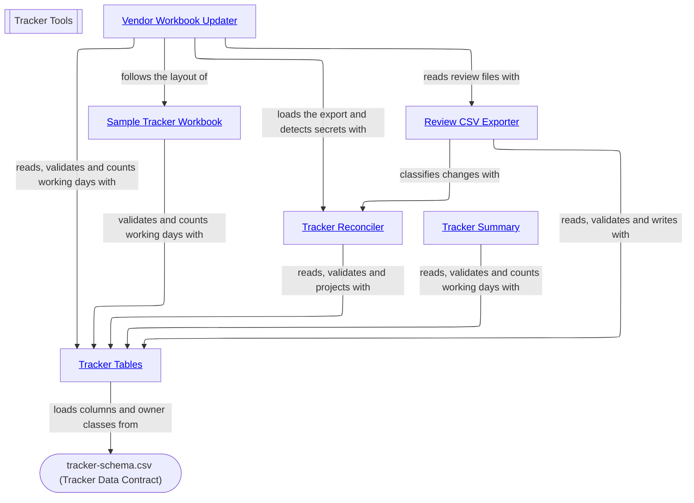
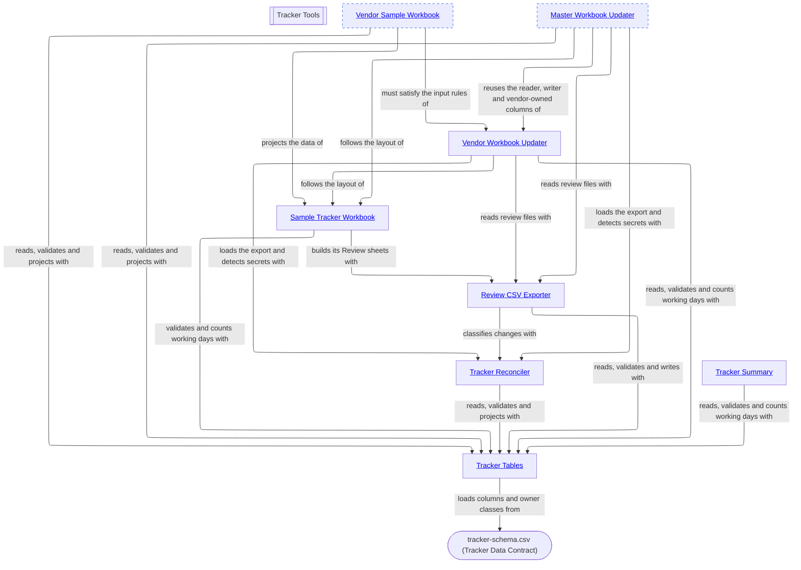

# Tracker Tools

## Purpose

The lead-facing Node tools for the use case tracker: a shared CSV table library, a reconciler that turns reviewed proposals and a tracker export into reviewable changes, and a daily summary. Leads run them by hand; the authoritative tracker stays an Excel workbook on SharePoint.

## Navigation

[Job Behavior Specifications](../README.md#navigation) / **Tracker Tools**

- [Components](#components)
- [Design](#design)
  - [Diagram](#diagram)
- [Technology](#technology)
- [Links](#links)

## Components

| Component | Purpose |
| --- | --- |
| [Tracker Tables](tracker-tables/README.md#purpose) | A Node library that reads and writes the tracker's CSV tables, validates them against the shared schema, builds vendor views and does working-day arithmetic, so the reconciler and the summary share one correct implementation. |
| [Tracker Reconciler](tracker-reconciler/README.md#purpose) | A Node command line tool that compares reviewed tracker proposals with the latest tracker export and writes additions, field updates, conflicts and suggestions for a lead to review and apply by hand, never overwriting human edits. |
| [Tracker Summary](tracker-summary/README.md#purpose) | A Node command line tool that writes the internal daily summary across all vendor tracks from a tracker export: use cases by stage, overdue questions, blocked items, access actions, mappings pending a decision and next batch suggestions. |
| [Sample Tracker Workbook](sample-tracker-workbook/README.md#purpose) | A small, realistic sample of the final Excel tracker, generated from fictional data, so the team can review the format of the sheets before the real tracker is built. |
| [Review CSV Exporter](review-csv-exporter/README.md#purpose) | A Node command line tool that turns tracker proposals and a tracker export into consolidated review CSVs, one wide row per record ordered by what needs a lead's judgment, so leads review adds, updates and suggestions without transposing proposal rows. |
| [Vendor Workbook Updater](vendor-workbook-updater/README.md#purpose) | A Node command line tool that applies the review rows a lead accepted to one vendor's vendor-facing workbook, starting from the copy downloaded from SharePoint, and writes a new vendor-safe `.xlsx` for the lead to upload by hand. |
| [Vendor Sample Workbook](vendor-sample-workbook/README.md#purpose) | A Node command line tool that writes a small, realistic vendor-only sample workbook for one vendor from the sample's fictional data, with only that vendor's rows and the vendor-visible columns, so the team can review what a vendor receives and the updater has a representative input. |
| [Master Workbook Updater](master-workbook-updater/README.md#purpose) | A Node command line tool that produces the internal master tracker workbook from the copy downloaded from SharePoint: it applies the review rows a lead accepted, copies each vendor's own answers into the master by reference, and rebuilds each named vendor's vendor-safe workbook from the new master, so nothing is hand-copied and the workbooks cannot drift. |

## Design

The group holds five deliverables that leads run by hand on exported CSV files and a sample for team review, and it has no behavior of its own. The [Tracker Tables](tracker-tables/README.md#design) library reads, validates and writes the tracker's CSV tables, builds the vendor view and does the working-day arithmetic. The [Tracker Reconciler](tracker-reconciler/README.md#design) and the [Tracker Summary](tracker-summary/README.md#design) command line tools both import it by relative path, and all three read the column list, owner classes, keys and visibility from the shared `tracker-schema.csv` of the Tracker Data Contract, so no column list is repeated in code. The reconciler turns proposals and an export into reviewable files for a lead to apply by hand, and the summary writes the internal daily summary from an export. Neither tool writes to SharePoint, releases a question or changes a file it reads. The [Sample Tracker Workbook](sample-tracker-workbook/README.md#design) is not a lead tool: it generates a fictional sample of the final Excel tracker from CSV data shaped by the same schema, validates it with the table library and counts working days with it, so the team can review the format before the real tracker is built; it is internal and not vendor-safe. The [Review CSV Exporter](review-csv-exporter/README.md#design) is a fourth lead tool: it imports the Tracker Tables library and the Tracker Reconciler's loaders and classification by relative path, reads the shared schema and writes consolidated review CSVs for a lead to review, and adds no dependency. The [Vendor Workbook Updater](vendor-workbook-updater/README.md#design) is a fifth lead tool: it starts from a vendor workbook the lead downloaded from SharePoint, applies the review rows a lead accepted and writes a new vendor-safe `.xlsx`, a report and the review files' `applied_on` cells for the lead to upload by hand. It imports the Tracker Tables library, the reconciler's export loader and secret detection, the exporter's review reading and the sample's layout rules by relative path, and adds the same pinned `exceljs` dependency. The shared check declarations (`test`, `coverage`, `testGlob`, `adapterGlob`) live in this group's `craft.json` and are inherited by the members.

### Diagram

## Technology

- Node 26 with native TypeScript (erasable syntax, `.ts` import extensions), no dependencies and `node:test`, as in the sibling `website-availability-check`, except that the Sample Tracker Workbook and the Vendor Workbook Updater each add one pinned dependency, `exceljs`, to write `.xlsx` files (their `install` check is `npm ci`); CSV is read and written by the library's own code. Checks are declared here and inherited by the members. No `typecheck`, `lint` or `boundaries` check is declared, because each needs a development dependency. Detail is in [requirements.md](requirements.md#requirements).

## Links

- [requirements.md](requirements.md#requirements) — what the group and its members must do and what they need not.
- [contract.md](contract.md#contract) — the shared check declarations and the command line of the members.

## Plan

### Planned Navigation

[Job Behavior Specifications](../README.md#navigation) / **Tracker Tools**

- [Planned Components](#planned-components)
- [Planned Design](#planned-design)
  - [Planned Diagram](#planned-diagram)
- [Planned Relationships](#planned-relationships)

### Planned Components

| Component | Purpose |
| --- | --- |
| [Tracker Tables](tracker-tables/README.md#purpose) | A Node library that reads and writes the tracker's CSV tables, validates them against the shared schema, builds vendor views and does working-day arithmetic, so the reconciler and the summary share one correct implementation. |
| [Tracker Reconciler](tracker-reconciler/README.md#purpose) | A Node command line tool that compares reviewed tracker proposals with the latest tracker export and writes additions, field updates, conflicts and suggestions for a lead to review and apply by hand, never overwriting human edits. |
| [Tracker Summary](tracker-summary/README.md#purpose) | A Node command line tool that writes the internal daily summary across all vendor tracks from a tracker export: use cases by stage, overdue questions, blocked items, access actions, mappings pending a decision and next batch suggestions. |
| [Sample Tracker Workbook](sample-tracker-workbook/README.md#plan) | A small, realistic sample of the final Excel tracker, generated from fictional data, so the team can review the format of the sheets before the real tracker is built. |
| [Review CSV Exporter](review-csv-exporter/README.md#purpose) | A Node command line tool that turns tracker proposals and a tracker export into consolidated review CSVs, one wide row per record ordered by what needs a lead's judgment, so leads review adds, updates and suggestions without transposing proposal rows. |
| [Vendor Workbook Updater](vendor-workbook-updater/README.md#purpose) | A Node command line tool that applies the review rows a lead accepted to one vendor's vendor-facing workbook, starting from the copy downloaded from SharePoint, and writes a new vendor-safe `.xlsx` for the lead to upload by hand. |
| [Vendor Sample Workbook](vendor-sample-workbook/README.md#planned-design) | A Node command line tool that writes a small, realistic vendor-only sample workbook for one vendor from the sample's fictional data, with only that vendor's rows and the vendor-visible columns, so the team can review what a vendor receives and the updater has a representative input. |
| [Master Workbook Updater](master-workbook-updater/README.md#planned-design) | A Node command line tool that produces the internal master tracker workbook from the copy downloaded from SharePoint: it applies the review rows a lead accepted, copies each vendor's own answers into the master by reference, and rebuilds each named vendor's vendor-safe workbook from the new master, so nothing is hand-copied and the workbooks cannot drift. |

### Planned Design

The group gains a seventh member, the [Vendor Sample Workbook](vendor-sample-workbook/README.md#planned-design), a lead-side sample generator that imports the Tracker Tables library and the Sample Tracker Workbook's data and headings by relative path, reads the Vendor Workbook Updater's editable-column list and satisfies its input rules. The [Sample Tracker Workbook](sample-tracker-workbook/README.md#plan) is also planned to change: it builds its Review sheets by running the Review CSV Exporter, so the diagram gains that edge. The Vendor Sample Workbook adds the third pinned `exceljs` dependency in the group (with the sample and the updater); the group's owner reconciles the Technology text and the "no dependencies" rule when it is built, and until then neither the Technology section nor the requirements of this group change.

The four lead tools (the [Tracker Reconciler](tracker-reconciler/README.md#purpose), the [Review CSV Exporter](review-csv-exporter/README.md#purpose), the [Tracker Summary](tracker-summary/README.md#purpose) and the [Vendor Workbook Updater](vendor-workbook-updater/README.md#purpose)) stay Node tools and run in the client environment, because the user confirmed on 2026-11-16 that scripts can run there; the [Client Transfer Package](../client-transfer-package/README.md#planned-design) ships them. The earlier plan to give them Markdown-only counterparts in the Lead Tracker Skills group is withdrawn. One Markdown skill, [Review Decisions](../lead-tracker-skills/review-decisions/README.md#design), records the lead's decisions in the review CSVs the Review CSV Exporter writes and reads that tool's headings file; no code, test or check here changes.

The group also gains an eighth member, the [Master Workbook Updater](master-workbook-updater/README.md#planned-design), which applies accepted review rows to the internal master workbook, copies each vendor's own answers into it and rebuilds each named vendor's workbook from it (the backlog item `internal-tracker-apply`). It imports Tracker Tables, the Reconciler, the Exporter, the Sample Tracker Workbook and the [Vendor Workbook Updater](vendor-workbook-updater/README.md#plan) by relative path, adds the fourth pinned `exceljs` dependency, and asks the Updater for two small exports; the group's owner reconciles the Technology text, the "no dependencies" rule and the command table when it is built. This Plan is extended, not replaced, because it still carries the unbuilt Vendor Sample Workbook and skills plans; override by asking for the Plan to be replaced.

#### Planned Diagram

### Planned Relationships

None.
