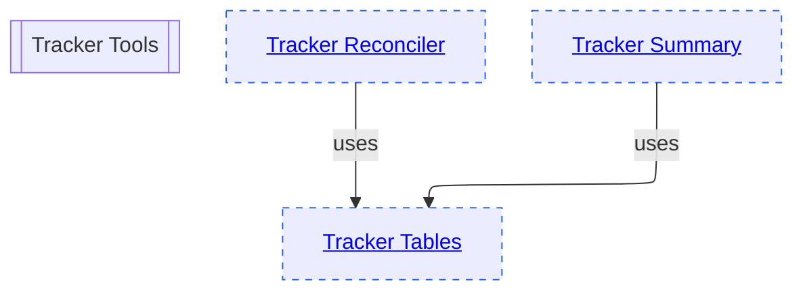

# Tracker Tools

## Purpose

The lead-facing Node tools for the use case tracker: a shared CSV table library, a reconciler that turns reviewed proposals and a tracker export into reviewable changes, and a daily summary. Leads run them by hand; the authoritative tracker stays an Excel workbook on SharePoint.

## Navigation

[Job Behavior Specifications](../README.md#navigation) / **Tracker Tools**

- [Components](#components)
- [Design](#design)
  - [Diagram](#diagram)
- [Technology](#technology)
- [Plan](#plan)
- [Links](#links)

## Components

| Component | Purpose |
| --- | --- |
| [Tracker Tables](tracker-tables/README.md#purpose) | A Node library that reads and writes the tracker's CSV tables, validates them against the shared schema, builds vendor views and does working-day arithmetic, so the reconciler and the summary share one correct implementation. |
| [Tracker Reconciler](tracker-reconciler/README.md#purpose) | A Node command line tool that compares reviewed tracker proposals with the latest tracker export and writes additions, field updates, conflicts and suggestions for a lead to review and apply by hand, never overwriting human edits. |
| [Tracker Summary](tracker-summary/README.md#purpose) | A Node command line tool that writes the internal daily summary across all vendor tracks from a tracker export: use cases by stage, overdue questions, blocked items, access actions, mappings pending a decision and next batch suggestions. |

## Design

Not built yet.

### Diagram

Not built yet.

## Technology

- Node 26 with native TypeScript (erasable syntax, `.ts` import extensions), no dependencies and `node:test`, as in the sibling `website-availability-check`; CSV is read and written by the library's own code. Checks are declared here and inherited by the members. No `typecheck`, `lint` or `boundaries` check is declared, because each needs a development dependency. Detail is in [requirements.md](requirements.md#requirements).

## Plan

### Planned Navigation

[Job Behavior Specifications](../README.md#plan) / **Tracker Tools**

- [Planned Components](#planned-components)
- [Planned Design](#planned-design)
  - [Planned Diagram](#planned-diagram)
- [Steps](#steps)
- [Acceptance Mapping](#acceptance-mapping)
- [Assumptions And Open Questions](#assumptions-and-open-questions)
- [Planned Links](#planned-links)

### Planned Components

| Component | Purpose |
| --- | --- |
| [Tracker Tables](tracker-tables/README.md#planned-design) | A Node library that reads and writes the tracker's CSV tables, validates them against the shared schema, builds vendor views and does working-day arithmetic, so the reconciler and the summary share one correct implementation. |
| [Tracker Reconciler](tracker-reconciler/README.md#planned-design) | A Node command line tool that compares reviewed tracker proposals with the latest tracker export and writes additions, field updates, conflicts and suggestions for a lead to review and apply by hand, never overwriting human edits. |
| [Tracker Summary](tracker-summary/README.md#planned-design) | A Node command line tool that writes the internal daily summary across all vendor tracks from a tracker export: use cases by stage, overdue questions, blocked items, access actions, mappings pending a decision and next batch suggestions. |

### Planned Design

The group holds three similar deliverables. The table library reads, validates and writes tracker CSV and builds vendor views; the reconciler and the summary both use it. The group has no behavior of its own.

#### Planned Diagram

### Steps

1. Create this group's `craft.json` with the shared checks (`test`, `coverage`, `testGlob`, `adapterGlob`) and write its `requirements.md` and `contract.md`.
2. Build the members in dependency order: `tracker-tables`, then `tracker-reconciler`, then `tracker-summary`.
3. After the members are built, rewrite this README's Design from them and delete this Plan.

### Acceptance Mapping

The group has no behavior and no task; acceptance is the members'.

### Assumptions And Open Questions

Assumptions (override any of them in chat before `/craft:build`):

1. The group exists so that the stack and its checks are declared once. Override: declare the checks in each member.
2. Leads have Node 26 available to run the tools by hand (confirmed by the user). Developers need only Copilot.
3. No dependency is added, so reading and writing CSV is our own small code.

Open questions: none about behavior.

### Planned Links

- [requirements.md](requirements.md#requirements) — what the component must do and what it need not.
- [contract.md](contract.md#contract) — the shapes, formats and wording rules.

## Links

- [requirements.md](requirements.md#requirements) — what the group and its members must do and what they need not.
- [contract.md](contract.md#contract) — the shared check declarations and the command line of the members.
