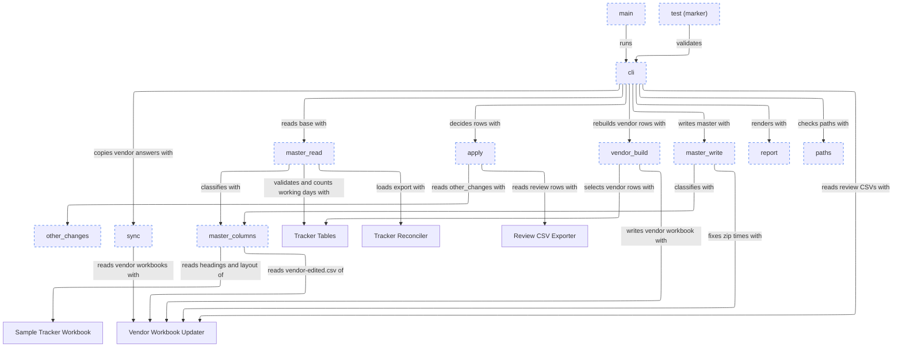

# Master Workbook Updater

## Purpose

A Node command line tool that produces the internal master tracker workbook from the copy downloaded from SharePoint: it applies the review rows a lead accepted, copies each vendor's own answers into the master by reference, and rebuilds each named vendor's vendor-safe workbook from the new master, so the lead stops hand-copying rows and the master and the vendor workbooks cannot drift.

## Navigation

[Job Behavior Specifications](../../README.md#navigation) / [Tracker Tools](../README.md#navigation) / **Master Workbook Updater**

- [Design](#design)
- [Technology](#technology)
- [Behavior](#behavior)
- [Plan](#plan)
  - [Planned Navigation](#planned-navigation)
  - [Planned Design](#planned-design)
    - [Planned Diagram](#planned-diagram)
  - [Steps](#steps)
  - [Acceptance Mapping](#acceptance-mapping)
  - [Assumptions And Open Questions](#assumptions-and-open-questions)
  - [Planned Relationships](#planned-relationships)
  - [Planned Links](#planned-links)
- [Relationships](#relationships)
- [Links](#links)

## Design

Not built yet.

## Technology

- Inherited from [Tracker Tools](../README.md#technology) (Node 26 with native TypeScript and `node:test`), plus one exact-pinned dependency, `exceljs` 4.4.0, with a component-local `package.json` and lockfile (`npm ci` is the `install` check), as the Sample Tracker Workbook and the Vendor Workbook Updater. Detail is in [requirements.md](requirements.md#requirements).

## Behavior

- **B1** When it runs on a downloaded master (or an export) with reviews and vendor files, then it writes a new master `.xlsx` holding all vendors' use cases, questions, identity and access, workflow mappings, groups, links, batches and holidays in the sample layout, and leaves every input untouched.
- **B2** When a review row is `accepted` and unchanged since review, then its add, update and suggest fields of schema owner `spec` or `human`, including internal columns and every readable `other_changes` entry, are written to the master, new rows take `suggested_ref` and the proposal IDs go to `proposal_refs`; a blank, `rejected` or `clarify` row never applies.
- **B3** When a row changed since review, holds or conflicts, has a digest mismatch, differs from the master's current value, has an unreadable `other_changes` entry or an ambiguous use-case name, then nothing is applied for it and it is listed; forbidden and computed fields are listed and never applied; a reference collision stops the run.
- **B4** When a vendor workbook is given, then its vendor-owned columns (the Vendor Workbook Updater's `vendor-edited.csv` set) are copied into the master row matched by `question_ref`, `use_case_ref` or `access_ref`, and nothing else, never to another row.
- **B5** When a vendor value would blank a filled master cell, is off the schema's list or not a date, belongs to a row of another vendor or to an unreleased question, or differs from the master on an already resolved question, then nothing is copied for that row and a conflict is listed; `status`, `resolver` and `closed_reason` are never touched; a different filled value on an open question is copied and listed.
- **B6** When a vendor row has no row in the rebuilt vendor view, then it is listed with its vendor-owned values and that vendor's workbook is held, not rebuilt; master rows missing from a vendor workbook are added when it is rebuilt.
- **B7** When a vendor is named, then its workbook is rebuilt from the new master: only that vendor's rows and vendor-visible columns, released questions only, `acknowledgement_requested_on`, `due_on` (release plus two working days) and vendor fields changed in the master included, and no internal column, mapping, group, link or other vendor's row.
- **B8** When the same inputs and run date are run twice, then the bytes match; all outputs go through temporary names; and any invalid input or secret-looking value stops the run naming `file: line N`, with nothing written.
- **B9** When it runs again on its own output with the same reviews and vendor files, then nothing changes, there are no duplicate rows, and an `applied_on` row whose values are not in the master is listed as marked applied but not in the master.
- **B10** When a run ends, then the report accounts for every review row, every vendor value synced or in conflict, every held vendor workbook, every row added to a vendor workbook and every file written, with no secret value or absolute path.

## Plan

### Planned Navigation

[Job Behavior Specifications](../../README.md#plan) / [Tracker Tools](../README.md#plan) / **Master Workbook Updater**

- [Planned Design](#planned-design)
  - [Planned Diagram](#planned-diagram)
- [Steps](#steps)
- [Acceptance Mapping](#acceptance-mapping)
- [Assumptions And Open Questions](#assumptions-and-open-questions)
- [Planned Relationships](#planned-relationships)
- [Planned Links](#planned-links)

### Planned Design

One command, `update-master-workbook`, behind a thin adapter. [main](src/main.ts) connects the process to [cli](src/cli.ts), which parses the arguments, collects every input problem, runs the modules and returns the exit status (0 done, 1 any input problem, 2 bad usage). `master_columns` classifies each tab's columns (the sample's headings, then schema columns missing from them, then the lead's extra columns) and reads the vendor-owned set from the Vendor Workbook Updater's `vendor-edited.csv`. `master_read` reads a downloaded master or a contract export into one table set. `apply` decides every accepted review row on all four tabs and `other_changes` parses the exporter's `field: current -> proposed [state]` entries strictly, so an unreadable entry is a conflict and never a guess. `sync` copies the vendor-owned columns from each vendor's downloaded workbook into the master row matched by reference. `vendor_build` then rebuilds each named vendor's workbook from the new in-memory master with Tracker Tables' vendor view and the Updater's writer, so the vendor-safe rule exists once. `master_write` writes the master with `exceljs` and fixed zip times, `report` renders the Markdown report and `paths` checks that every output differs from every input and from the others.

**One tool, not two.** Sync must run before any vendor workbook is rebuilt, because a rebuild alone would overwrite answers a vendor typed that the master has not seen. A standalone "build vendor workbook" command is therefore deliberately not offered. If the behaviors ever exceed ten, the vendor rebuild splits into a child this tool imports.

Reading, validating, secret detection, the review file reader, the vendor-safe writer and the layout are imported by relative path from [Tracker Tables](../tracker-tables/README.md#design), the [Tracker Reconciler](../tracker-reconciler/README.md#design), the [Review CSV Exporter](../review-csv-exporter/README.md#design), the [Sample Tracker Workbook](../sample-tracker-workbook/README.md#design) and the [Vendor Workbook Updater](../vendor-workbook-updater/README.md#design); none changes behavior (the Updater gets two small exports, see its Plan). How a run goes: every input is read and validated and every decision computed first; any problem stops with exit 1 and one `file: line N: message` each before anything is written; then the master, the vendor workbooks, the report and the changed review files are written to temporary names and renamed, the review files last. The tool never reads proposals or the use case index (it copies proposal IDs verbatim from the review rows), so the index plan is unaffected, and it does not touch the Tracker Data Contract or the vendor-safe rules.

#### Planned Diagram

### Steps

1. **Scaffold.** `package.json` (private, ES module, Node 26, `exceljs` 4.4.0 exact, an `update-master-workbook` script), `.gitignore` for `node_modules/`, `package-lock.json`. The lockfile needs one network `npm install`, an external effect the builder must have the user approve in that turn.
2. **Spike first, throwaway.** Read a SharePoint-saved master with `exceljs` (formulas, tables, extra columns) and check the output bytes repeat.
3. **`src/master_columns.ts`, `src/master_read.ts`** (B1, B8): columns, and reading a downloaded master or an export into one validated table set; formula cells give their result, computed columns are ignored and recomputed, a secret-looking value, duplicate or blank key, error cell or schema error stops the run.
4. **`src/other_changes.ts`, `src/apply.ts`** (B2, B3, B9): the strict parser and the decision core in the order set out in [contract.md](contract.md#decision-order).
5. **`src/sync.ts`** (B4, B5, B6): the vendor-owned copy and its conflicts.
6. **`src/vendor_build.ts`** (B6, B7): per-vendor rebuild, held vendors.
7. **`src/master_write.ts`, `src/report.ts`, `src/paths.ts`, `src/cli.ts`, `src/main.ts`** (B1, B8, B10).
8. **Tests** in `test/`, real temporary directories, fictional two-vendor fixtures, tagged `[B#]`: `build`, `apply`, `other_changes`, `sync`, `rebuild`, `leak` (feeds the output to the Updater's reader and re-syncs for no change), `repeat`, `input`, `report`.
9. **Docs:** the built Design and diagram in this README, in step with `requirements.md` and `contract.md`.
10. **Validate** as below.

### Acceptance Mapping

| Acceptance | Behaviors | Step | Test |
| --- | --- | --- | --- |
| 1. Accepted rows for all four tabs reach the master; conflicts and unaccepted rows are left alone and listed | B1, B2, B3, B9 | 3, 4, 7 | `build.test.ts` `[B1]`; `apply.test.ts` `[B2]` `[B3]`; `other_changes.test.ts` `[B2]` `[B3]`; `repeat.test.ts` `[B9]` |
| 2. Vendor-owned columns copied by reference; conflicts and orphans reported; lead columns untouched | B4, B5, B6 | 5 | `sync.test.ts` `[B4]` `[B5]`; `rebuild.test.ts` `[B6]` |
| 3. Each named vendor's workbook rebuilt vendor-safe, accepted by the Updater's reader, re-sync gives no change | B6, B7 | 6 | `rebuild.test.ts` `[B6]` `[B7]`; `leak.test.ts` `[B7]` |
| 4. Same inputs give identical bytes, no input overwritten, bad input writes nothing | B1, B8, B9 | 3, 7 | `repeat.test.ts` `[B8]` `[B9]`; `input.test.ts` `[B8]`; `build.test.ts` `[B1]` |
| 5. The report accounts for every row, value and file | B10 | 7 | `report.test.ts` `[B10]` |

Validation, narrowest first: `npm ci --prefix tracker-tools/master-workbook-updater`; `npm ci --prefix tracker-tools/vendor-workbook-updater` (the Updater's modules resolve `exceljs` from their own folder); `node --test "tracker-tools/master-workbook-updater/test/*.test.ts"`; the coverage check; the Updater's own tests (its change is shared); the root `test`. The project declares no typecheck, lint or boundaries check.

### Assumptions And Open Questions

Assumptions (override any in chat; the first three were confirmed by the user on 2026-11-16):

1. **Both sides filled and different on an open question:** the vendor's value is copied and listed; a resolved question (`accepted`, `incorporated`, `closed`, `withdrawn`, `superseded`) is a conflict. Override: always a conflict.
2. **A vendor row with no row in the rebuilt view** holds that vendor's rebuild and is listed, so nothing the vendor typed is lost. Override: rebuild anyway and report the dropped row.
3. **Whole-workbook rebuild** loses the lead's formatting and helper formulas (`due_on` becomes a value; dropped formulas are listed). Override: edit the downloaded file in place, which needs its own spike and a larger budget.
4. **Master layout** is the sample layout with every schema column kept (`proposal_refs`, `source_links`, `evidence_refs`, `mr_link` and `last_updated` in a trailing band), not the layout guide's "headings exactly the schema names", so the master stays exportable. Override: schema-name headings.
5. **No Review, Proposed Changes or Trace sheet** in the master: the contract keeps proposals outside the authoritative tracker. Override: add Review sheets from the exporter's CSVs.
6. **No release flags.** The lead sets `batch_ref` and `released_on` in the master; the tool then fills `due_on` and carries the rows to the vendor workbook. The Updater keeps its release flags for the interim.
7. **One tool per review set.** Use this tool, not the Updater, for the same review rows; B9's drift list catches a mix. The Updater stays unchanged in behavior.
8. **An off-list or malformed vendor value is a row conflict, not a run stop**, so one vendor's bad cell does not block the others. Override: stop the run.
9. **New questions** take `captured_on` = the run date and `status` `captured`; `last_updated` is set to the run date on changed rows.
10. **Vendor names** are the slug in the master's `vendor` column; `--vendor` takes `name=path`.
11. **Component placement and name.** A leaf in Tracker Tools named after its sibling, the Vendor Workbook Updater, not after the backlog item; one component because sync and rebuild must share one in-memory master. Override by naming another.
12. **Budget** USD 6 and 7,200 s, more than the Updater's because this adds a master reader, sync and writer; if it cannot cover that, split the vendor rebuild into a child.
13. **The Lead Tracker Skills plan is left as is.** The user said (2026-11-16) that executables can now run in the client environment, so that group's premise needs a later reconcile; a proposed backlog item records it. The plans `dca66b2` and `d562b3c` are not contradicted.

Open questions: none. The behavior and the three real ambiguities were settled by the user on 2026-11-16.

### Planned Relationships

- [Tracker Data Contract](../../tracker-data-contract/README.md#purpose) — the schema, owner classes, vendor-view rule and reference scheme the tool reads; unchanged.
- [Tracker Tables](../tracker-tables/README.md#purpose) — CSV, schema, vendor view and working-day functions.
- [Tracker Reconciler](../tracker-reconciler/README.md#purpose) — the export loader and the secret detection.
- [Review CSV Exporter](../review-csv-exporter/README.md#purpose) — the review file header, digest, statuses and the `other_changes` format.
- [Sample Tracker Workbook](../sample-tracker-workbook/README.md#purpose) — the layout, headings and review columns the master follows.
- [Vendor Workbook Updater](../vendor-workbook-updater/README.md#plan) — the vendor-owned column list, reader, writer and zip-time code the tool reuses.

### Planned Links

- [requirements.md](requirements.md#requirements) — what the tool must do, what must match the source and what need not.
- [contract.md](contract.md#contract) — the command, inputs, decision order, sync rules, outputs and writing rules.

## Relationships

- [Tracker Data Contract](../../tracker-data-contract/README.md#purpose) — the schema, owner classes, vendor-view rule and reference scheme the tool reads; unchanged.
- [Tracker Tables](../tracker-tables/README.md#purpose) — CSV, schema, vendor view and working-day functions.
- [Tracker Reconciler](../tracker-reconciler/README.md#purpose) — the export loader and the secret detection.
- [Review CSV Exporter](../review-csv-exporter/README.md#purpose) — the review file header, digest, statuses and the `other_changes` format.
- [Sample Tracker Workbook](../sample-tracker-workbook/README.md#purpose) — the layout, headings and review columns the master follows.
- [Vendor Workbook Updater](../vendor-workbook-updater/README.md#purpose) — the vendor-owned column list, reader, writer and zip-time code the tool reuses.

## Links

- [requirements.md](requirements.md#requirements) — what the tool must do, what must match the source and what need not.
- [contract.md](contract.md#contract) — the command, inputs, decision order, sync rules, outputs and writing rules.
