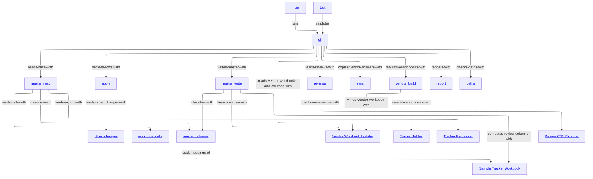

# Master Workbook Updater

## Purpose

A Node command line tool that produces the internal master tracker workbook from the copy downloaded from SharePoint: it applies the review rows a lead accepted, copies each vendor's own answers into the master by reference, and rebuilds each named vendor's vendor-safe workbook from the new master, so the lead stops hand-copying rows and the master and the vendor workbooks cannot drift.

## Navigation

[Job Behavior Specifications](../../README.md#navigation) / [Tracker Tools](../README.md#navigation) / **Master Workbook Updater**

- [Design](#design)
  - [Diagram](#diagram)
- [Technology](#technology)
- [Behavior](#behavior)
- [Relationships](#relationships)
- [Links](#links)
- [Plan](#plan)
  - [Planned Navigation](#planned-navigation)
  - [Planned Design](#planned-design)
  - [Planned Behavior](#planned-behavior)
  - [Steps](#steps)
  - [Acceptance Mapping](#acceptance-mapping)
  - [Assumptions And Open Questions](#assumptions-and-open-questions)
  - [Planned Relationships](#planned-relationships)
  - [Planned Links](#planned-links)

## Design

One command, `update-master-workbook`, behind a thin adapter. [main](src/main.ts) connects the process to [cli](src/cli.ts), which parses the arguments, collects every input problem, runs the modules and returns the exit status (0 done, 1 any input problem, 2 bad usage). [master_columns](src/master_columns.ts) classifies each tab's columns: the sample's headings first, then every schema column they omit in a trailing band, and the schema names for a tab the sample has no headings for. [master_read](src/master_read.ts) reads a downloaded master or a contract export into one table set, with every schema column on each row and the lead's extra columns kept by heading. [apply](src/apply.ts) decides each accepted review row of all four tabs, and [other_changes](src/other_changes.ts) parses the exporter's `field: current -> proposed [state]` entries strictly, so an unreadable entry is a conflict and never a guess. [sync](src/sync.ts) copies each vendor's own columns from the downloaded vendor workbook into the master row of the same reference. [vendor_build](src/vendor_build.ts) then rebuilds each named vendor's workbook from the new in-memory master with the Tracker Tables vendor view and the Updater's writer, so the vendor-safe rule exists once. [master_write](src/master_write.ts) fills `due_on` and writes the master with `exceljs` and fixed zip times, [report](src/report.ts) renders the Markdown report and [paths](src/paths.ts) checks that every output differs from every input and from the others. [reviews](src/reviews.ts) reads the four review files, [workbook_cells](src/workbook_cells.ts) reads cells and header rows, and [values](src/values.ts) holds the one value comparison.

**One tool, not two.** Sync must run before any vendor workbook is rebuilt, because a rebuild alone would overwrite answers a vendor typed that the master has not seen. A standalone "build vendor workbook" command is therefore deliberately not offered.

Reading, validating, secret detection, the review file layout, the vendor-safe writer and the layout are imported by relative path from [Tracker Tables](../tracker-tables/README.md#design), the [Tracker Reconciler](../tracker-reconciler/README.md#design), the [Review CSV Exporter](../review-csv-exporter/README.md#design), the [Sample Tracker Workbook](../sample-tracker-workbook/README.md#design) and the [Vendor Workbook Updater](../vendor-workbook-updater/README.md#design) (its `columns`, `workbook_read`, `workbook_write`, `archive`, `files`, `valueProblem` of `apply` and the review types and `markApplied`); none is changed. The Updater's reader stays strict and its `loadReviews` is fixed to the three vendor tabs, so this tool carries its own small copies of `loadReviews` (any list of tabs, here all four) and of `cellText` and `headerRow` (about 80 lines); the Updater's owner may later export them, and these copies then go. The tool never reads proposals or the use case index (it copies proposal IDs verbatim from the review rows). How a run goes: every input is read and validated and every decision computed first; any problem stops with exit 1 and one `file: line N: message` each before anything is written; then the master, the vendor workbooks, the report and the changed review files are written to temporary names and renamed, the review files last.

Decisions (record of the build; override in chat):

- **Decision order.** For each review row: not accepted is skipped; `applied_on` set is skipped, and listed as marked applied but not in the master when its values are not there, before any conflict check, so a rerun is quiet; a record not in the master is skipped; a new row finds its use case by name (none: skipped, more than one: conflict); then conflict causes (changed since review, held or conflicting field, `conflict` cell, digest mismatch, unreadable `other_changes`, a current value that differs from the master); then the fields are applied. A reference column of the record, and any `forbidden` or `computed` column, is never applied and is listed. A value outside the schema's list, date or reference format, a bad or colliding `suggested_ref` stops the run.
- **New records.** A new question takes `captured_on` = the run date and status `captured`, left unreleased; its `use_case_ref`, `use_case_name` and `vendor` come from its use case; a new access row and a new mapping take `use_case_ref` the same way. `proposal_refs` gets the row's proposal IDs, and a changed row's `last_updated` is the run date.
- **Vendor sync.** A row is all or nothing: a vendor value that would blank a master cell, is off the list or not a date, or a master row of another vendor or an unreleased question, leaves the whole row alone and lists a conflict. A different filled value is copied and listed as an update, except on a resolved question (`accepted`, `incorporated`, `closed`, `withdrawn`, `superseded`), which is a conflict. A vendor row with no row in the rebuilt view holds that vendor's rebuild, so nothing the vendor typed is lost, and is listed with its values.
- **Due dates.** `due_on` of Questions and Batches is filled where blank as the release date plus two working days (holidays from the master's Holidays sheet, else `--holidays`); a stored value that differs is listed and left. The review columns (`review_state`, `days_past_original_due`, `age_awaiting_review`) are recomputed at the run date with the sample's rule, which has no holidays. The sample's `pending_change` column is not kept, because the master has no Proposed Changes sheet.
- **Layout.** Sheets Read Me, Use Cases, Questions, Identity & Access, Workflow Mappings, Question Groups, Question Links, Batches, Holidays (a `holiday` column) and Lists; blue and grey headers by visibility, red internal tabs, dropdowns from the Lists sheet (a column that two tabs list differently gets the tab in its list name), no protection, nothing hidden, values only. Extra lead columns are kept at the right as values; an extra column holding formulas is dropped and listed. The bytes repeat because the zip entry times are fixed, as in the Updater.
- **Held and new vendors.** A held vendor writes no workbook and lists no added rows. `--new-vendor` builds a vendor workbook from the master with no sync (a first release).
- **Risks.** A whole-workbook rebuild loses the lead's formatting and helper formulas; the report lists dropped formulas. Using this tool and the Vendor Workbook Updater on the same review rows can double-apply; the drift list catches the mix. A vendor's later edit on a download older than the master shows only as a value difference, so download fresh copies before a run.

### Diagram

## Technology

- Inherited from [Tracker Tools](../README.md#technology) (Node 26 with native TypeScript and `node:test`), plus one exact-pinned dependency, `exceljs` 4.4.0, with a component-local `package.json` and lockfile (`npm ci` is the `install` check), as the Sample Tracker Workbook and the Vendor Workbook Updater. The Updater's modules resolve `exceljs` from their own folder, so its `npm ci` must also have been run. Detail is in [requirements.md](requirements.md#requirements).

## Behavior

- **B1** When it runs on a downloaded master (or an export) with reviews and vendor files, then it writes a new master `.xlsx` holding all vendors' use cases, questions, identity and access, workflow mappings, groups, links, batches and holidays in the sample layout, and leaves every input untouched.
- **B2** When a review row is `accepted` and unchanged since review, then its add, update and suggest fields of schema owner `spec` or `human`, including internal columns and every readable `other_changes` entry, are written to the master, new rows take `suggested_ref` and the proposal IDs go to `proposal_refs`; a blank, `rejected` or `clarify` row never applies.
- **B3** When a row changed since review, holds or conflicts, has a digest mismatch, differs from the master's current value, has an unreadable `other_changes` entry or an ambiguous use-case name, then nothing is applied for it and it is listed; forbidden and computed fields are listed and never applied; a reference collision stops the run.
- **B4** When a vendor workbook is given, then its vendor-owned columns (the Vendor Workbook Updater's `vendor-edited.csv` set) are copied into the master row matched by `question_ref`, `use_case_ref` or `access_ref`, and nothing else, never to another row.
- **B5** When a vendor value would blank a filled master cell, is off the schema's list or not a date, belongs to a row of another vendor or to an unreleased question, or differs from the master on an already resolved question, then nothing is copied for that row and a conflict is listed; `status`, `resolver` and `closed_reason` are never touched; a different filled value on an open question is copied and listed.
- **B6** When a vendor row has no row in the rebuilt vendor view, then it is listed with its vendor-owned values and that vendor's workbook is held, not rebuilt; master rows missing from a vendor workbook are added when it is rebuilt.
- **B7** When a vendor is named, then its workbook is rebuilt from the new master: only that vendor's rows and vendor-visible columns, released questions only, `acknowledgement_requested_on`, `due_on` (release plus two working days) and vendor fields changed in the master included, and no internal column, mapping, group, link or other vendor's row.
- **B8** When the same inputs and run date are run twice, then the bytes match; all outputs go through temporary names; and any invalid input or secret-looking value stops the run naming `file: line N`, with nothing written.
- **B9** When it runs again on its own output with the same reviews and vendor files, then nothing changes, there are no duplicate rows, and an `applied_on` row whose values are not in the master is listed as marked applied but not in the master.
- **B10** When a run ends, then the report accounts for every review row, every vendor value synced or in conflict, every held vendor workbook, every row added to a vendor workbook and every file written, with no secret value or absolute path.

## Relationships

- [Tracker Data Contract](../../tracker-data-contract/README.md#purpose) — the schema, owner classes, vendor-view rule and reference scheme the tool reads; unchanged.
- [Tracker Tables](../tracker-tables/README.md#purpose) — CSV, schema, vendor view and working-day functions.
- [Tracker Reconciler](../tracker-reconciler/README.md#purpose) — the export loader and the secret detection.
- [Review CSV Exporter](../review-csv-exporter/README.md#purpose) — the review file header, digest, statuses and the `other_changes` format.
- [Sample Tracker Workbook](../sample-tracker-workbook/README.md#purpose) — the layout, headings and review columns the master follows.
- [Vendor Workbook Updater](../vendor-workbook-updater/README.md#purpose) — the vendor-owned column list, reader, writer and zip-time code the tool reuses.

## Links

- [requirements.md](requirements.md#requirements) — what the tool must do, what must match the source and what need not.
- [contract.md](contract.md#contract) — the command, inputs, decision order, sync rules, outputs and writing rules.

## Plan

### Planned Navigation

[Job Behavior Specifications](../../README.md#plan) / [Tracker Tools](../README.md#plan) / **Master Workbook Updater**

- [Planned Design](#planned-design)
- [Planned Behavior](#planned-behavior)
- [Steps](#steps)
- [Acceptance Mapping](#acceptance-mapping)
- [Assumptions And Open Questions](#assumptions-and-open-questions)
- [Planned Relationships](#planned-relationships)
- [Planned Links](#planned-links)

### Planned Design

The tool stops matching a new question, access or mapping row's use case by name and matches by the derived use case ID `uc-<vendor-slug>-<use-case-slug>` defined in the [Tracker Data Contract](../../tracker-data-contract/contract.md#planned-use-case-id-and-local-references), through the one `useCaseId(vendor, name)` helper added to the [Tracker Tables](../tracker-tables/README.md#purpose) library (imported by relative path, no private copy). The review CSVs' `use_case` cell now carries the ID. The structure is unchanged, so there is no new diagram; the changes are inside [apply](src/apply.ts) and [reviews](src/reviews.ts):

- **Finding the use case** (`apply.ts` lines 85-89): the master's Use Cases rows are matched by the ID derived from each row's `vendor` and `use_case_name`, which now also keeps the same-named use cases of two vendors apart (they have two IDs). Exactly one row: used. More than one row with that ID (a master that holds a duplicate): the row is a conflict, "the use case ID <ID> matches N master rows" (the old "ambiguous use case name" cause, line 98). None: the `use_case` cell must be in the ID form and known. Known means a Use Cases row of the master (which includes a new use case added earlier in this run, because new rows are appended to the table) or a new use case row of the review files, whatever its review status; a known ID missing from the master is skipped as today with the reason "use case <ID> is not in the master" (for example its new use case row was rejected). An ID in none of them, or a cell in the old name form or slug-alone form, stops the run with `file: line N: message` naming the expected form, writing nothing.
- **A new use case** (lines 90 and 144): needs a proposed `use_case_name` and `vendor`; without either it stays a conflict, "the new use case has no name or no vendor, so it has no use case ID" (the old "has no name" text, with the same conflict status). Its name comes from the proposed `use_case_name` field (the field loop already writes it, because `use_case_name` is a `spec` column), not from the `use_case` cell, which holds the ID. The ID derived from the proposed vendor and name must equal its `use_case` cell and must not already exist in the master; otherwise the row is a conflict and nothing is applied.
- **A new question, access or mapping row** (lines 146-149): takes `use_case_ref`, `vendor` (not Mappings) and, for a question, `use_case_name` from the matched master row, so the readable name comes from the row and never from the review cell.
- **Reviews** (`reviews.ts` line 69, the tool's own copy): a non-blank `use_case` cell that is not in the ID form stops the run naming file and line; a blank cell is accepted on an existing record, because an update maps by `record`.
- **Sync and rebuild** match by `question_ref`, `use_case_ref` or `access_ref` and are not changed.

### Planned Behavior

Reworded behavior (ID kept, the other behaviors are unchanged; B1 does not name the use case name and stays as it is):

- **B3** When a row changed since review, holds or conflicts, has a digest mismatch, differs from the master's current value, has an unreadable `other_changes` entry, or has a use case ID that matches more than one master row, then nothing is applied for it and it is listed; forbidden and computed fields are listed and never applied; a reference collision stops the run, and so does a use case ID that is unknown or in the old name or slug form.

Also reworded with it, because they name the matching: Decision order items 1, 3 and 5 of [contract.md](contract.md#planned-use-case-id-matching) and the "Decision order" and "New records" bullets of the Design decisions, when built.

### Steps

1. Read the helper `useCaseId` in `tracker-tables/src` as built by the Tracker Tables component and import it in `apply.ts` and `reviews.ts`; write no slug code here.
2. `src/reviews.ts` (B3, line 69): validate a non-blank `use_case` cell against the ID form `uc-<slug>(-<slug>)*` and push `file: line N: use case "<cell>" is not a use case ID such as uc-example-vendor-daily-report`.
3. `src/apply.ts` (B3): replace the name filter at line 87 and the skip text at line 88 with the ID lookup described in Planned Design, including the review-files known-ID set; change the cause text at line 98 to "the use case ID <ID> matches N master rows"; change line 90 and line 144 for a new use case (proposed name, vendor, ID check); change lines 146-149 so the name comes from the matched row.
4. `contract.md`: merge the planned section below into Inputs (Vendor workbooks stay) and Decision order items 1, 3 and 5; update the Decisions "Decision order" and "New records" bullets in this README and the B3 line.
5. Tests, using a helper in the Updater's `test/support.ts` that builds the ID from the library helper (this tool's tests import the Updater's `reviewCells` and `RV`, so the Vendor Workbook Updater builds first): update `apply.test.ts`, `edge.test.ts`, `repeat.test.ts`, `report.test.ts`, `reviews.test.ts`, `rebuild.test.ts` and `input.test.ts` (line 67) so every `useCase` is an ID and the `key` values use the new local references (`<id>/Q9`, `<id>/<endpoint>/<environment>`, `<id>->>candidate-slug`); change the expected texts in `edge.test.ts` (lines 14-27) and the `[B3]` ambiguous test in `apply.test.ts` (lines 88-95), which becomes "a use case ID matching two master rows is a conflict"; add `[B3]` tests that two vendors' same-named use cases take the question to the right vendor's row and never to the other (the new root B09 in miniature), that an unknown ID and a name-form cell each stop the run naming file and line with nothing written, that a rejected new use case with an accepted question is skipped, and that a new use case whose ID differs from its cell or duplicates a master row is a conflict. `build.test.ts` (it only checks headings) and `sync.test.ts`, `leak.test.ts`, `other_changes.test.ts`, `columns.test.ts`, `cli.test.ts` need no change; `build.test.ts` is on the planner's list but names no use case key.
6. Run this component's tests and the coverage check, then the Vendor Workbook Updater's tests (this tool reads its modules).

### Acceptance Mapping

| Acceptance | Behaviors | Step | Test |
| --- | --- | --- | --- |
| 1. A new question, access or mapping row finds its use case by the use case ID from the one shared helper, never by name, and two vendors' same-named use cases are never confused | B3 | 1, 3, 5 | `apply.test.ts`, `edge.test.ts` |
| 2. A use case ID matching more than one master row is a conflict, and an unknown ID or a name or slug-alone cell stops naming file and line with nothing written | B3 | 2, 3, 5 | `apply.test.ts`, `edge.test.ts`, `reviews.test.ts` |
| 3. A new use case takes its name from the proposed field, a wrong or duplicate ID is a conflict, and a new question takes name, reference and vendor from the matched row | B3 | 3, 5 | `apply.test.ts`, `edge.test.ts` |
| 4. Contract merged, fixtures regenerated, repeat byte-identity and every other test and the coverage check pass | B3 | 4, 5, 6 | `repeat.test.ts`, `report.test.ts`, `rebuild.test.ts`, `input.test.ts` and the rest of the suite |

Validation: `npm ci`, then `node --test "tracker-tools/master-workbook-updater/test/*.test.ts"` and the Vendor Workbook Updater's tests, narrowest first.

### Assumptions And Open Questions

Assumptions (override by telling the builder, or by editing the file named):

- **Build order.** After the Vendor Workbook Updater (its test support is reused), and after the Review CSV Exporter and Tracker Reconciler.
- **The exporter shows `use_case_name` for a new use case.** Today `review-csv-exporter/data/review-headings.csv` has no `Use Cases,use_case_name` row, so a review row has no proposed name cell and, as the tool does not read the old name from the ID, a new use case could not be named. The Review CSV Exporter's plan must add it; this plan depends on that.
- **Unknown ID stops the run**, as the root's new behavior B10 says; a known ID whose use case is not in the master is skipped.
- **A bad or duplicate ID of a new use case is a conflict, not a stop**, because the tool already treats a new use case with no name as a conflict. Override: stop the run.
- **A duplicate use case ID in the downloaded master is not a stop** (the lead edits the master by hand); only a row that needs it becomes a conflict, as the "ambiguous" case is today.
- **Old fixtures are regenerated, not migrated.**

Open questions: none.

### Planned Relationships

- [Tracker Data Contract](../../tracker-data-contract/README.md#plan) — defines the use case ID and local references; this tool builds after it.
- [Tracker Tables](../tracker-tables/README.md#purpose) — will hold the `useCaseId` helper this tool imports.
- [Vendor Workbook Updater](../vendor-workbook-updater/README.md#planned-design) — its test support (`reviewCells`, `RV`) is reused and is changed first.
- [Review CSV Exporter](../review-csv-exporter/README.md#purpose) — writes the ID in the `use_case` cell and must show `use_case_name` for a new use case.

### Planned Links

- [contract.md](contract.md#planned-use-case-id-matching) — the exact replacement text for the Inputs and Decision order bullets.
