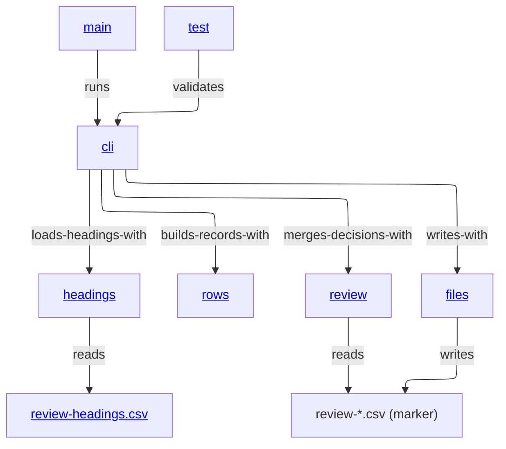

# Review CSV Exporter

## Purpose

A Node command line tool that turns reviewed-pending tracker proposals and a tracker export into consolidated review CSVs, one wide row per record, ordered by what needs a lead's judgment, so leads can review adds, updates and suggestions without transposing one-row-per-field proposals.

## Navigation

[Job Behavior Specifications](../../README.md#navigation) / [Tracker Tools](../README.md#navigation) / **Review CSV Exporter**

- [Design](#design)
  - [Diagram](#diagram)
- [Behavior](#behavior)
- [Relationships](#relationships)
- [Links](#links)

## Design

One command, `export-review --export <dir> --proposals <dir> [--scope <slug>] [--headings <file>] --out <dir>`, behind a thin adapter. [main](src/main.ts) only connects the process to [cli](src/cli.ts), which parses the arguments, collects every input problem, runs the modules and returns the exit status (0 done, 1 input problem, 2 bad usage). [headings](src/headings.ts) loads and checks the headings data file ([review-headings.csv](data/review-headings.csv), provisional, headings equal keys) against `tracker-schema.csv` and builds the column headers. [rows](src/rows.ts) turns the Tracker Reconciler's classification into one record per (tab, identity), joins its field proposals, assigns the tier and the global order and renders the content cells with their digest. [review](src/review.ts) reads the earlier `review-*.csv` files and merges the lead's five review cells. [files](src/files.ts) checks the output folder, renders the four files and writes them through temporary names. Reading, validating and secret detection (`inputs`, `reconcile`, `secrets` of [Tracker Reconciler](../tracker-reconciler/README.md#design); CSV and schema of [Tracker Tables](../tracker-tables/README.md#design)) are imported by relative path and not changed. No column list is repeated in code; shown fields and headings are data.

How a run goes: the headings, the export, the proposals, the output folder and any earlier review files are all read and validated first; any problem stops the run with exit 1 and one `file: line N: message` per problem before anything is written. Then the reconciler classifies, rows are built and ranked, review cells are merged, and the four files are written to temporary names and renamed only after all are written.

Decisions (record of the build; override in chat):

- **Identity.** The central reference when the record is in the export, else `new:<local_key>`; a link suggestion made on an addition's suggested reference is mapped back to its `new:` identity. The same record across proposals and folders is one row; the same field with the same value merges its proposal IDs, different values are joined with ` | `.
- **Field state** is the strongest of `add`, `update`, `suggest`, `held`, `conflict`. A conflicting or held field shows the export value as current and the proposed value as written in the proposal, not the reconciler's merged list.
- **Kind and tier.** Tier 1: any conflict or held change (kind `conflict`). Tier 2: a suggestion entry or a suggested human field. Else tier 3. Kind is `suggestion` when no field is an add or update, else `add` for a new record and `update` otherwise. Sorting is tier, use case name, tab (Use Cases, Questions, Identity & Access, Mappings), identity, by plain string comparison, so it does not depend on the locale.
- **Review merge.** Rows match by (tab, identity). `changed_since_review` is `yes` when a reviewed row's stored digest differs from the new one, and stays `yes` on later refreshes until the lead clears it, so a repeat on the same inputs is identical. A review file whose headings no longer match the headings file stops the run rather than losing decisions.
- **Headings file.** Rows of a schema tab that is not proposable (for example Batches) are ignored; the required `Review` keys are `record`, `record_key`, `kind`, `content_digest`, `review_status` and the three suffix keys; two headings that produce the same column header in a tab stop the run.
- **Row and order shape.** One global `order` column ranks rows across the four files and each file is sorted by it; review state is one set of review columns per record row, so a lead who finds one field wrong marks the row `clarify` or `rejected` and names the field in `review_note`. There is no `--keep-applied` mode (a row that now matches the export is dropped with its review cells), and `--proposals` takes a single root.
- **Output folder** may be new or hold earlier review files and anything else, which is left alone; one that is, contains or sits inside an input, or is a file, is refused. The reconciler's rejected proposal rows are printed on standard output only.

### Diagram

## Behavior

- **B01** When it runs on the proposal files and a tracker export, then it writes one review CSV per tab with one wide, human-readable row per record, with adds, updates and suggestions all in the column format agreed from the sample workbook.
- **B02** When a record has several field proposals, then they join into one row showing current value, proposed value and review state per changed field.
- **B03** When a record appears in several proposals or folders, then it appears once, keyed by its reference.
- **B04** When a record already matches the tracker export, then it gets no row.
- **B05** When a refresh meets rows a lead already reviewed, then the lead's review columns are preserved.
- **B06** When a proposal's base value differs from the export, then the row is flagged as a conflict and nothing is overwritten.
- **B07** When it runs twice on the same inputs, then the files are identical.
- **B08** When an input is invalid or a value looks like a secret, then it stops, names it and writes nothing.
- **B09** When it runs, then it changes no input and never writes to the tracker.
- **B10** When the rows are written, then they are ordered by what they need from the lead (conflicts, suggestions for the lead's fields, then plain evidence-backed adds grouped by use case).

## Relationships

- [Tracker Data Contract](../../tracker-data-contract/README.md#purpose) — the schema, owner classes and proposal format the exporter reads.
- [Sample Tracker Workbook](../sample-tracker-workbook/README.md#purpose) — the sample whose reviewed format the review CSV columns follow.
- [Tracker Tables](../tracker-tables/README.md#purpose) — the library that reads, validates and writes the CSV tables.
- [Tracker Reconciler](../tracker-reconciler/README.md#purpose) — the matching and conflict logic the exporter reuses.

## Links

- [requirements.md](requirements.md#requirements) — what the exporter must do, what must match the source and what need not, and the follow-on work.
- [contract.md](contract.md#contract) — the command, output files, headings file, wide row layout, ordering and preservation rules.
