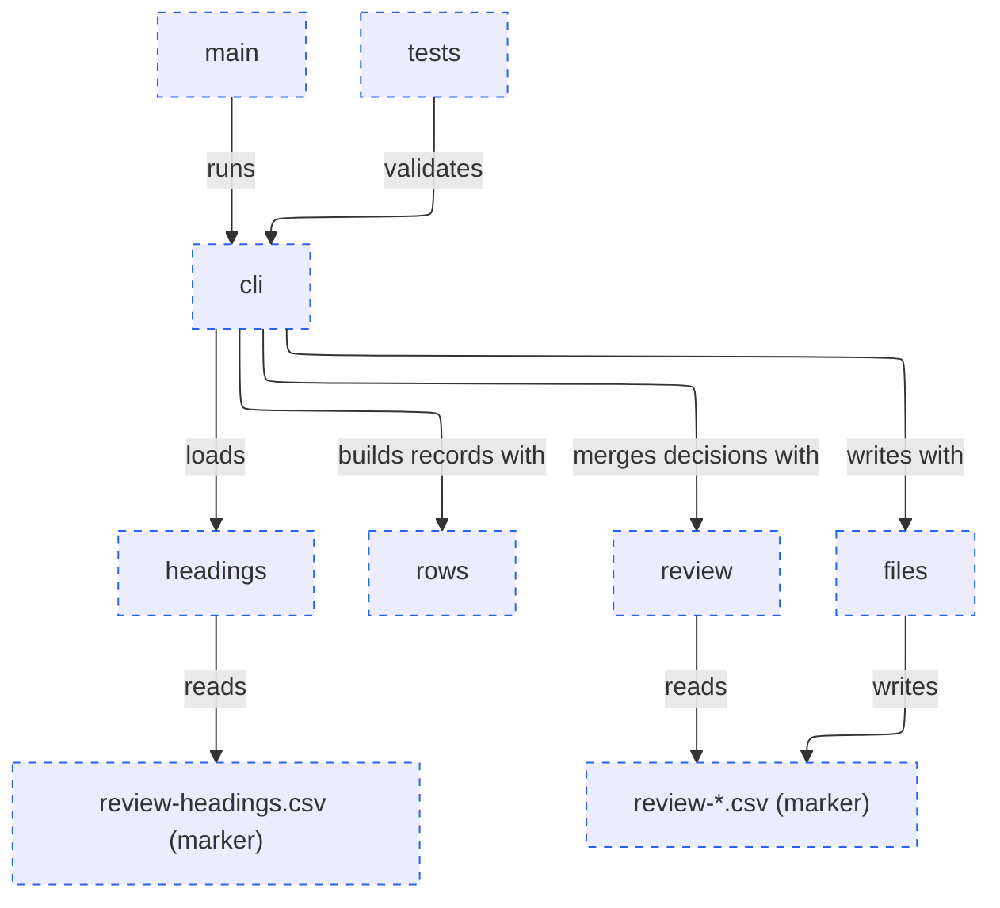

# Review CSV Exporter

## Purpose

A Node command line tool that turns reviewed-pending tracker proposals and a tracker export into consolidated review CSVs, one wide row per record, ordered by what needs a lead's judgment, so leads can review adds, updates and suggestions without transposing one-row-per-field proposals.

## Navigation

[Job Behavior Specifications](../../README.md#navigation) / [Tracker Tools](../README.md#navigation) / **Review CSV Exporter**

- [Design](#design)
- [Behavior](#behavior)
- [Relationships](#relationships)
- [Links](#links)

## Design

Not built yet.

## Behavior

- **B01** When it runs on the proposal files and a tracker export, then it writes one review CSV per tab with one wide, human-readable row per record, with adds, updates and suggestions all in the column format agreed from the sample workbook.
- **B02** When a record has several field proposals, then they join into one row showing current value, proposed value and review state per changed field.
- **B03** When a record appears in several proposals or folders, then it appears once, keyed by its reference.
- **B04** When a record already matches the tracker export, then it gets no row.
- **B05** When a refresh meets rows a lead already reviewed, then the lead's review columns are preserved.
- **B06** When a proposal's base value differs from the export, then the row is flagged as a conflict and nothing is overwritten.
- **B07** When it runs twice on the same inputs, then the files are identical.
- **B08** When an input is invalid or a value looks like a secret, then it stops, names it and writes nothing.
- **B09** When it runs, then it changes no input and never writes to the tracker.
- **B10** When the rows are written, then they are ordered by what they need from the lead (conflicts, suggestions for the lead's fields, then plain evidence-backed adds grouped by use case).

## Relationships

- [Tracker Data Contract](../../tracker-data-contract/README.md#purpose) — the schema, owner classes and proposal format the exporter reads.
- [Sample Tracker Workbook](../sample-tracker-workbook/README.md#purpose) — the sample whose reviewed format the review CSV columns follow.
- [Tracker Tables](../tracker-tables/README.md#purpose) — the library that reads, validates and writes the CSV tables.
- [Tracker Reconciler](../tracker-reconciler/README.md#purpose) — the matching and conflict logic the exporter reuses.

## Links

- [requirements.md](requirements.md#requirements) — what the exporter must do, what must match the source and what need not, and the follow-on work.
- [contract.md](contract.md#contract) — the command, output files, headings file, wide row layout, ordering and preservation rules.

## Plan

### Planned Navigation

[Job Behavior Specifications](../../README.md#plan) / [Tracker Tools](../README.md#plan) / **Review CSV Exporter**

- [Planned Design](#planned-design)
  - [Planned Diagram](#planned-diagram)
- [Steps](#steps)
- [Acceptance Mapping](#acceptance-mapping)
- [Assumptions And Open Questions](#assumptions-and-open-questions)
- [Planned Relationships](#planned-relationships)
- [Planned Links](#planned-links)

### Planned Design

`export-review` is a thin adapter (`src/main.ts`) over `cli`, which loads the headings file, reads the proposals and the tracker export through the Tracker Reconciler's loaders, classifies them with its `reconcile`, builds one wide record per (tab, identity) in `rows`, merges earlier review cells in `review` and writes the four `review-*.csv` files in `files`, writing nothing when any check fails. The shown fields and headings are data (`data/review-headings.csv`), so the format agreed from the sample workbook is a data change. Rows are ordered conflicts and held changes first, suggestions second and plain adds and updates last, grouped by use case.

#### Planned Diagram

### Steps

1. **Scaffold.** `package.json` (private, ES module, `engines node >=26`, script `test`, as `tracker-reconciler/package.json`).
2. **Headings data.** `data/review-headings.csv` with the shape and keys in `contract.md`; provisional headings equal to the keys.
3. **`src/headings.ts`** (B01, B08): loads and validates the headings file against `tracker-schema.csv` and the required keys.
4. **`src/rows.ts`** (B02, B03, B04, B06, B10): turns the reconciler result into review records by (tab, identity), merges proposals, maps link suggestions made on an addition back to its `new:` identity, assigns tier and global `order`.
5. **`src/review.ts`** (B05, B08): reads existing `review-*.csv`, validates `review_status`, copies the five review cells by (tab, identity) and sets `changed_since_review`.
6. **`src/files.ts`** (B01, B07, B09): renders the wide rows with the headings and writes the files through temporary names, header-only for an empty tab.
7. **`src/cli.ts`** (all): the command, input collection, counts and exit codes.
8. **`src/main.ts`**: the adapter, as the reconciler's.
9. **Tests** in `test/`, real temporary directories, tagged `[B01]` to `[B10]`: `export`, `merge`, `conflict`, `order`, `review`, `repeat`, `input` and `headings`.
10. **Docs:** the built `Design` and diagram in this README, kept in step with `requirements.md` and `contract.md`.
11. **Validate:** the group's `test`, then `coverage` checks, narrowest first.

### Acceptance Mapping

| Acceptance | Behaviors | Step | Test |
| --- | --- | --- | --- |
| 1. One review CSV per tab, wide rows, joined proposals, once across folders, matching records omitted, ordered | B01, B02, B03, B04, B10 | 2 to 7 | `export.test.ts` `[B01]` `[B02]` `[B04]`; `headings.test.ts` `[B01]` (a changed headings file changes the output with no code change); `merge.test.ts` `[B03]`; `order.test.ts` `[B10]` |
| 2. Refresh keeps review columns; a differing base value is a flagged conflict, nothing overwritten | B05, B06 | 4, 5 | `review.test.ts` `[B05]`; `conflict.test.ts` `[B06]` |
| 3. Identical files on repeat; invalid input stops with the item named and writes nothing; no input changed | B07, B08, B09 | 6, 7, 9 | `repeat.test.ts` `[B07]`; `input.test.ts` `[B08]`; `export.test.ts` `[B09]` |

### Assumptions And Open Questions

Assumptions (override by telling the builder, or by editing the file named):

- Command name `export-review`. Rename in `cli.ts` and `contract.md`.
- A global `order` column carries the cross-tab order and each file is sorted by it. For one combined file, ask for `review-all.csv`.
- Review state is one set of review columns per record row, so a lead who finds one field wrong marks the row `clarify` or `rejected` and says which field in `review_note`. For per-field decisions, say so; every row would widen.
- Plain specification updates on existing records share tier 3 with plain adds. Ask for a fourth tier, or tier 2, to change that.
- The headings file has the shape of the sample workbook's `headings.csv`; the first version is provisional.
- A row that vanishes after a hand-apply takes its review cells with it. A `--keep-applied` mode is not planned.
- A single `--proposals` root. Say so to allow the option to repeat.
- The reconciler and the library are imported by relative path and not changed.
- The budget (USD 6, 5,400 s) is workable but thin for six modules and eight test files; keep tests compact.

Open questions (behavior or real ambiguity): none. The planner recommended keeping one row per record with one review state, as assumed; confirm it when the team reviews the sample.

### Planned Relationships

- [Tracker Data Contract](../../tracker-data-contract/README.md#purpose) — the schema, owner classes and proposal format the exporter reads.
- [Sample Tracker Workbook](../sample-tracker-workbook/README.md#plan) — the reviewed format the headings file follows.
- [Tracker Tables](../tracker-tables/README.md#purpose) — CSV reading and writing and schema validation.
- [Tracker Reconciler](../tracker-reconciler/README.md#purpose) — the loaders and classification the exporter reuses.

### Planned Links

- [requirements.md](requirements.md#requirements) — requirements, dependencies and follow-on work.
- [contract.md](contract.md#contract) — command, headings file, row layout, ordering and preservation.
