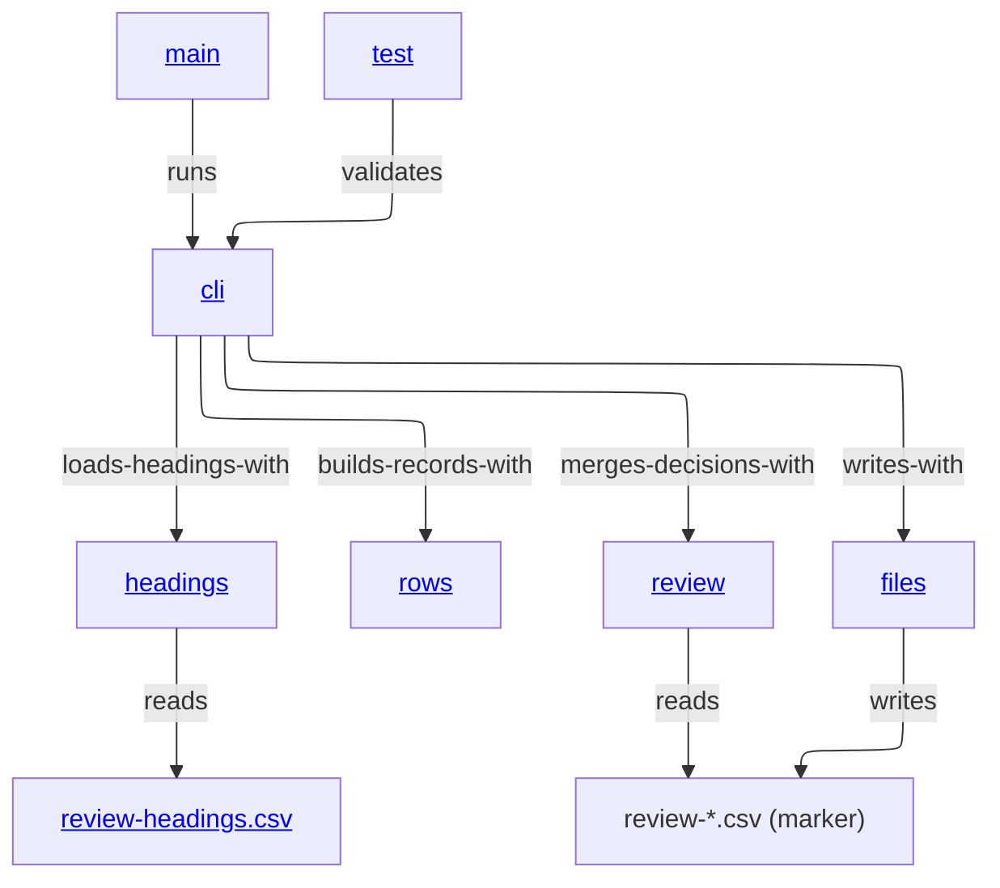

# Review CSV Exporter

## Purpose

A Node command line tool that turns reviewed-pending tracker proposals and a tracker export into consolidated review CSVs, one wide row per record, ordered by what needs a lead's judgment, so leads can review adds, updates and suggestions without transposing one-row-per-field proposals.

## Navigation

[Job Behavior Specifications](../../README.md#navigation) / [Tracker Tools](../README.md#navigation) / **Review CSV Exporter**

- [Design](#design)
  - [Diagram](#diagram)
- [Behavior](#behavior)
- [Relationships](#relationships)
- [Links](#links)
- [Plan](#plan)
  - [Planned Navigation](#planned-navigation)
  - [Planned Design](#planned-design)
  - [Planned Behavior](#planned-behavior)
  - [Steps](#steps)
  - [Acceptance Mapping](#acceptance-mapping)
  - [Assumptions And Open Questions](#assumptions-and-open-questions)
  - [Planned Relationships](#planned-relationships)
  - [Planned Links](#planned-links)

## Design

One command, `export-review --export <dir> --proposals <dir> [--scope <slug>] [--headings <file>] --out <dir>`, behind a thin adapter. [main](src/main.ts) only connects the process to [cli](src/cli.ts), which parses the arguments, collects every input problem, runs the modules and returns the exit status (0 done, 1 input problem, 2 bad usage). [headings](src/headings.ts) loads and checks the headings data file ([review-headings.csv](data/review-headings.csv), provisional, headings equal keys) against `tracker-schema.csv` and builds the column headers. [rows](src/rows.ts) turns the Tracker Reconciler's classification into one record per (tab, identity), joins its field proposals, assigns the tier and the global order and renders the content cells with their digest. [review](src/review.ts) reads the earlier `review-*.csv` files and merges the lead's five review cells. [files](src/files.ts) checks the output folder, renders the four files and writes them through temporary names. Reading, validating and secret detection (`inputs`, `reconcile`, `secrets` of [Tracker Reconciler](../tracker-reconciler/README.md#design); CSV and schema of [Tracker Tables](../tracker-tables/README.md#design)) are imported by relative path and not changed. No column list is repeated in code; shown fields and headings are data.

How a run goes: the headings, the export, the proposals, the output folder and any earlier review files are all read and validated first; any problem stops the run with exit 1 and one `file: line N: message` per problem before anything is written. Then the reconciler classifies, rows are built and ranked, review cells are merged, and the four files are written to temporary names and renamed only after all are written.

Decisions (record of the build; override in chat):

- **Identity.** The central reference when the record is in the export, else `new:<local_key>`; a link suggestion made on an addition's suggested reference is mapped back to its `new:` identity. The same record across proposals and folders is one row; the same field with the same value merges its proposal IDs, different values are joined with ` | `.
- **Field state** is the strongest of `add`, `update`, `suggest`, `held`, `conflict`. A conflicting or held field shows the export value as current and the proposed value as written in the proposal, not the reconciler's merged list.
- **Kind and tier.** Tier 1: any conflict or held change (kind `conflict`). Tier 2: a suggestion entry or a suggested human field. Else tier 3. Kind is `suggestion` when no field is an add or update, else `add` for a new record and `update` otherwise. Sorting is tier, use case name, tab (Use Cases, Questions, Identity & Access, Mappings), identity, by plain string comparison, so it does not depend on the locale.
- **Review merge.** Rows match by (tab, identity). `changed_since_review` is `yes` when a reviewed row's stored digest differs from the new one, and stays `yes` on later refreshes until the lead clears it, so a repeat on the same inputs is identical. A review file whose headings no longer match the headings file stops the run rather than losing decisions.
- **Headings file.** Rows of a schema tab that is not proposable (for example Batches) are ignored; the required `Review` keys are `record`, `record_key`, `kind`, `content_digest`, `review_status` and the three suffix keys; two headings that produce the same column header in a tab stop the run.
- **Row and order shape.** One global `order` column ranks rows across the four files and each file is sorted by it; review state is one set of review columns per record row, so a lead who finds one field wrong marks the row `clarify` or `rejected` and names the field in `review_note`. There is no `--keep-applied` mode (a row that now matches the export is dropped with its review cells), and `--proposals` takes a single root.
- **Output folder** may be new or hold earlier review files and anything else, which is left alone; one that is, contains or sits inside an input, or is a file, is refused. The reconciler's rejected proposal rows are printed on standard output only.

### Diagram

## Behavior

- **B01** When it runs on the proposal files and a tracker export, then it writes one review CSV per tab with one wide, human-readable row per record, with adds, updates and suggestions all in the column format agreed from the sample workbook.
- **B02** When a record has several field proposals, then they join into one row showing current value, proposed value and review state per changed field.
- **B03** When a record appears in several proposals or folders, then it appears once, keyed by its reference.
- **B04** When a record already matches the tracker export, then it gets no row.
- **B05** When a refresh meets rows a lead already reviewed, then the lead's review columns are preserved.
- **B06** When a proposal's base value differs from the export, then the row is flagged as a conflict and nothing is overwritten.
- **B07** When it runs twice on the same inputs, then the files are identical.
- **B08** When an input is invalid or a value looks like a secret, then it stops, names it and writes nothing.
- **B09** When it runs, then it changes no input and never writes to the tracker.
- **B10** When the rows are written, then they are ordered by what they need from the lead (conflicts, suggestions for the lead's fields, then plain evidence-backed adds grouped by use case).

## Relationships

- [Tracker Data Contract](../../tracker-data-contract/README.md#purpose) — the schema, owner classes and proposal format the exporter reads.
- [Sample Tracker Workbook](../sample-tracker-workbook/README.md#purpose) — the sample whose reviewed format the review CSV columns follow.
- [Tracker Tables](../tracker-tables/README.md#purpose) — the library that reads, validates and writes the CSV tables.
- [Tracker Reconciler](../tracker-reconciler/README.md#purpose) — the matching and conflict logic the exporter reuses.

## Links

- [requirements.md](requirements.md#requirements) — what the exporter must do, what must match the source and what need not, and the follow-on work.
- [contract.md](contract.md#contract) — the command, output files, headings file, wide row layout, ordering and preservation rules.

## Plan

### Planned Navigation

[Job Behavior Specifications](../../README.md#plan) / [Tracker Tools](../README.md#plan) / **Review CSV Exporter**

- [Planned Design](#planned-design)
- [Planned Behavior](#planned-behavior)
- [Steps](#steps)
- [Acceptance Mapping](#acceptance-mapping)
- [Assumptions And Open Questions](#assumptions-and-open-questions)
- [Planned Relationships](#planned-relationships)
- [Planned Links](#planned-links)

### Planned Design

The exporter itself needs no code change: its `use_case` cell and its sort read `Change.useCase`, which the [Tracker Reconciler](../tracker-reconciler/README.md#planned-design) now fills with the use case ID (`uc-<vendor-slug>-<use-case-slug>`) instead of the name, and `new:<local_key>` identities carry the ID-based local key. What changes is what the files say and what the tests expect: the `use_case` cell (header and heading key unchanged) holds the ID, and because the ID starts with the vendor slug, the order within a tier groups use cases by vendor and then by name. Two vendors' same-named use cases are two different IDs, so their rows never merge. The structure does not change, so there is no Planned Diagram. The exact wording is in [contract.md](contract.md#planned-use-case-id-in-the-review-csvs). The reviewed rows of an earlier run still match by (tab, identity), which are central references or `new:<key>`; an old-form `new:` identity simply no longer matches, and there is no migration (the user confirmed no live data).

One data change: `data/review-headings.csv` gains a `Use Cases,use_case_name` row, because a use case's key is now its ID and its readable name must reach the review file as a proposed field for the workbook updaters to write it.

### Planned Behavior

Reworded; the rest keep their text.

- **B03** When a record appears in several proposals or folders, then it appears once, keyed by its reference, and use cases of two vendors that have the same name are two records under two use case IDs.
- **B10** When the rows are written, then they are ordered by what they need from the lead (conflicts, suggestions for the lead's fields, then plain evidence-backed adds grouped by use case ID, so by vendor and then by use case name).

### Steps

1. Confirm no code change is needed: [src/rows.ts](src/rows.ts) lines ~56, ~114 and ~133 use `Change.useCase` and the plain string compare as they are. If a build finds code that reads a use case name, it uses `useCaseId` from [Tracker Tables](../tracker-tables/README.md#planned-design), never a private copy.
2. Tests, rewritten to ID keys over the reconciler's regenerated fixtures (`baseExport` from `tracker-reconciler/test/fixtures.ts`, IDs `uc-acme-daily-report`, `uc-beta-nightly-sync`, `uc-gamma-invoice-feed`): [test/order.test.ts](test/order.test.ts) (the keys on lines 8 to 15 and the expected `kind:use_case:record` lines 25 to 33 and 37 become ID forms, ordered by ID; the `Alpha` add becomes `uc-a-alpha` with its vendor, and one more add for a second vendor with the same name as an existing use case, to show the vendor grouping); [test/export.test.ts](test/export.test.ts) (line 7, 13 to 16, 46 to 50, 68, 75; a `use_case` cell expectation of the ID, and one test for two same-named use cases of two vendors giving two rows); [test/repeat.test.ts](test/repeat.test.ts) (lines 7, 8, 19); [test/conflict.test.ts](test/conflict.test.ts) (lines 9 to 11, 32 to 33 where the inline `use-cases.csv` holds names and vendors, 42 to 43); [test/review.test.ts](test/review.test.ts) (lines 9, 19, 33, 39, 48; the `new:` identity in the review-by-local-key test is the ID key); [test/support.ts](test/support.ts) (re-exports; add the shared ID constants if the reconciler's `support.ts` exports them). Also in the list, not named by the planner: [test/merge.test.ts](test/merge.test.ts) (lines 6, 10), [test/input.test.ts](test/input.test.ts) (lines 15 to 23) and [test/headings.test.ts](test/headings.test.ts) (lines 8, 26), which use name keys too.
3. [contract.md](contract.md): the `use_case` description and the ordering line; [README.md](README.md): `B03` and `B10`, the Design "Kind and tier" decision ("use case name" becomes "use case ID, so by vendor then name"); [requirements.md](requirements.md): nothing needed (it says "grouped by use case", which still holds) unless the build finds a name wording.
4. [data/review-headings.csv](data/review-headings.csv): add the row `Use Cases,use_case_name,use_case_name,,` after the `Use Cases,vendor` row, so a new use case's review row carries a proposed name cell (its key is now the ID, so the readable name travels as a field), which the vendor and master workbook updaters read; [test/headings.test.ts](test/headings.test.ts) and any test that counts the wide row's columns follow.
5. Run `test` and `coverage`.

### Acceptance Mapping

| Acceptance | Behaviors | Step | Check |
| --- | --- | --- | --- |
| 1. The `use_case` cell holds the use case ID and rows within a tier are ordered by ID, so grouped by vendor and then by name, with the ordering test rewritten to ID keys. | B10 | 2, 3 | `order.test.ts` |
| 2. Two vendors' same-named use cases give two rows with two IDs and are never merged. | B03 | 2 | `export.test.ts`, `merge.test.ts` |
| 3. The export, repeat, conflict, review, merge, input, headings and support tests use ID keys and pass, and the files stay identical on a repeat. | B01, B02, B04 to B09 | 2, 4 | `test` and `coverage` |
| 4. contract.md and README state that the `use_case` cell is the ID and the sort is by vendor then name. | B03, B10 | 3 | read-through |
| 5. A new use case's review row has a proposed `use_case_name` cell through a `Use Cases,use_case_name` row in the headings file. | B03 | 4 | `headings.test.ts`, `export.test.ts` |

### Assumptions And Open Questions

Assumptions (override by telling the builder, or by editing the file named):

- **The sort is a string compare of the ID,** which groups by vendor and then by name except where one vendor's slug starts another's (for example `acme` and `acme-corp`), where rows can interleave. This is accepted because it keeps the code unchanged. Override by sorting on the vendor and name columns (new code and an export lookup).
- **The `use_case` cell keeps its header** and is not a readable name any more; the readable name stays in the `use_case_name` column of the Use Cases and Questions tabs, which a lead can show through the headings file. Override by adding a readable column (a headings and layout change).
- **One data change to the headings file:** the `Use Cases,use_case_name` row (step 4) adds three columns (`use_case_name_current`, `_proposed`, `_state`) to the Use Cases review file, found by the Review Decisions skill through the headings file, so that skill needs no change; the golden fixtures of the lead tracker skills are regenerated later (backlog item `golden-fixture-regeneration`). An earlier review file with an old-form `new:` identity is not matched (no migration). Override by carrying the name another way, which changes both updaters.
- **The exporter depends on the reconciler's fixtures and `Change.useCase`,** so it builds after the Tracker Reconciler; the vendor and master workbook updaters read the same cell and match by derived ID in their own plans.
- **Planner findings checked.** The listed test files are right and incomplete (merge, input and headings also carry name keys); no source file needs a change.

Open questions: none.

### Planned Relationships

It builds after the [Tracker Reconciler](../tracker-reconciler/README.md#planned-design) (its `Change.useCase` and fixtures) and the [Tracker Tables](../tracker-tables/README.md#planned-design) helper, and after the [Tracker Data Contract](../../tracker-data-contract/README.md#planned-design). The [Vendor Workbook Updater](../vendor-workbook-updater/README.md#design) and [Master Workbook Updater](../master-workbook-updater/README.md#design) read its `use_case` cell and build after it.

### Planned Links

- [contract.md](contract.md#planned-use-case-id-in-the-review-csvs) — the exact planned wording.
