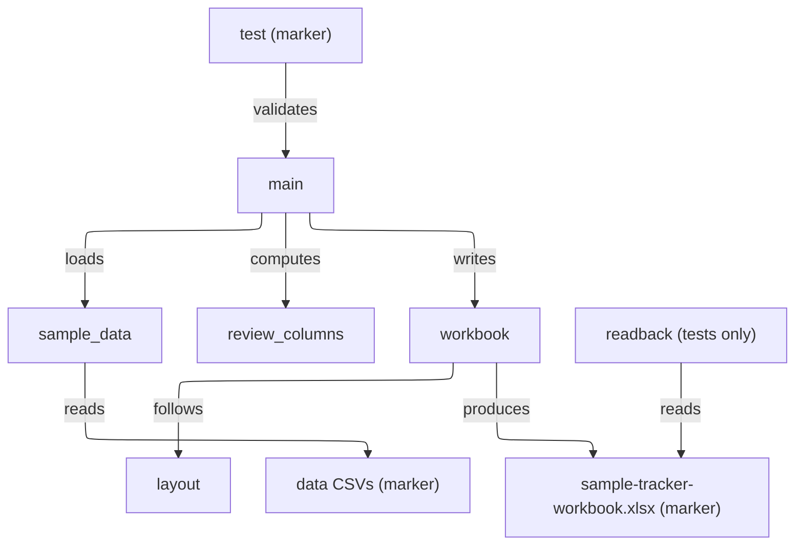

# Sample Tracker Workbook

## Purpose

A small, realistic sample of the final Excel tracker, generated from fictional data, so the team can review the proposed format of the sheets and give feedback before the real tracker is built.

## Navigation

[Job Behavior Specifications](../../README.md#navigation) / [Tracker Tools](../README.md#navigation) / **Sample Tracker Workbook**

- [Design](#design)
  - [Diagram](#diagram)
- [Technology](#technology)
- [Behavior](#behavior)
- [Relationships](#relationships)
- [Links](#links)

## Design

`node src/main.ts generate --out <file> --as-of <YYYY-MM-DD> [--data <folder>]` is a thin adapter ([main](src/main.ts)) that loads the sample data, validates it, computes the review columns and writes the workbook, writing nothing when any check fails. The optional `--data` folder lets the tests try invalid data. The sample data is fictional and contract-shaped: [data](data/) holds `use-cases.csv`, `questions.csv`, `identity-access.csv` and `mappings.csv` with every schema column, validated with the Tracker Tables library against the real `tracker-schema.csv`, plus `proposed-changes.csv`, `trace.csv` and `headings.csv` (friendly heading, column group and visibility for each column of the main sheets, Proposed Changes and Trace). [sample_data](src/sample_data.ts) loads and checks the data (references, allowed values, secret-like values, decision fields) and reports every finding in one error. [review_columns](src/review_columns.ts) computes `due_on`, review state, days past original due (working days) and age awaiting review (calendar days) as values at the as-of date. [layout](src/layout.ts) holds the layout rules (sheet order, tab colours, column bands, header colours, freeze, widths, the columns kept off the main sheets). [workbook](src/workbook.ts) writes the eight sheets with `exceljs`: Excel tables under a group band, named-range dropdowns with stop-alerts from the schema, fixed timestamps, and a Trace sheet built from the columns kept off the main sheets plus `trace.csv`. [readback](src/readback.ts) reads a workbook back into a plain structure and is used by the tests only. The output is written to a temporary name and renamed.

The workbook is an internal sample: it mixes vendor-visible and internal columns, is not vendor-safe, and hides nothing. [contract.md](contract.md#differences-from-the-tracker-contract) lists every difference from the tracker contract.

### Diagram

## Technology

Inherited from [Tracker Tools](../README.md#technology), with one departure: this component adds the pinned `exceljs` package to write the workbook (see [requirements.md](requirements.md#requirements)).

## Behavior

- **B1** When `generate --out <file> --as-of <date>` runs, then it writes one `.xlsx` with the sheets Read Me, Use Cases, Questions, Identity & Access, Workflow Mappings, Proposed Changes, Trace and Lists.
- **B2** When it runs twice on the same sample data and as-of date, then the two workbooks match cell for cell, with identical dropdowns, widths and formats (compared by reading them back).
- **B3** When the sample data is read, then it holds 5 fictional use cases across two vendors covering source located, empty, not located and uncertain mapping (supporting documents never clear a blocker), website sign-in and API access, and one endpoint shared by two use cases as separate rows per use case, endpoint and environment with no permissions assumed.
- **B4** When the question, review, acknowledgement, mapping and proposal data is read, then it shows unanswered, partially answered and complete-awaiting-review rows, a lead-requested clarification, an acknowledgement at a specific version, a workflow candidate awaiting a lead decision and a proposed tracker change awaiting review.
- **B5** When a reference dangles, a value is outside the schema's allowed list, or a value looks like a secret, then generation stops with an error naming it and writes no file.
- **B6** When the workbook is opened, then every enum column has a dropdown with a stop-alert listing the schema's `allowed_values`, read from `tracker-schema.csv` at generation.
- **B7** When question rows are shown, then `due_on` is the release date plus two working days, a complete answer awaiting lead review shows its owner and age and is not vendor-overdue, a clarification-requested row is overdue against its original due date even when the answer is complete, and a partial answer is overdue and a follow-up.
- **B8** When the layout is inspected, then headers and key columns are frozen, filters are on, widths are readable, each sheet and column is marked vendor-visible or internal (Workflow Mappings, Proposed Changes and Trace are internal) and nothing is hidden.
- **B9** When proposed and accepted values are compared, then main sheets hold accepted values only, proposals sit on Proposed Changes with a pending-change pointer on the affected row, and proposal metadata (proposal and update IDs, sources, base values) is on Trace and Proposed Changes.
- **B10** When the walkthrough, feedback questions and differences from the contract are checked against the workbook, then every sheet and column they name exists.

## Relationships

- [Tracker Data Contract](../../tracker-data-contract/README.md#purpose) — the schema, status lists, due-date rule and workbook layout guide the sample follows and departs from explicitly.
- [Tracker Tables](../tracker-tables/README.md#purpose) — the library that loads the schema, validates the sample CSVs and does the working-day arithmetic.

## Links

- [requirements.md](requirements.md#requirements) — what the component must do, what must match the contract and what need not, and the follow-on work.
- [contract.md](contract.md#contract) — the command, data file shapes, sheet order and every difference from the tracker contract.
- [walkthrough.md](walkthrough.md) — the sheet tour, feedback questions per sheet and how to present the sample and capture feedback.
- [sample-tracker-workbook.xlsx](sample-tracker-workbook.xlsx) — the generated sample, as of 2026-11-16.
- [data](data/) — the fictional sample data: four contract-shaped CSVs, `proposed-changes.csv`, `trace.csv` and `headings.csv`.
- [src/main.ts](src/main.ts) — the `generate` command.
- [test](test/) — the tests, each titled with its behavior tag.
