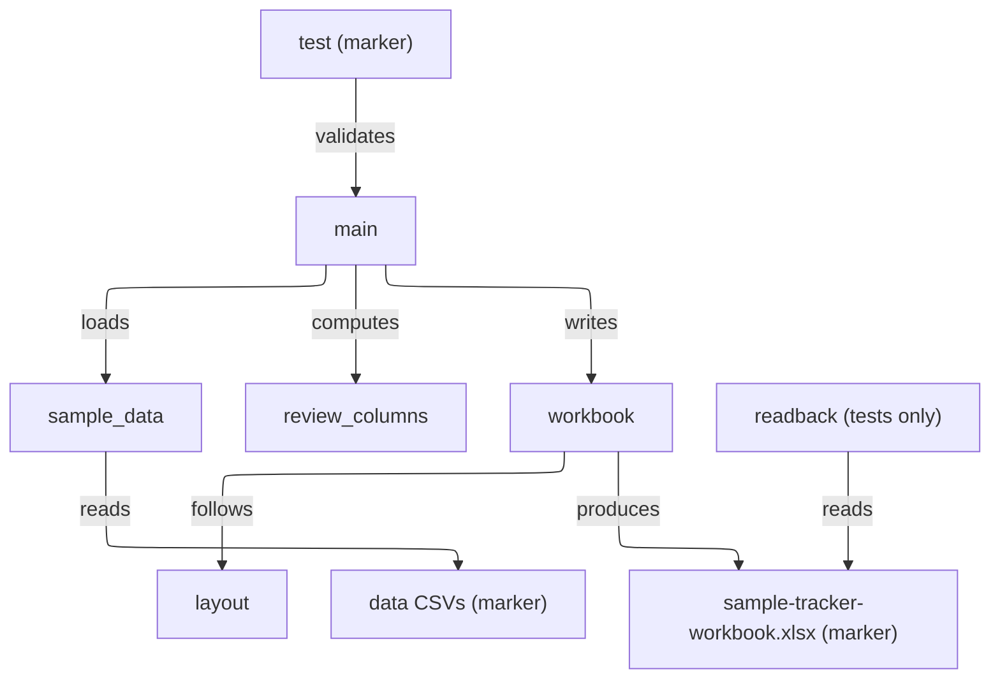
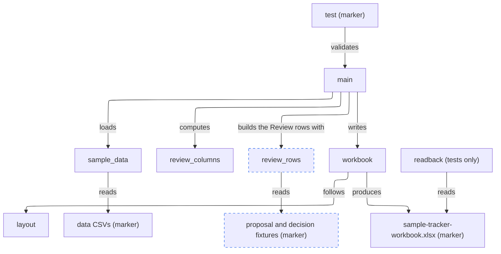

# Sample Tracker Workbook

## Purpose

A small, realistic sample of the final Excel tracker, generated from fictional data, so the team can review the proposed format of the sheets and give feedback before the real tracker is built.

## Navigation

[Job Behavior Specifications](../../README.md#navigation) / [Tracker Tools](../README.md#navigation) / **Sample Tracker Workbook**

- [Design](#design)
  - [Diagram](#diagram)
- [Technology](#technology)
- [Behavior](#behavior)
- [Relationships](#relationships)
- [Links](#links)

## Design

`node src/main.ts generate --out <file> --as-of <YYYY-MM-DD> [--data <folder>]` is a thin adapter ([main](src/main.ts)) that loads the sample data, validates it, computes the review columns and writes the workbook, writing nothing when any check fails. The optional `--data` folder lets the tests try invalid data. The sample data is fictional and contract-shaped: [data](data/) holds `use-cases.csv`, `questions.csv`, `identity-access.csv` and `mappings.csv` with every schema column, validated with the Tracker Tables library against the real `tracker-schema.csv`, plus `proposed-changes.csv`, `trace.csv` and `headings.csv` (friendly heading, column group and visibility for each column of the main sheets, Proposed Changes and Trace). [sample_data](src/sample_data.ts) loads and checks the data (references, allowed values, secret-like values, decision fields) and reports every finding in one error. [review_columns](src/review_columns.ts) computes `due_on`, review state, days past original due (working days) and age awaiting review (calendar days) as values at the as-of date. [layout](src/layout.ts) holds the layout rules (sheet order, tab colours, column bands, header colours, freeze, widths, the columns kept off the main sheets). [workbook](src/workbook.ts) writes the eight sheets with `exceljs`: Excel tables under a group band, named-range dropdowns with stop-alerts from the schema, fixed timestamps, and a Trace sheet built from the columns kept off the main sheets plus `trace.csv`. [readback](src/readback.ts) reads a workbook back into a plain structure and is used by the tests only. The output is written to a temporary name and renamed.

The workbook is an internal sample: it mixes vendor-visible and internal columns, is not vendor-safe, and hides nothing. [contract.md](contract.md#differences-from-the-tracker-contract) lists every difference from the tracker contract.

### Diagram

## Technology

Inherited from [Tracker Tools](../README.md#technology), with one departure: this component adds the pinned `exceljs` package to write the workbook (see [requirements.md](requirements.md#requirements)).

## Behavior

- **B1** When `generate --out <file> --as-of <date>` runs, then it writes one `.xlsx` with the sheets Read Me, Use Cases, Questions, Identity & Access, Workflow Mappings, Proposed Changes, Trace and Lists.
- **B2** When it runs twice on the same sample data and as-of date, then the two workbooks match cell for cell, with identical dropdowns, widths and formats (compared by reading them back).
- **B3** When the sample data is read, then it holds 5 fictional use cases across two vendors covering source located, empty, not located and uncertain mapping (supporting documents never clear a blocker), website sign-in and API access, and one endpoint shared by two use cases as separate rows per use case, endpoint and environment with no permissions assumed.
- **B4** When the question, review, acknowledgement, mapping and proposal data is read, then it shows unanswered, partially answered and complete-awaiting-review rows, a lead-requested clarification, an acknowledgement at a specific version, a workflow candidate awaiting a lead decision and a proposed tracker change awaiting review.
- **B5** When a reference dangles, a value is outside the schema's allowed list, or a value looks like a secret, then generation stops with an error naming it and writes no file.
- **B6** When the workbook is opened, then every enum column has a dropdown with a stop-alert listing the schema's `allowed_values`, read from `tracker-schema.csv` at generation.
- **B7** When question rows are shown, then `due_on` is the release date plus two working days, a complete answer awaiting lead review shows its owner and age and is not vendor-overdue, a clarification-requested row is overdue against its original due date even when the answer is complete, and a partial answer is overdue and a follow-up.
- **B8** When the layout is inspected, then headers and key columns are frozen, filters are on, widths are readable, each sheet and column is marked vendor-visible or internal (Workflow Mappings, Proposed Changes and Trace are internal) and nothing is hidden.
- **B9** When proposed and accepted values are compared, then main sheets hold accepted values only, proposals sit on Proposed Changes with a pending-change pointer on the affected row, and proposal metadata (proposal and update IDs, sources, base values) is on Trace and Proposed Changes.
- **B10** When the walkthrough, feedback questions and differences from the contract are checked against the workbook, then every sheet and column they name exists.

## Relationships

- [Tracker Data Contract](../../tracker-data-contract/README.md#purpose) — the schema, status lists, due-date rule and workbook layout guide the sample follows and departs from explicitly.
- [Tracker Tables](../tracker-tables/README.md#purpose) — the library that loads the schema, validates the sample CSVs and does the working-day arithmetic.

## Links

- [requirements.md](requirements.md#requirements) — what the component must do, what must match the contract and what need not, and the follow-on work.
- [contract.md](contract.md#contract) — the command, data file shapes, sheet order and every difference from the tracker contract.
- [walkthrough.md](walkthrough.md) — the sheet tour, feedback questions per sheet and how to present the sample and capture feedback.
- [sample-tracker-workbook.xlsx](sample-tracker-workbook.xlsx) — the generated sample, as of 2026-11-16.
- [data](data/) — the fictional sample data: four contract-shaped CSVs, `proposed-changes.csv`, `trace.csv` and `headings.csv`.
- [src/main.ts](src/main.ts) — the `generate` command.
- [test](test/) — the tests, each titled with its behavior tag.

## Plan

### Planned Navigation

[Job Behavior Specifications](../../README.md#navigation) / [Tracker Tools](../README.md#plan) / **Sample Tracker Workbook**

- [Planned Design](#planned-design)
  - [Planned Diagram](#planned-diagram)
- [Planned Behavior](#planned-behavior)
- [Steps](#steps)
- [Acceptance Mapping](#acceptance-mapping)
- [Assumptions And Open Questions](#assumptions-and-open-questions)
- [Planned Relationships](#planned-relationships)
- [Planned Links](#planned-links)

### Planned Design

The workbook keeps its Use Cases, Questions, Identity & Access, Workflow Mappings, Trace and Lists sheets and replaces Proposed Changes with three internal Review sheets (Review - Use Cases, Review - Questions and Review - Identity & Access) in the exact shape of the Review CSV Exporter's files. They are not typed in: a new `review_rows` module writes the sample tables to a temporary tracker export, runs the exporter's command over real-format proposal fixtures (`data/proposals/uc-<vendor-slug>-<use-case-slug>/tracker-updates.csv`, with composed update IDs), applies a small decisions fixture (`data/review-decisions.csv`: record, status, reviewer, note, date) and runs the exporter again, then once more over an edited copy of one proposal so one row is changed since review. The sheets load the resulting review CSVs with friendly headings from `data/review-headings.csv`, so the Review format cannot drift from the tool the leads will run. The old `data/proposed-changes.csv` goes; `trace.csv` stays and carries the proposal and update IDs. Pending-change pointers on the main sheets come from the Review rows that are not yet applied. The review status dropdown takes the exporter's list (blank, accepted, rejected, clarify). The vendor-only sample is a separate component, the [Vendor Sample Workbook](../vendor-sample-workbook/README.md#planned-design), so this component does not write a vendor file.

#### Planned Diagram

### Planned Behavior

Behaviors changed in place (the count stays 10; the other behaviors are unchanged):

- **B1** When `generate --out <file> --as-of <date>` runs, then it writes one `.xlsx` with the sheets Read Me, Use Cases, Questions, Identity & Access, Workflow Mappings, Review - Use Cases, Review - Questions, Review - Identity & Access, Trace and Lists.
- **B4** When the question, review, acknowledgement, mapping and Review data is read, then the Review sheets show one wide row per record in the exporter's format covering an add, an update, a suggestion and a conflict, and a pending row, an accepted row, a rejected row, a clarify row and a row changed since review, together with unanswered, partially answered and complete-awaiting-review question rows, a lead-requested clarification, an acknowledgement at a specific version and a workflow candidate awaiting a lead decision.
- **B5** When a reference dangles, a value is outside the schema's allowed list, a value looks like a secret, an update ID is not `<proposal_id>:<tab>:<record_key>:<field>` or a proposal ID is not `uc-<vendor-slug>-<use-case-slug>`, then generation stops with an error naming it and writes no file.
- **B9** When proposed and accepted values are compared, then main sheets hold accepted values only, proposals appear only as Review rows with a pending-change pointer on the affected row, and proposal metadata (proposal and update IDs, sources, base values) is on Trace and the Review sheets.
- **B10** When the walkthrough, feedback questions and differences from the contract are checked against the workbook, then every sheet and column they name exists, including the questions about the Review format and the vendor view.

### Steps

1. **Data.** Add `data/proposals/<proposal-id>/tracker-updates.csv` fixtures for the five use cases (proposal IDs `uc-<vendor-slug>-<use-case-slug>`, update IDs composed) covering an add, an update, a suggestion and a conflict across Use Cases, Questions and Identity & Access; add `data/review-decisions.csv` and `data/review-headings.csv`; remove `data/proposed-changes.csv`; update `trace.csv` for the new IDs.
2. **`src/review_rows.ts`** (B4, B9): writes a temporary tracker export from the sample tables, runs the exporter's `run` three times as described, and returns the review rows per tab.
3. **`src/sample_data.ts`** (B5): validates the fixtures (composed update IDs, proposal ID form, references, secret-like values, the decisions file against the exporter's status list) and reports every finding in one error.
4. **`src/layout.ts` and `src/workbook.ts`** (B1, B6, B8, B9): the three Review sheets (internal, red tabs, frozen headers, filters, the status dropdown from the exporter's list, readable widths), pending-change pointers from unapplied Review rows, and Trace and Read Me updated; Proposed Changes removed.
5. **`src/readback.ts`**: reads the Review sheets back for the tests.
6. **Tests** in `test/`, tagged `[B#]`: update `generate`, `sample_data`, `layout` and `docs`; add `review_rows` for B4 and B5.
7. **Generate** `sample-tracker-workbook.xlsx` at the as-of date.
8. **Docs:** update `walkthrough.md` (a Review section with feedback questions, a vendor view section pointing to the Vendor Sample Workbook, the sheet list) and this README's `Design` and diagram when built; the requirements and contract planned-change sections merge in.
9. **Validate:** `npm ci --prefix tracker-tools/sample-tracker-workbook`, then `node --test "tracker-tools/sample-tracker-workbook/test/*.test.ts"`, the coverage check, and the Review CSV Exporter's and the Vendor Workbook Updater's tests to confirm nothing they read has changed.

### Acceptance Mapping

| Acceptance | Behaviors | Step | Test |
| --- | --- | --- | --- |
| 1. Nine-sheet workbook with Review sheets, identical twice, nothing on invalid data | B1, B2, B5 | 2, 3, 4 | `generate.test.ts`: `[B1]` sheets in order; `[B2]` two runs read back cell for cell; `[B5]` dangling reference, off-list value, secret-like value, a counter-style update ID and a malformed proposal ID each exit 1 and leave no file |
| 2. Data covers the scenarios and Review states with composed IDs | B3, B4, B5, B7 | 1, 2, 3 | `sample_data.test.ts` `[B3]` `[B5]`; `review_rows.test.ts` `[B4]` (every kind and state present, headers equal the exporter's); `review_columns.test.ts` `[B7]` as before |
| 3. Easy to review, proposals apart from accepted values | B6, B8, B9 | 4, 5 | `layout.test.ts`: `[B6]` the status dropdown equals the exporter's list; `[B8]` freeze, filter, widths, colours, nothing hidden; `[B9]` main sheets hold accepted values only, pointers on rows, metadata on Trace and Review |
| 4. Docs agree with the workbook | B10 | 8 | `docs.test.ts` `[B10]`: every `` `Sheet > Heading` `` named exists, the new feedback questions exist |

Validation: the commands in step 9, narrowest first.

### Assumptions And Open Questions

Assumptions (override by telling the builder, or by editing the file named):

- **Planner substitution.** The planner agent is blocked in this session by an administrator's 403 error, so this plan was written from a direct read of the repository by the planning session. Nothing was renamed or reworded to work around it. Re-run `/craft:plan` for an independent pass later.
- **Review sheets replace Proposed Changes**, one per tab the vendor workbook uses (Use Cases, Questions, Identity & Access). No Review sheet for Workflow Mappings, because the sample has no mapping proposals and the vendor updater ignores that tab. Ask for one to add it.
- **The Review rows are generated by the real exporter** from fixtures, with the sample's own friendly `data/review-headings.csv`, so the format cannot drift. The cost is a relative import of the exporter and a few fixtures. To type the rows into CSV by hand instead, say so.
- **Review status** uses the exporter's list (blank, accepted, rejected, clarify). The old `pending-review` is dropped; blank means pending.
- **Proposal IDs** follow `uc-<vendor-slug>-<use-case-slug>` as the orchestrator's index plan says; update IDs are composed, never counters. Slugs follow the reconciler's rule.
- **The `Proposed Changes` data and sheet are removed.** The old sheet was one row per field change; leads work in the Review format instead. Keep both only if the team asks.
- **The sample imports the Review CSV Exporter** by relative path; this adds a sibling dependency that the group's diagram will show.
- **Budget:** USD 5 and 4,500 s; thin because the fixtures and three tests need care. Build data and tests first.

Open questions (behavior or real ambiguity): none. The team may prefer one combined Review sheet; that is feedback to collect from the walkthrough.

### Planned Relationships

- [Tracker Data Contract](../../tracker-data-contract/README.md#purpose) — the schema, status lists, due-date rule and ID forms the sample follows.
- [Tracker Tables](../tracker-tables/README.md#purpose) — the library that loads the schema, validates the CSVs and does the working-day arithmetic.
- [Review CSV Exporter](../review-csv-exporter/README.md#purpose) — the tool whose command and format generate the Review rows.

### Planned Links

- [requirements.md](requirements.md#planned-change-review-sheets-and-composed-ids) — the planned change to the requirements.
- [contract.md](contract.md#planned-review-sheets-and-composed-ids) — the planned change to the data files and sheets.
