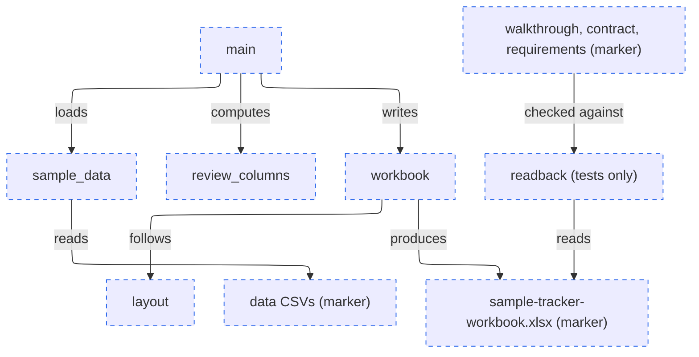

# Sample Tracker Workbook

## Purpose

A small, realistic sample of the final Excel tracker, generated from fictional data, so the team can review the proposed format of the sheets and give feedback before the real tracker is built.

## Navigation

[Job Behavior Specifications](../../README.md#navigation) / [Tracker Tools](../README.md#navigation) / **Sample Tracker Workbook**

- [Design](#design)
- [Technology](#technology)
- [Behavior](#behavior)
- [Relationships](#relationships)

## Design

Not built yet.

## Technology

Inherited from [Tracker Tools](../README.md#technology), with one departure: this component adds the pinned `exceljs` package to write the workbook (see [requirements.md](requirements.md#requirements)).

## Behavior

- **B1** When `generate --out <file> --as-of <date>` runs, then it writes one `.xlsx` with the sheets Read Me, Use Cases, Questions, Identity & Access, Workflow Mappings, Proposed Changes, Trace and Lists.
- **B2** When it runs twice on the same sample data and as-of date, then the two workbooks match cell for cell, with identical dropdowns, widths and formats (compared by reading them back).
- **B3** When the sample data is read, then it holds 5 fictional use cases across two vendors covering source located, empty, not located and uncertain mapping (supporting documents never clear a blocker), website sign-in and API access, and one endpoint shared by two use cases as separate rows per use case, endpoint and environment with no permissions assumed.
- **B4** When the question, review, acknowledgement, mapping and proposal data is read, then it shows unanswered, partially answered and complete-awaiting-review rows, a lead-requested clarification, an acknowledgement at a specific version, a workflow candidate awaiting a lead decision and a proposed tracker change awaiting review.
- **B5** When a reference dangles, a value is outside the schema's allowed list, or a value looks like a secret, then generation stops with an error naming it and writes no file.
- **B6** When the workbook is opened, then every enum column has a dropdown with a stop-alert listing the schema's `allowed_values`, read from `tracker-schema.csv` at generation.
- **B7** When question rows are shown, then `due_on` is the release date plus two working days, a complete answer awaiting lead review shows its owner and age and is not vendor-overdue, a clarification-requested row is overdue against its original due date even when the answer is complete, and a partial answer is overdue and a follow-up.
- **B8** When the layout is inspected, then headers and key columns are frozen, filters are on, widths are readable, each sheet and column is marked vendor-visible or internal (Workflow Mappings, Proposed Changes and Trace are internal) and nothing is hidden.
- **B9** When proposed and accepted values are compared, then main sheets hold accepted values only, proposals sit on Proposed Changes with a pending-change pointer on the affected row, and proposal metadata (proposal and update IDs, sources, base values) is on Trace and Proposed Changes.
- **B10** When the walkthrough, feedback questions and differences from the contract are checked against the workbook, then every sheet and column they name exists.

## Relationships

- [Tracker Data Contract](../../tracker-data-contract/README.md#purpose) — the schema, status lists, due-date rule and workbook layout guide the sample follows and departs from explicitly.
- [Tracker Tables](../tracker-tables/README.md#purpose) — the library that loads the schema, validates the sample CSVs and does the working-day arithmetic.

## Links

- [requirements.md](requirements.md#requirements) — what the component must do, what must match the contract and what need not, and the follow-on work.
- [contract.md](contract.md#contract) — the command, data file shapes, sheet order and every difference from the tracker contract.

## Plan

### Planned Navigation

[Job Behavior Specifications](../../README.md#navigation) / [Tracker Tools](../README.md#plan) / **Sample Tracker Workbook**

- [Planned Design](#planned-design)
  - [Planned Diagram](#planned-diagram)
- [Steps](#steps)
- [Acceptance Mapping](#acceptance-mapping)
- [Assumptions And Open Questions](#assumptions-and-open-questions)
- [Planned Relationships](#planned-relationships)
- [Planned Links](#planned-links)

### Planned Design

`generate --out <file> --as-of <YYYY-MM-DD>` is a thin adapter (`src/main.ts`) that loads the sample data, validates it, computes the review columns and writes the workbook, writing nothing when any check fails. The sample data is fictional and contract-shaped: `data/use-cases.csv`, `questions.csv`, `identity-access.csv` and `mappings.csv` carry the full schema columns, so the Tracker Tables library validates them against the real `tracker-schema.csv`; `proposed-changes.csv`, `trace.csv` and `headings.csv` (friendly heading, column group and visibility per column) are this component's own. `sample_data` loads and checks the data (references, allowed values, secrets); `review_columns` computes `due_on`, review state, days past original due and age awaiting review as values at the fixed as-of date; `layout` holds the layout rules (sheet order, tab colours, band, header fills, freeze, widths); `workbook` writes the eight sheets with Excel tables, named-range dropdowns and fixed timestamps. `readback` reads a workbook back into a plain structure for the tests only. The generated `sample-tracker-workbook.xlsx` is kept in the component for the team to open. The workbook is an internal sample: it mixes vendor-visible and internal columns and is not vendor-safe, and nothing in it is hidden.

#### Planned Diagram

### Steps

1. **Scaffold.** `package.json` (private, ES module, Node 26, one exact-pinned `exceljs`, a `generate` script), `package-lock.json`, `.gitignore` for `node_modules/`. The lockfile needs one network `npm install`, an external effect the builder must have the user approve in that turn.
2. **Data.** The seven files under `data/` for the 5 fictional use cases, as set out in `requirements.md`; as-of date 2026-11-16.
3. **`src/sample_data.ts`** (B3, B4, B5): loads the CSVs, validates contract tabs with the Tracker Tables schema functions, checks references (`use_case_ref`, `shared_with`, `blocking_question_refs`, pending-change pointers, trace records), identity references as names only, a secret-pattern scan over every cell and blank decision fields; reports all findings in one error.
4. **`src/review_columns.ts`** (B7): `due_on`, review state, days past original due (working days) and age awaiting review (calendar days, with owner), as values.
5. **`src/layout.ts`** (B6, B8, B9): sheet order, tab colours, row-1 band, blue and grey headers, freeze, filter, widths and wrap, the columns omitted from main sheets and the added `Pending change` column.
6. **`src/workbook.ts`**: Read Me (purpose, as-of date, colour key, column dictionary), Excel tables, Lists sheet with named ranges, stop-alert dropdowns from the schema, fixed created and modified timestamps.
7. **`src/readback.ts`**: reads sheets, tables, values, validations, widths, freeze, filters, tab colours and header fills back for the tests.
8. **`src/main.ts`** (B1, B5): the command; writes a temporary file then renames; exit 1 with the findings on invalid data and no output, exit 2 on bad usage.
9. **Tests** in `test/`, each title tagged `[B#]`, in real temporary directories: `generate`, `sample_data`, `review_columns`, `layout` and `docs`.
10. **Generate** `sample-tracker-workbook.xlsx` at the as-of date.
11. **Docs:** `walkthrough.md` (sheet tour, how the team uses each sheet, feedback questions, how to present the sample and capture feedback), the built `Design` and diagram in this README, and the already-written `requirements.md` and `contract.md`, kept in step. Docs name sheets and columns as `` `Sheet > Heading` `` so `docs.test` can check them.
12. **Validate:** `npm ci --prefix tracker-tools/sample-tracker-workbook`, then `node --test "tracker-tools/sample-tracker-workbook/test/*.test.ts"`, then the coverage check; no typecheck, lint or boundaries check is declared. No LibreOffice is installed, so visual inspection is the read-back assertions plus the user opening the file in Excel before the team session.

### Acceptance Mapping

| Acceptance | Behaviors | Step | Test |
| --- | --- | --- | --- |
| 1. `generate` writes the eight sheets, identically twice, nothing on invalid data | B1, B2, B5 | 3, 6, 8, 9 | `generate.test.ts`: `[B1]` sheets in order; `[B2]` two runs read back cell for cell with validations, widths and formats; `[B5]` dangling reference, off-list value and secret-like value each exit 1, name the item and leave no file |
| 2. Sample data covers every scenario with valid references and computed deadlines | B3, B4, B5, B7 | 2, 3, 4 | `sample_data.test.ts`: `[B3]`, `[B4]`, `[B5]` real data validates clean; `review_columns.test.ts`: `[B7]` due dates, awaiting-review age not overdue, clarification overdue on the original due date, partial answer overdue and follow-up, unreleased row blank |
| 3. Easy to review, proposed apart from accepted | B6, B8, B9 | 5, 6, 7 | `layout.test.ts`: `[B6]` every enum column's list equals the schema's; `[B8]` freeze, filter, widths, header colours, red internal tabs, nothing hidden; `[B9]` main sheets keep accepted values, pointer on the row, proposal metadata only on Proposed Changes and Trace |
| 4. Docs exist and agree | B10 | 11 | `docs.test.ts`: `[B10]` every `` `Sheet > Heading` `` named exists; the follow-on section exists |

Validation: the commands in step 12, narrowest first.

### Assumptions And Open Questions

Assumptions (override by telling the builder, or by editing the file named):

- Entry point `src/main.ts`, so the group's `adapterGlob` excludes it from coverage. Snake-case module names follow the siblings.
- The generated `sample-tracker-workbook.xlsx` is committed in the component. To untrack it, add it to `.gitignore`.
- `proposal_refs`, `source_links`, `evidence_refs` and `mr_link` are on Trace and `last_updated` is dropped from main sheets. Say which to keep on main sheets.
- Age awaiting review is in calendar days and days past due in working days (the contract sets neither unit for the summary; the layout guide uses calendar days for age). No holidays in the sample.
- Docs name sheets and columns as `` `Sheet > Heading` ``.
- Vendors (Harborline Analytics, Meridian Freight Systems), people, tickets and specification references are fictional. Edit the `data/` CSVs to change them.
- Two departures from the group's [requirements](../requirements.md#requirements) are recorded in this component's `requirements.md` and not edited in the group: one pinned `exceljs` dependency against "no dependencies", and writing `.xlsx` against "Excel file formats need not match". The group's Plan lists them for its owner to reconcile.
- The build needs the user's approval in its turn for one network `npm install`.
- Budget: the planner estimates USD 4 to 5.5 and 3,500 to 5,000 s against USD 8 and 7,200 s, a thin margin. Build data and tests first and keep the docs terse.

Open questions: none about behavior.

### Planned Relationships

- [Tracker Data Contract](../../tracker-data-contract/README.md#plan) — the schema, status lists, due-date rule and layout guide, followed and departed from as `contract.md` lists.
- [Tracker Tables](../tracker-tables/README.md#plan) — schema loading, validation and working-day arithmetic, imported by relative path.

### Planned Links

- [requirements.md](requirements.md#requirements) — requirements, the two departures and the follow-on work.
- [contract.md](contract.md#contract) — command, data shapes and differences from the contract.
