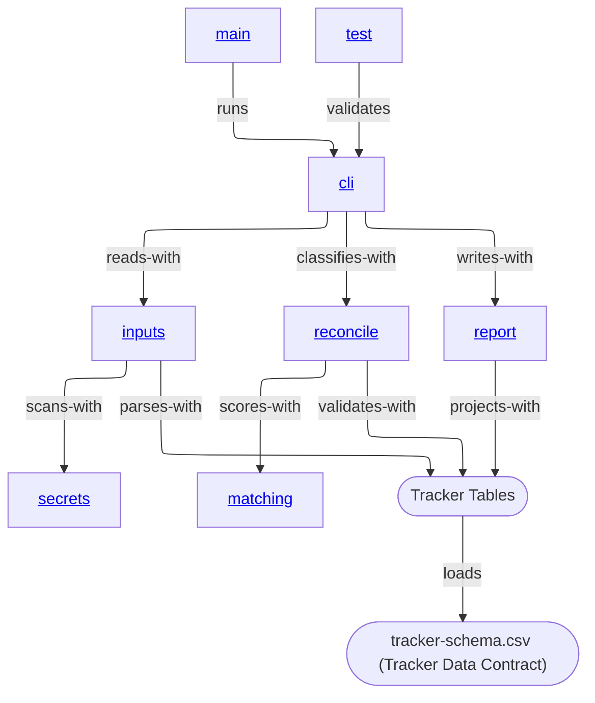

# Tracker Reconciler

## Purpose

A Node command line tool that compares reviewed tracker proposals with the latest tracker export and writes additions, field updates, conflicts and suggestions for a lead to review and apply by hand, never overwriting human edits.

## Navigation

[Job Behavior Specifications](../../README.md#navigation) / [Tracker Tools](../README.md#navigation) / **Tracker Reconciler**

- [Design](#design)
  - [Diagram](#diagram)
- [Technology](#technology)
- [Behavior](#behavior)
- [Relationships](#relationships)
- [Links](#links)
- [Plan](#plan)
  - [Planned Navigation](#planned-navigation)
  - [Planned Design](#planned-design)
  - [Planned Behavior](#planned-behavior)
  - [Steps](#steps)
  - [Acceptance Mapping](#acceptance-mapping)
  - [Assumptions And Open Questions](#assumptions-and-open-questions)
  - [Planned Relationships](#planned-relationships)
  - [Planned Links](#planned-links)

## Design

Two commands, `reconcile --export <dir> --proposals <dir> [--scope <slug>] --out <dir>` and `validate <file-or-dir>`, behind a thin adapter. [main](src/main.ts) only connects the process to [cli](src/cli.ts), which parses the arguments, calls the modules, prints and returns the exit status. [inputs](src/inputs.ts) reads and checks the files, [reconcile](src/reconcile.ts) classifies every proposed row against the export, [matching](src/matching.ts) scores question texts, and [report](src/report.ts) renders every output and writes them. [secrets](src/secrets.ts) recognises credential-looking values. Reading, validation, schema and the vendor projection come from the [Tracker Tables](../tracker-tables/README.md#design) library by relative import; the column list, owner classes, keys and visibility are read from `tracker-schema.csv` and never repeated in code.

How a run goes: every input is read and validated first (header, tab, field, operation, composed `update_id`, dates, use case names, CSV shape, secret-looking values, and the export's statuses, references and dates); any problem stops the run with exit status 1 and one `file: line N: message` per problem, before the output folder is touched. Then each proposed row is classified, all files are built in memory, and they are written into a temporary sibling folder that replaces the output folder, so an input error leaves no partial output and an earlier run's output as it was.

Decisions (record of the build; override in chat):

- **Rows in order.** Proposal files are found recursively under `--proposals` and sorted by path; rows keep their file order, so the same inputs give byte-identical files. The report holds no absolute path and no run date.
- **Rejected rows** (listed with a reason in the report, never fatal): a table that proposals do not address (Question Groups, Question Links, Batches), a forbidden or computed field, `proposal_refs`, a central reference column, a `request_status` other than `proposed` or `ready-to-raise`, `question_text` on a released row (the new wording goes to `current_spec_text`), `suggest` on a spec field, `link` on a non-list field, a row that is not an `add` for a record absent from the export, and a value outside its schema list or format.
- **Finding the record.** A proposal's `record_key` is matched to an export row by its `update_id` prefix in `proposal_refs`, else by natural key: the use case name, a `spec_refs` entry (version dropped) for a question, the use case plus `workflow_candidate` slug for a mapping, the use case plus endpoint and environment for access. A use case is named in a key by its name or by its kebab-case form, as the proposer writes it.
- **Already reflected.** A row yields nothing when its `update_id` is in the record's `proposal_refs`, or its value equals the export (a `link` item already in the list). An `add` on an existing record is treated field by field the same way. This is what makes applying the additions and re-running give nothing.
- **Human-field `set` rows** are always suggestions, even when their `base_value` differs from the export, so a `base-mismatch` conflict is only raised for spec fields; nothing human-owned is ever overwritten either way.
- **Version-only changes.** Re-review follows the stated impact; a proposer states `not-expected` for a version-only or wording change, which suggests nothing. A version change with no stated impact (and none in the export) is unknown and is listed, never treated as no impact.
- **Spec fields** become a field update (current and proposed, a `link` appends missing items in order) unless a conflict applies. **Human fields** (a `set`, `suggest` or `link` on an existing record, or any value on an `add`) are suggestions only; a blank suggestion is ignored.
- **Conflicts.** `base-mismatch` (a `set` whose `base_value` differs from the export), `later-edit` (the row's `last_updated` is later than the proposal's `created_on`), `stale-export` (the manifest's `exported_at` date is before the proposal's `created_on`, applied to each change that would update an existing record, so additions of records absent from the export are still reported) and `proposal-disagreement` (two proposals give a spec field different values). A conflict is listed with both values and never resolved. It holds its record and every change that refers to it (the same record, the rows of a use case in conflict, a mapping that names a conflicted question as blocking); those are listed in `conflicts.csv` with kind `held` and the detail `held by <conflict id>`, and unrelated changes are reported as usual. Held changes produce no addition, update or suggestion.
- **Additions** get the next central reference after the highest `AA-nnn` found anywhere in the export, marked `suggested`, so an export reference is never reused; spec fields are plain columns, human fields appear as `suggested_<column>`, and `trace_source`, `trace_spec_version` (the `@version` of the source) and `trace_mr_link` carry the traceability. `suggested_proposal_refs` lists the update ids a lead pastes into `proposal_refs` when applying. No answer column is ever written.
- **Link suggestions** compare each new question's suggested text with the export's question rows and the earlier new rows, by normalised text and token overlap (lower case, accents and punctuation dropped, a short stop-word list removed): score 1 for equal normalised text, else the Jaccard overlap. A score of 0.5 or more is suggested, 0.8 or more is `likely`, between is `uncertain-review`. Nothing is linked, grouped, merged or answered.
- **Re-review** is suggested when a version change is not held and a decided mapping (a `decision_ref` or an accepted or rejected status) of that use case considered only older versions (none recorded counts as older). The impact is the lead's `grouping_impact_lead` (`could-affect` suggests, `no-impact` does not), else the proposal's `grouping_impact`, else the export's, else unknown. `could-affect` and unknown suggest, `not-expected` does not, and unknown is listed as `impact: unknown`. It suggests `mapping_status` `re-review-suggested` and never touches decision fields.
- **Vendor folders** hold, for each vendor name found in the export (folder name: the name in kebab case; two names with the same folder name stop the run), the vendor view of the export from the library (that vendor's rows, released question rows only, vendor-visible columns, no group, link, mapping or unreleased row, no reference to a hidden row) and a `field-updates.csv` of the non-held spec updates for those visible rows and columns (never the `vendor` field itself) with hidden references dropped from list values. Additions, conflicts and suggestions are internal only. `--scope <slug>` names the manifest row used for the stale check (default `internal`); a vendor scope limits `vendor/` to that vendor, and the master export stays authoritative.
- **Output folder** may be new, empty or hold only a previous run's own files (`reconciliation-report.md`, `field-updates.csv`, `conflicts.csv`, `suggestions.csv`, `additions/<tab>.csv`, `vendor/<slug>/<tab>.csv`, checked file by file); anything else, or a folder that contains or sits inside an input, is refused.
- **Unknown use case names** are checked in `reconcile` only (it knows the export); `validate` checks shape, header, tab, field, dates, composed `update_id`, secrets and, for an export, the schema lists. A reported line is the CSV record number with the header as line 1, and a proposals folder with no `tracker-updates.csv` is an input error.

### Diagram

## Technology

Inherited from [Tracker Tools](../README.md#technology): Node 26 with native TypeScript (erasable syntax, `.ts` import extensions), no dependencies, `node:test`, ES modules. The declared checks are `test` and `coverage`; no typecheck, lint or boundaries check exists because each would need a dev dependency. Tests use real temporary directories for the export, the proposals and the output, drive the commands through `cli`, read the real `tracker-data-contract/tracker-schema.csv` and the proposer's example `tracker-updates.csv` by relative path, and spawn `main` once as the adapter smoke test. [main](src/main.ts) is the adapter excluded from unit coverage by `adapterGlob`; argument parsing is in [cli](src/cli.ts) so it is unit tested.

## Behavior

- **B01** When a proposed record is absent from the export, then it is an addition in the per-tab file with its source, specification version and MR link, human-owned fields shown as suggestions, and a suggested reference that never reuses an export reference.
- **B02** When a spec-owned field differs on an existing row, then a field update lists the current and the proposed value, a human-owned field is never overwritten and is suggested only, and forbidden fields are rejected; a changed question wording appears as a `current_spec_text` update with a text-review suggestion and never touches the released question text or an answer.
- **B03** When the same inputs are run twice, then the outputs are identical, and a proposal already reflected in the export (an equal value, or its `update_id` in `proposal_refs`) yields nothing.
- **B04** When a proposal's `base_value` differs from the export, or a row's `last_updated` is later than the proposal's `created_on`, then it is a conflict listing both values and is never resolved silently; the affected record and the changes of rows that refer to it are held with it, and unrelated safe changes are still reported.
- **B05** When a new question row's text is similar to an existing row, then a link suggestion to that row is listed, uncertain matches are marked for review, nothing is linked, merged or grouped automatically, and no answer is copied or inherited by the new row.
- **B06** When a proposal sets `released_on`, `batch_ref`, an answer or answer status, an acknowledgement, a ticket, verification or a decision, then it is rejected, and release status comes only from the tracker.
- **B07** When a decided mapping's `spec_versions_considered` is older than the proposed version, then it suggests re-review with the reason only when the use case's grouping impact is could-affect or unknown (a lead's override replaces the suggestion), lists an unknown impact as unknown and never as no impact, suggests nothing for a not-expected impact or a version-only or wording change, and never edits decision fields.
- **B08** When it writes vendor outputs, then each `vendor/<slug>/` holds only that vendor's released question rows and vendor-visible columns, and internal tabs, internal columns, groups, links and cross-vendor suggestions appear only in the internal outputs.
- **B09** When an input has a bad header, an unknown tab or field, an unknown use case name, malformed CSV or a secret-looking value, then it exits 1 naming the file and line and writes no partial output.
- **B10** When it is run, then it never changes or reassigns an existing central reference, answer, answer status, owner, status, ticket, date, acknowledgement or released question text, never releases or applies anything, and a repeated run does not overwrite a newer human edit.

## Relationships

- [Tracker Data Contract](../../tracker-data-contract/README.md#purpose) — the schema, reference scheme, field classes, proposal and export formats the tool implements.
- [Tracker Tables](../tracker-tables/README.md#purpose) — the library the tool uses to read, validate and write tables and to build vendor views.

## Links

- [requirements.md](requirements.md#requirements) — what the component must do and what it need not.
- [contract.md](contract.md#contract) — the shapes, formats and wording rules.
- [src/main.ts](src/main.ts) — the adapter: connects the process arguments, output and exit status to `cli`.
- [src/cli.ts](src/cli.ts) — argument parsing and the `reconcile` and `validate` commands.
- [src/inputs.ts](src/inputs.ts) — reading and checking the export and the proposal files.
- [src/reconcile.ts](src/reconcile.ts) — classification of each proposed row, conflicts, holds and suggestions.
- [src/matching.ts](src/matching.ts) — text normalisation, similarity and the recorded thresholds.
- [src/report.ts](src/report.ts) — the report, the files, the vendor copies and the safe write.
- [src/secrets.ts](src/secrets.ts) — recognition of credential-looking values.
- [test/reconcile.test.ts](test/reconcile.test.ts) — tests for B01, B02, B04 to B07 and B10; `repeat.test.ts` covers B03, `vendor.test.ts` B08 and `input.test.ts` B09.

## Plan

### Planned Navigation

[Job Behavior Specifications](../../README.md#plan) / [Tracker Tools](../README.md#plan) / **Tracker Reconciler**

- [Planned Design](#planned-design)
- [Planned Behavior](#planned-behavior)
- [Steps](#steps)
- [Acceptance Mapping](#acceptance-mapping)
- [Assumptions And Open Questions](#assumptions-and-open-questions)
- [Planned Relationships](#planned-relationships)
- [Planned Links](#planned-links)

### Planned Design

The reconciler identifies a use case by its use case ID, `uc-<vendor-slug>-<use-case-slug>`, instead of its name, so two vendors' same-named use cases are never merged or matched to each other's rows. The structure does not change (no new module, no new output column), so there is no Planned Diagram. What changes is how a key is read:

- **Known IDs.** `loadProposals` builds the set of known IDs from the export's Use Cases rows (each derived with `useCaseId(vendor, use_case_name)` from [Tracker Tables](../tracker-tables/README.md#planned-design); a row with no ID adds nothing) and from the `record_key` of every `add` change on the Use Cases tab. The name form and the slug-alone form are no longer accepted anywhere.
- **Leading ID.** `useCaseOf` resolves a key's leading ID: a Use Cases key must equal a known ID; a Questions key starts with `<id>/`, a Mappings key with `<id>->>` and an Access key with `<id>/`; the longest known ID wins, as the longest label does today. `Change.useCase` holds the ID.
- **Errors.** A key whose leading ID is not known stops the run: `<file>: line <n>: unknown use case ID in record_key "<key>"; expected uc-<vendor-slug>-<use-case-slug> (an ID of a Use Cases row in the export or of a Use Cases add), as in <id>/Q<n>`. A Questions `use_case_name` value is still checked, now against the use case the key names: it must equal that use case's name (the export row's `use_case_name`, or the `use_case_name` value of the Use Cases add), else `<file>: line <n>: use_case_name "<value>" does not belong to use case ID <id>`. Two export Use Cases rows that derive the same ID stop the run before anything else: `<export>/use-cases.csv: line <n>: use case ID <id> is also derived by line <m>; make the vendor or the name differ`.
- **Natural key.** `matchesNaturalKey` in [reconcile.ts](src/reconcile.ts) derives the ID of the export row's use case (a Use Cases row from its own columns, any other tab through `use_case_ref`) and compares: a Use Cases key to that ID, a Questions key to a `spec_refs` entry without `@v` (unchanged code, new form), a Mappings key to `<id>->><slug of workflow_candidate>`, an Access key to `<id>/<endpoint>/<environment>`. The name and slug labels are removed.
- **Traceability.** The `mr_link` of an addition in [report.ts](src/report.ts) looks the use case up by `record_key === useCase` (now the ID) among the proposals, else by `useCaseId(vendor, use_case_name) === useCase` among the export rows.

The exact contract wording is in [contract.md](contract.md#planned-use-case-id-keys); nothing in the outputs changes shape (`local_key` and `record_key` simply hold the new form), the vendor folders and the vendor view are not touched, and the reconciler's private `slug` stays for the mapping candidate and the vendor folder name only (not a use case ID copy).

### Planned Behavior

Reworded and added behaviors; the rest (`B02`, `B04` to `B08`, `B10`) keep their text and their tests are only re-keyed.

- **B01** When a proposed record is absent from the export, then it is an addition in the per-tab file with its local key (built from the use case ID), source, specification version and MR link (the MR link of the same use case ID, from a proposal row or the export), human-owned fields shown as suggestions, and a suggested reference that never reuses an export reference.
- **B09** When an input has a bad header, an unknown tab or field, a key whose leading use case ID is unknown (or is written as the use case name or its slug), a `use_case_name` value that does not belong to the key's use case ID, two export Use Cases rows that derive the same use case ID, malformed CSV or a secret-looking value, then it exits 1 naming the file and line and writes no partial output.
- **B11** When two vendors have use cases with the same name (two IDs, `uc-<vendor-a>-<name>` and `uc-<vendor-b>-<name>`), then their use case additions, their question 1 additions and their updates are separate records under their own IDs, a key reaches only its own ID's row, and nothing is merged or matched to the other vendor's row; a similar question text is at most a link suggestion.

### Steps

1. [src/inputs.ts](src/inputs.ts): update the `Change.useCase` comment (line ~36, "the use case ID"); rewrite `useCaseOf` (lines ~183 to 189) to take the set of known IDs and return the longest known ID that equals the Use Cases key or starts the key plus its separator, dropping the name and slug labels (the exported `slug` stays only for the reconciler's own mapping candidate and vendor folder); in `loadProposals` (lines ~215 to 223) build the known IDs from `useCaseId` over the export Use Cases rows and from the Use Cases `add` keys, add the duplicate-ID problem, replace the `unknown use case name` messages with the two messages above and compare a Questions `use_case_name` value with the name of the key's use case. Update the doc comment of `loadProposals`. Import `useCaseId` from `../../tracker-tables/src/use_case_id.ts`.
2. [src/reconcile.ts](src/reconcile.ts): rewrite `matchesNaturalKey` (lines ~52 to 61) as above, with `useCaseNames` replaced by a map from `use_case_ref` to the derived ID; keep `slug` for the workflow candidate (import line 3); line ~165 (`Use Cases|${c.useCase}`) and lines ~228 to 239 need no change because the keys and `useCase` are the same strings.
3. [src/report.ts](src/report.ts): the `mr` lookup (line ~30) compares the export row through `useCaseId(r.vendor, r.use_case_name) === useCase`; `slug` (import line 6, use at ~120) stays for the vendor folder name.
4. Tests, all with `uc-` keys and the fixtures' vendors: [test/fixtures.ts](test/fixtures.ts) (`spec_refs` on lines 12 to 15 become `uc-acme-daily-report/Q1@v1` and the like; the Use Cases rows already carry vendor and name, so their IDs are `uc-acme-daily-report`, `uc-beta-nightly-sync`, `uc-gamma-invoice-feed`); [test/support.ts](test/support.ts) (an exported `ids` constant for those three IDs so tests do not repeat the strings); [test/reconcile.test.ts](test/reconcile.test.ts) (the key on line 28, `Use Cases` keys on lines 40, 69 to 72, 83, 97 to 99, 116 to 118, 153 to 156, 188 to 189, 205 to 217, 288 to 297, 351 to 355 and 415 to 438, the `update_id` and `proposal_refs` strings on lines 64, 90, 166 to 172 and 210 to 211, and the `local_key` expectations on lines 76 and 111); [test/repeat.test.ts](test/repeat.test.ts) (lines 11 to 17, 41 to 51, and the example-proposal test on lines ~103 to 125: its expected `local_key` values come from the regenerated proposer example, so read the example's ID instead of hard-coding the old name); [test/vendor.test.ts](test/vendor.test.ts) (lines 11, 17 to 24, 110); [test/input.test.ts](test/input.test.ts) (lines 11, 45 to 47 for the unknown ID, an old name key and a slug-alone key, 69 to 73, 81 to 88, and one test for the duplicate export ID). Add the two-vendor test for `B11` in `reconcile.test.ts`: an export where two vendors have a `Daily Report` and each has a question 1 in `spec_refs`, proposals that set each use case's `current_version` and add question 2 for each, each change reaching only its own row; and an empty-export run where both vendors' use cases and question 1 are additions (two `UC-` and two `QN-` suggested references, `local_key` values `uc-acme-daily-report` and `uc-beta-daily-report`), where equal question texts give a link suggestion and never a merge.
5. [README.md](README.md) and [contract.md](contract.md): move the planned content in: Design line 22 ("use case names" becomes "use case IDs"), line 28 ("Finding the record": a use case is named in a key by its ID, and the name and the slug form are not valid), line 39 ("Unknown use case names" becomes "Unknown use case IDs" with the messages and the duplicate-ID rule), `B01`, `B09`, a new `B11`, and the link to the new test. In [requirements.md](requirements.md), change the last bullet (`unknown use case name`) to the use case ID wording in the planned note. The skills and fixtures of other components are not touched here.
6. Run `test` and `coverage`; the vendor outputs and every other output are byte-identical for the same data apart from the key strings.

### Acceptance Mapping

| Acceptance | Behaviors | Step | Check |
| --- | --- | --- | --- |
| 1. A key's leading use case ID resolves against the export Use Cases rows (derived from vendor and name) and Use Cases adds in all four tabs, `Change.useCase` holds the ID, and the name and slug forms are not accepted; the natural-key match and the `mr_link` lookup use the ID. | B01, B03 | 1 to 3 | `reconcile.test.ts`, `repeat.test.ts` |
| 2. An unknown ID, a name or slug key, a `use_case_name` value that does not belong to the key's ID, and two export Use Cases rows deriving one ID each exit 1 naming the file, line and expected form and write nothing. | B09 | 1, 4 | `input.test.ts` |
| 3. Two same-named use cases of different vendors reconcile as separate records, never merged or matched. | B11 | 4 | the new test in `reconcile.test.ts` |
| 4. Every reconcile, repeat, vendor, input, support and fixture test is rewritten to ID keys and passes with unchanged outputs apart from the key strings, and vendor outputs stay vendor-safe. | B02, B04 to B08, B10 | 4, 6 | `test` and `coverage` |

### Assumptions And Open Questions

Assumptions (override by telling the builder, or by editing the file named):

- **A `use_case_name` value is checked against the key's use case, not dropped.** It protects against a typo in the readable name; override by dropping the check (then only the key is validated).
- **An `add` key is trusted as the ID.** The reconciler does not check that a Use Cases add's `record_key` equals the ID its own `vendor` and `use_case_name` values would derive; a skill that wrote a different key has broken the contract. Override by adding that check (it needs the add's vendor and name values, so it is a new error).
- **Errors name the ID form, not the old keys.** A name or slug key gets the same `unknown use case ID` error as any other unknown ID, with the expected form in the message; there is no special "old form" message and no migration.
- **`validate` does not check IDs.** Like unknown names today, an unknown ID is found only in `reconcile`, which knows the export; `validate` still checks shape, header, tab, field, dates, `update_id` and secrets.
- **The two-row duplicate stops the run** (an input error, `B09`) rather than the first match winning, as the brief asks; the line is the CSV record number, header as line 1.
- **Existing tests read the proposer's example** for the website case (`repeat.test.ts`); that example is regenerated by the Tracker Update Proposer component, which builds before this one, with a fictional vendor, so the test reads its use case ID from the file.
- **Planner findings checked.** The listed places (inputs.ts `useCaseOf` and `loadProposals`, reconcile.ts `matchesNaturalKey`, report.ts line 30) are right; also needed and not listed: the `use_case_name` value check in `loadProposals` (the old name check cannot work against IDs), the `Change.useCase` comment, `support.ts` for shared IDs and the `update_id`/`proposal_refs` strings in the tests. `slug` cannot be removed (the mapping candidate and the vendor folder use it). The exporter and the workbook updaters read `Change.useCase`, so their expectations change with this component.

Open questions: none.

### Planned Relationships

It depends on [Tracker Tables](../tracker-tables/README.md#planned-design) (`useCaseId`) and on the [Tracker Data Contract](../../tracker-data-contract/README.md#planned-design) (the key forms) and on the [Tracker Update Proposer](../../tracker-update-proposer/README.md#planned-design) (its example proposal, read by a test), so it builds after them. The [Review CSV Exporter](../review-csv-exporter/README.md#planned-design), the [Vendor Workbook Updater](../vendor-workbook-updater/README.md#design) and the [Master Workbook Updater](../master-workbook-updater/README.md#design) import its loaders and need the new `Change.useCase`, so they build after it; the exporter's fixtures also import this component's `fixtures.ts` and `support.ts`.

### Planned Links

- [contract.md](contract.md#planned-use-case-id-keys) — the exact planned wording.
