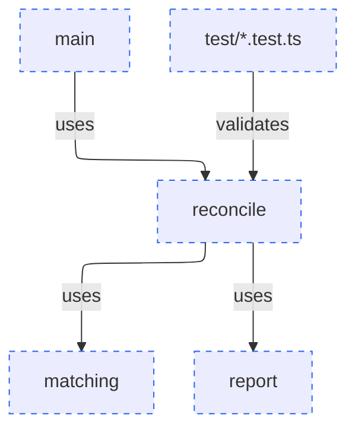

# Tracker Reconciler

## Purpose

A Node command line tool that compares reviewed tracker proposals with the latest tracker export and writes additions, field updates, conflicts and suggestions for a lead to review and apply by hand, never overwriting human edits.

## Navigation

[Job Behavior Specifications](../../README.md#navigation) / [Tracker Tools](../README.md#navigation) / **Tracker Reconciler**

- [Design](#design)
- [Behavior](#behavior)
- [Plan](#plan)
- [Relationships](#relationships)
- [Links](#links)

## Design

Not built yet.

## Behavior

- **B01** When a proposed record is absent from the export, then it is an addition in the per-tab file with its source, specification version and MR link, human-owned fields shown as suggestions, and a suggested reference that never reuses an export reference.
- **B02** When a spec-owned field differs on an existing row, then a field update lists the current and the proposed value, a human-owned field is never overwritten and is suggested only, and forbidden fields are rejected; a changed question wording appears as a `current_spec_text` update with a text-review suggestion and never touches the released question text or an answer.
- **B03** When the same inputs are run twice, then the outputs are identical, and a proposal already reflected in the export (an equal value, or its `update_id` in `proposal_refs`) yields nothing.
- **B04** When a proposal's `base_value` differs from the export, or a row's `last_updated` is later than the proposal's `created_on`, then it is a conflict listing both values and is never resolved silently; the affected record and the changes of rows that refer to it are held with it, and unrelated safe changes are still reported.
- **B05** When a new question row's text is similar to an existing row, then a link suggestion to that row is listed, uncertain matches are marked for review, nothing is linked, merged or grouped automatically, and no answer is copied or inherited by the new row.
- **B06** When a proposal sets `released_on`, `batch_ref`, an answer or answer status, an acknowledgement, a ticket, verification or a decision, then it is rejected, and release status comes only from the tracker.
- **B07** When a decided mapping's `spec_versions_considered` is older than the proposed version, then it suggests re-review with the reason only when the use case's grouping impact is could-affect or unknown (a lead's override replaces the suggestion), lists an unknown impact as unknown and never as no impact, suggests nothing for a not-expected impact or a version-only or wording change, and never edits decision fields.
- **B08** When it writes vendor outputs, then each `vendor/<slug>/` holds only that vendor's released question rows and vendor-visible columns, and internal tabs, internal columns, groups, links and cross-vendor suggestions appear only in the internal outputs.
- **B09** When an input has a bad header, an unknown tab or field, an unknown use case name, malformed CSV or a secret-looking value, then it exits 1 naming the file and line and writes no partial output.
- **B10** When it is run, then it never changes or reassigns an existing central reference, answer, answer status, owner, status, ticket, date, acknowledgement or released question text, never releases or applies anything, and a repeated run does not overwrite a newer human edit.

## Plan

### Planned Navigation

[Job Behavior Specifications](../../README.md#plan) / [Tracker Tools](../README.md#plan) / **Tracker Reconciler**

- [Planned Design](#planned-design)
  - [Planned Diagram](#planned-diagram)
- [Steps](#steps)
- [Acceptance Mapping](#acceptance-mapping)
- [Assumptions And Open Questions](#assumptions-and-open-questions)
- [Planned Relationships](#planned-relationships)
- [Planned Links](#planned-links)

### Planned Design

A thin command line adapter parses the two commands. The reconcile module classifies each proposed update against the export; the matching module normalizes question text for duplicate suggestions; the report module writes the files. The tests build real exports and proposals in temporary directories.

#### Planned Diagram

### Steps

1. Write `src/reconcile.ts`, `src/matching.ts`, `src/report.ts` and the adapter `src/main.ts`, using `tracker-tables` for reading, validation and vendor views.
2. Write `test/*.test.ts` with each test titled with its behavior tag, including fixtures with owners, answers per use case, tickets, dates and acknowledgements, base mismatches and stale exports, a reworded released question, a behavior change that could affect grouping, a behavior change with no grouping impact, an unknown impact, a lead override and a version-only change, and a three-vendor export that includes unreleased rows and groups.
3. Run the declared `test` and `coverage` checks and the record validators.

### Acceptance Mapping

| Acceptance condition | Behaviors | Step | Validation |
| --- | --- | --- | --- |
| Human-owned fields, per-row answers, released text and existing references are preserved and forbidden fields are rejected (B02, B06, B10). | B02, B06, B10 | 2 | `[B02]`, `[B06]`, `[B10]` tests with human-field fixtures |
| A repeated run is identical and creates no duplicates (B03). | B03 | 2 | `[B03]` test running twice and applying additions then re-running |
| Conflicts hold the affected record and the rows that refer to it while unrelated safe changes are still reported, and re-review follows the grouping impact with unknown kept visible and lead overrides respected (B04, B07). | B04, B07 | 2 | `[B04]`, `[B07]` tests |
| Vendor-safe outputs are separated with no group, link or unreleased row, and bad input stops the run with nothing written (B08, B09). | B08, B09 | 2 | `[B08]`, `[B09]` tests |
| Similar rows are suggested and never linked, merged or given an inherited answer, and additions carry traceability (B01, B05). | B01, B05 | 2 | `[B01]`, `[B05]` tests |

Checks: the declared `test` and `coverage` checks apply (inherited from Tracker Tools).

### Assumptions And Open Questions

Assumptions (override any of them in chat before `/craft:build`):

1. Similarity matching between question rows is deterministic: normalized text and token overlap with a threshold chosen at build and recorded in the contract. Uncertain matches go to review and nothing is linked, merged or grouped automatically. Override: ask for a different rule.
2. The tool reads the master export. A vendor workbook export can be passed with `--scope` for checks, but the master stays authoritative (confirmed by the user).
3. Leads apply the output to SharePoint by hand; the tool writes only to its output directory, and never releases a question or applies a proposal.
4. A conflict holds the affected record and the changes of rows that refer to it, and unrelated safe changes are still reported; the conflict is never resolved silently (confirmed).
5. Re-review uses the grouping-impact assessment (the lead's override first, else the proposer's suggestion) and not the behavior-change class alone; unknown impact is listed for a lead (confirmed).
6. Similarity checking between question rows is the reconciler's alone (the proposer writes no link rows); the reconciler suggests, and a lead creates links and groups by hand (confirmed in the 2026-11-15 assessment fixes).

Open questions: none about behavior.

### Planned Relationships

- [Tracker Data Contract](../../tracker-data-contract/README.md#plan) — the schema, reference scheme, field classes, proposal and export formats the tool implements.
- [Tracker Tables](../tracker-tables/README.md#plan) — the library the tool uses to read, validate and write tables and to build vendor views.

### Planned Links

- [requirements.md](requirements.md#requirements) — what the component must do and what it need not.
- [contract.md](contract.md#contract) — the shapes, formats and wording rules.

## Relationships

- [Tracker Data Contract](../../tracker-data-contract/README.md#purpose) — the schema, reference scheme, field classes, proposal and export formats the tool implements.
- [Tracker Tables](../tracker-tables/README.md#purpose) — the library the tool uses to read, validate and write tables and to build vendor views.

## Links

- [requirements.md](requirements.md#requirements) — what the component must do and what it need not.
- [contract.md](contract.md#contract) — the shapes, formats and wording rules.
