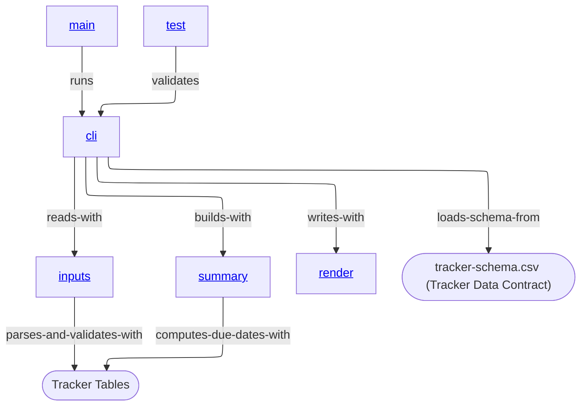

# Tracker Summary

## Purpose

A Node command line tool that writes the internal daily summary across all vendor tracks from a tracker export: use cases by stage, overdue questions, blocked items, access actions, mappings pending a decision and next batch suggestions.

## Navigation

[Job Behavior Specifications](../../README.md#navigation) / [Tracker Tools](../README.md#navigation) / **Tracker Summary**

- [Design](#design)
  - [Diagram](#diagram)
- [Technology](#technology)
- [Behavior](#behavior)
- [Relationships](#relationships)
- [Links](#links)

## Design

`summary --export <dir> [--date <YYYY-MM-DD>] [--holidays <file>] --out <file>` is a thin adapter ([main](src/main.ts)) over [cli](src/cli.ts), which parses the options and runs the pipeline in process. [inputs](src/inputs.ts) reads `manifest.csv` and the five tabs the summary needs (Use Cases, Questions, Mappings, Identity & Access, Batches) through the table library, and collects every problem (an unreadable or malformed file, a missing column, a value outside the schema's list or date format) into one error that names the file, row and field. [summary](src/summary.ts) turns the tables into a structured summary, and [render](src/render.ts) writes it as Markdown, one numbered section per item of the call agenda: Status, Overdue questions, Pending acknowledgements, Missing source and other blockers, Identity and access, Mappings, Next batches and capacity, Unassigned. The file opens with an `INTERNAL` line. The output is written only after everything has been read and built, so an error leaves no file, and the export is only ever read (an `--out` inside the export folder is refused).

Decisions (record of the build; override in chat):

- Vendor tracks are the distinct `vendor` values of the Use Cases tab, sorted; a blank vendor is `unassigned`. The stage columns come from the schema's `allowed_values` for `stage`, plus a `no stage` column for a blank stage.
- A question row counts only when `released_on` is set. Overdue uses `isOverdue` from the table library with `due_on` (or the due date computed from `released_on` and the holidays when `due_on` is blank): after `due_on`, status `released` or `clarification-requested`, and for `released` an answer status other than `answered`. "Days overdue" is the number of calendar days after `due_on` (the unit is not set by the contract). Rows are grouped under the question's `our_owner`, with `unassigned` last; a cannot-answer row also shows its `resolver`.
- A complete answer awaiting lead review is a released row with answer status `answered`; its age is calendar days since `answered_on`, or `unknown` when that is blank. It is listed whether or not the due date has passed and is never in the overdue list.
- A source blocker is a use case whose `source_status` is `not-located`, `empty`, `confirmed-unavailable` or `uncertain-mapping`, listed in that order with its own status, its `source_owner` and the count of supporting documents, which never clear it. Other blockers are use cases with a `blocked_reason` (owner `our_owner`), questions with `blocks_mapping` `yes` that are still captured, released or clarification-requested (owner `our_owner`), and access requests with status `blocked` (owner `our_coordinator`, with the vendor action owner and affected workflow).
- Access rows show the use case's acknowledgement (`acknowledged <version> on <date>` when `acknowledged_on` is set, else `not acknowledged`, or `unknown` for a use case missing from the export) apart from `request_status` and `verification`; a blank or `unknown` expected availability, verification or status is shown as `unknown`, and a blank coordinator or vendor action owner as `unassigned`.
- A mapping is listed when its status is `candidate`, `pending-clarification` or `re-review-suggested`; its grouping impact is read from the use case (blank is `unknown`) with the lead's `grouping_impact_lead` beside it.
- A use case is unreleased when it has no question with `released_on` and is in no batch with `released_on`. Unreleased use cases are grouped by vendor and `workflow_candidate` (blank is `no workflow candidate`), ranked by group size, then vendor, then workflow. Limits come from planned batches (not released, not closed) and are shown as `provisional`; no distribution is computed.
- Unassigned lists pending actions (use cases and access requests with a `next_action` and no `next_action_owner`), source blockers with no `source_owner`, listed questions (overdue or awaiting review) with no `our_owner`, and open cannot-answer rows with no `resolver`.
- The Question Groups and Question Links tabs are not read, so an export without them is accepted; the manifest must exist and have its four columns.

### Diagram

## Technology

Inherited from [Tracker Tools](../README.md#technology): Node 26 with native TypeScript (erasable syntax, `.ts` import extensions), no dependencies, `node:test`, ES modules. The declared checks are `test` and `coverage`; no typecheck, lint or boundaries check exists because each would need a dev dependency. Tests run the command in process against real temporary directories holding a three-vendor fixture, and read the real `tracker-data-contract/tracker-schema.csv` by relative path.

## Behavior

- **B01** When it reads an export, then it counts use cases per vendor track and per stage: draft, review, sent, awaiting-acknowledgement and acknowledged.
- **B02** When a released question row is open and the date is after `due_on`, then it is listed as overdue from day three with its original due date, grouped by owner, a partially answered or cannot-answer row stays overdue and is also marked follow-up (a cannot-answer row shows its resolver or `unassigned`), a clarification-requested row is overdue on its original due date even when the vendor's answer status is complete, a complete answer awaiting lead review is listed separately with its owner and age and is not vendor-overdue, and captured or unreleased rows are never counted.
- **B03** When a use case has a missing, empty, unlocated or uncertain source, a `blocked_reason`, an open mapping-blocking question or a blocked access request, then it is listed as blocked with its owner, and source blockers are listed first with not-located, empty, confirmed-unavailable and uncertain-mapping kept distinct.
- **B04** When access requests are listed, then each use case and endpoint row shows coordinator, vendor action owner, status and expected availability (blank or `unknown` is shown as `unknown`), and approval or provisioning, verified access and acknowledgement are shown separately.
- **B05** When mappings are read, then those pending a decision, pending clarification or suggested for re-review are listed, and a use case whose grouping impact is unknown is shown as unknown.
- **B06** When next batches are suggested, then they are advisory, group unreleased use cases by workflow candidate per vendor, rank by the number of use cases they unblock, show provisional limits as provisional, invent no distribution, and never release a question or set a commitment.
- **B07** When a pending action, source blocker, question or cannot-answer row has no owner or resolver, then it is flagged `unassigned`.
- **B08** When the export lacks a file, a column or a valid status, then it errors naming it or reports the unrecognized status, and writes no partial summary.
- **B09** When it writes the summary, then the sections follow the call agenda (overdue, pending acknowledgements, missing-source and other blockers, identity and access, next batches and capacity), the tracks are those found in the data, and the output is marked internal.
- **B10** When it is run twice with the same export and date, then the output is identical.

## Relationships

- [Tracker Data Contract](../../tracker-data-contract/README.md#purpose) — the schema, stage and status lists and the due-date rule the summary applies.
- [Tracker Tables](../tracker-tables/README.md#purpose) — the library the tool uses to read and validate the export and to compute due dates.

## Links

- [requirements.md](requirements.md#requirements) — what the component must do and what it need not.
- [contract.md](contract.md#contract) — the shapes, formats and wording rules.
- [src/cli.ts](src/cli.ts) — option parsing and the run of the command.
- [src/inputs.ts](src/inputs.ts) — reading and validating the export.
- [src/summary.ts](src/summary.ts) — building each section.
- [src/render.ts](src/render.ts) — the Markdown output.
- [test/summary.test.ts](test/summary.test.ts) — tests for B01 to B07; [test/cli.test.ts](test/cli.test.ts) covers B08 to B10.
