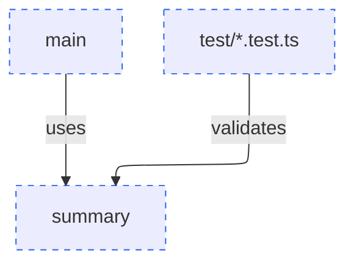

# Tracker Summary

## Purpose

A Node command line tool that writes the internal daily summary across all vendor tracks from a tracker export: use cases by stage, overdue questions, blocked items, access actions, mappings pending a decision and next batch suggestions.

## Navigation

[Job Behavior Specifications](../../README.md#navigation) / [Tracker Tools](../README.md#navigation) / **Tracker Summary**

- [Design](#design)
- [Behavior](#behavior)
- [Plan](#plan)
- [Relationships](#relationships)
- [Links](#links)

## Design

Not built yet.

## Behavior

- **B01** When it reads an export, then it counts use cases per vendor track and per stage: draft, review, sent, awaiting-acknowledgement and acknowledged.
- **B02** When a released question row is open and the date is after `due_on`, then it is listed as overdue from day three with its original due date, grouped by owner, a partially answered or cannot-answer row stays overdue and is also marked follow-up (a cannot-answer row shows its resolver or `unassigned`), a clarification-requested row is overdue on its original due date even when the vendor's answer status is complete, a complete answer awaiting lead review is listed separately with its owner and age and is not vendor-overdue, and captured or unreleased rows are never counted.
- **B03** When a use case has a missing, empty, unlocated or uncertain source, a `blocked_reason`, an open mapping-blocking question or a blocked access request, then it is listed as blocked with its owner, and source blockers are listed first with not-located, empty, confirmed-unavailable and uncertain-mapping kept distinct.
- **B04** When access requests are listed, then each use case and endpoint row shows coordinator, vendor action owner, status and expected availability (blank or `unknown` is shown as `unknown`), and approval or provisioning, verified access and acknowledgement are shown separately.
- **B05** When mappings are read, then those pending a decision, pending clarification or suggested for re-review are listed, and a use case whose grouping impact is unknown is shown as unknown.
- **B06** When next batches are suggested, then they are advisory, group unreleased use cases by workflow candidate per vendor, rank by the number of use cases they unblock, show provisional limits as provisional, invent no distribution, and never release a question or set a commitment.
- **B07** When a pending action, source blocker, question or cannot-answer row has no owner or resolver, then it is flagged `unassigned`.
- **B08** When the export lacks a file, a column or a valid status, then it errors naming it or reports the unrecognized status, and writes no partial summary.
- **B09** When it writes the summary, then the sections follow the call agenda (overdue, pending acknowledgements, missing-source and other blockers, identity and access, next batches and capacity), the tracks are those found in the data, and the output is marked internal.
- **B10** When it is run twice with the same export and date, then the output is identical.

## Plan

### Planned Navigation

[Job Behavior Specifications](../../README.md#plan) / [Tracker Tools](../README.md#plan) / **Tracker Summary**

- [Planned Design](#planned-design)
  - [Planned Diagram](#planned-diagram)
- [Steps](#steps)
- [Acceptance Mapping](#acceptance-mapping)
- [Assumptions And Open Questions](#assumptions-and-open-questions)
- [Planned Relationships](#planned-relationships)
- [Planned Links](#planned-links)

### Planned Design

A thin command line adapter reads the export through the table library and calls the summary module, which builds each section in the call's agenda order. The tests use fixtures with three vendor tracks.

#### Planned Diagram

### Steps

1. Write `src/summary.ts` and the adapter `src/main.ts`, using `tracker-tables` for reading, validation and working-day arithmetic.
2. Write `test/*.test.ts` with each test titled with its behavior tag and a three-vendor fixture.
3. Run the declared `test` and `coverage` checks and the record validators.

### Acceptance Mapping

| Acceptance condition | Behaviors | Step | Validation |
| --- | --- | --- | --- |
| Counts, per-row overdue lists (partial, cannot-answer and clarification-requested rows overdue on the original due date, partial and cannot-answer also follow-up), awaiting-review rows with owner and age and not vendor-overdue, and blocked lists, including missing-source blockers, are correct on a fixture (B01, B02, B03). | B01, B02, B03 | 2 | `[B01]`, `[B02]`, `[B03]` tests |
| Access, mappings and advisory batch suggestions are shown without invented facts, and unassigned owners (including source owners and resolvers) are flagged (B04, B05, B06, B07). | B04, B05, B06, B07 | 2 | `[B04]` to `[B07]` tests |
| Errors stop the run, and the output follows the call agenda, is deterministic and is marked internal (B08, B09, B10). | B08, B09, B10 | 2 | `[B08]`, `[B09]`, `[B10]` tests |

Checks: the declared `test` and `coverage` checks apply (inherited from Tracker Tools).

### Assumptions And Open Questions

Assumptions (override any of them in chat before `/craft:build`):

1. The number of vendor tracks (about three) is read from the data and never hardcoded; vendor names are free slugs.
2. Batch suggestions are advisory and use the provisional limits the lead enters; the tool invents no distribution of use cases across vendors and never releases a question or sets a commitment.
3. The summary is internal. Vendor workbooks never receive it.
4. Confirmed: a complete answer awaiting a lead's review is listed apart with its owner and age and is not vendor-overdue; a lead-requested clarification stays open on its original due date and can be overdue even when the vendor's answer status is complete. The vendor owns `answer_status` and the lead owns `status`. Override: count complete answers overdue until a lead resolves them.

Open questions: none about behavior.

### Planned Relationships

- [Tracker Data Contract](../../tracker-data-contract/README.md#plan) — the schema, stage and status lists and the due-date rule the summary applies.
- [Tracker Tables](../tracker-tables/README.md#plan) — the library the tool uses to read and validate the export and to compute due dates.

### Planned Links

- [requirements.md](requirements.md#requirements) — what the component must do and what it need not.
- [contract.md](contract.md#contract) — the shapes, formats and wording rules.

## Relationships

- [Tracker Data Contract](../../tracker-data-contract/README.md#purpose) — the schema, stage and status lists and the due-date rule the summary applies.
- [Tracker Tables](../tracker-tables/README.md#purpose) — the library the tool uses to read and validate the export and to compute due dates.

## Links

- [requirements.md](requirements.md#requirements) — what the component must do and what it need not.
- [contract.md](contract.md#contract) — the shapes, formats and wording rules.
