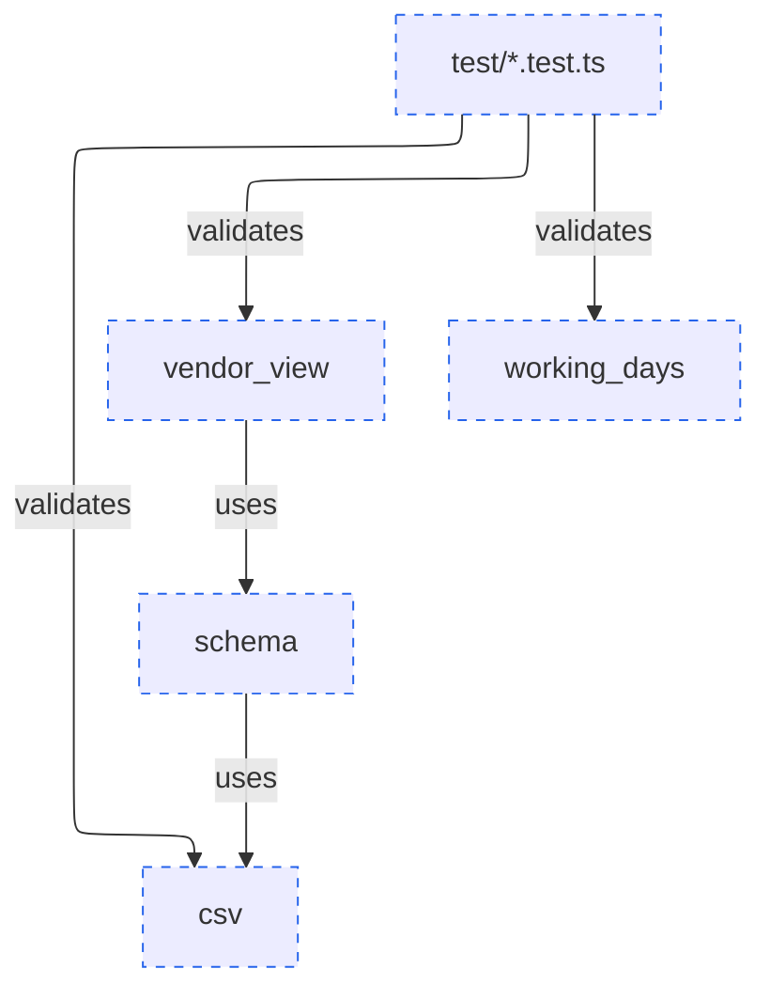

# Tracker Tables

## Purpose

A Node library that reads and writes the tracker's CSV tables, validates them against the shared schema, builds vendor views and does working-day arithmetic, so the reconciler and the summary share one correct implementation.

## Navigation

[Job Behavior Specifications](../../README.md#navigation) / [Tracker Tools](../README.md#navigation) / **Tracker Tables**

- [Design](#design)
- [Behavior](#behavior)
- [Plan](#plan)
- [Relationships](#relationships)
- [Links](#links)

## Design

Not built yet.

## Behavior

- **B01** When a CSV is read, then quoted fields, embedded commas, newlines and doubled quotes, a byte order mark and LF or CRLF line ends are parsed correctly.
- **B02** When rows are written, then the output has the schema column order, LF line ends and quoting only where needed, and a read followed by a write is stable.
- **B03** When a header lacks a required column, then it errors naming the file and column, and unknown columns are warned about and preserved.
- **B04** When the schema is loaded from the contract's `tracker-schema.csv`, then the tabs, columns, owner classes and visibility match that file.
- **B05** When a status or a reference value is outside its list or format (including question status, vendor answer status, source status and authentication type), then it is reported with the file, row and field.
- **B06** When a vendor view is requested, then only that vendor's rows and vendor-visible columns come out, question rows only after release and with no group, link or other-row reference, and no Question Groups, Question Links or Mappings tab.
- **B07** When due dates are computed, then two working days are added per question row from release, weekends and listed holidays are skipped, `due_on` is never moved by a response, and overdue is true after `due_on` for an open row whose lead-owned status is clarification-requested or whose vendor-owned answer status is not-answered, partially-answered or cannot-answer, so those rows stay overdue with their original due date until a lead resolves them, and a complete answer awaiting lead review is not vendor-overdue.
- **B08** When a multi-value field is read or written, then `;` is the separator and the order is preserved.
- **B09** When a date is not `YYYY-MM-DD`, then it errors with the field name.
- **B10** When an unknown tab name is given, then it errors and lists the known tabs.

## Plan

### Planned Navigation

[Job Behavior Specifications](../../README.md#plan) / [Tracker Tools](../README.md#plan) / **Tracker Tables**

- [Planned Design](#planned-design)
  - [Planned Diagram](#planned-diagram)
- [Steps](#steps)
- [Acceptance Mapping](#acceptance-mapping)
- [Assumptions And Open Questions](#assumptions-and-open-questions)
- [Planned Relationships](#planned-relationships)
- [Planned Links](#planned-links)

### Planned Design

The library has four small modules and its tests: CSV parsing and writing, schema loading and validation, the vendor projection, and working-day arithmetic. It has no entry point of its own, because the reconciler and the summary import it.

#### Planned Diagram

### Steps

1. Write `src/csv.ts`, `src/schema.ts`, `src/vendor_view.ts` and `src/working_days.ts`.
2. Write `test/*.test.ts` with each test titled with its behavior tag, using real temporary directories and the contract's schema file.
3. Run the declared `test` and `coverage` checks and the record validators.

### Acceptance Mapping

| Acceptance condition | Behaviors | Step | Validation |
| --- | --- | --- | --- |
| Parsing, writing, round trips and multi-value fields pass their tests (B01, B02, B08). | B01, B02, B08 | 2 | `[B01]`, `[B02]`, `[B08]` tests |
| Schema, status, reference, date and tab validation report precisely, including the question, answer, source and authentication statuses (B03, B04, B05, B09, B10). | B03, B04, B05, B09, B10 | 2 | `[B03]`, `[B04]`, `[B05]`, `[B09]`, `[B10]` tests |
| The vendor projection holds no group, link or unreleased row, and the working-day arithmetic is per question row and covers clarification-requested and awaiting-review rows (B06, B07). | B06, B07 | 2 | `[B06]`, `[B07]` tests |

Checks: the declared `test` and `coverage` checks apply (inherited from Tracker Tools).

### Assumptions And Open Questions

Assumptions (override any of them in chat before `/craft:build`):

1. The holidays file is a plain list of `YYYY-MM-DD` dates, one per line; no holiday is built in. Override: another format.
2. A working day is Monday to Friday. The release day is day 0, `due_on` is day 2 and a question is overdue from day 3.
3. The library is not a published package; siblings import it by relative path, which the Relationships record.

Open questions: none about behavior.

### Planned Relationships

- [Tracker Data Contract](../../tracker-data-contract/README.md#plan) — the `tracker-schema.csv` file the library loads, and the CSV encoding and status lists it validates.

### Planned Links

- [requirements.md](requirements.md#requirements) — what the component must do and what it need not.
- [contract.md](contract.md#contract) — the shapes, formats and wording rules.

## Relationships

- [Tracker Data Contract](../../tracker-data-contract/README.md#purpose) — the `tracker-schema.csv` file the library loads, and the CSV encoding and status lists it validates.

## Links

- [requirements.md](requirements.md#requirements) — what the component must do and what it need not.
- [contract.md](contract.md#contract) — the shapes, formats and wording rules.
