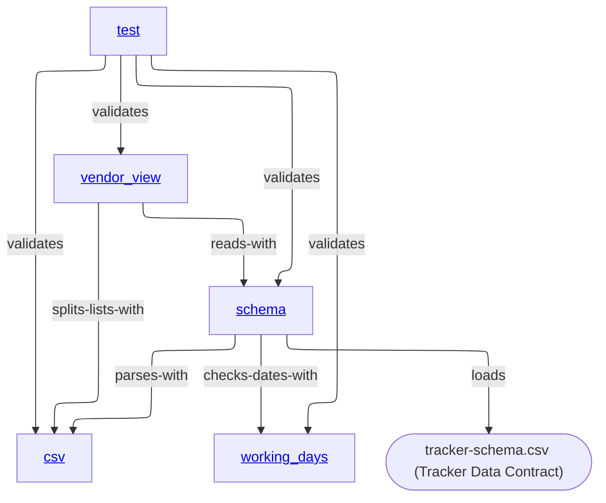
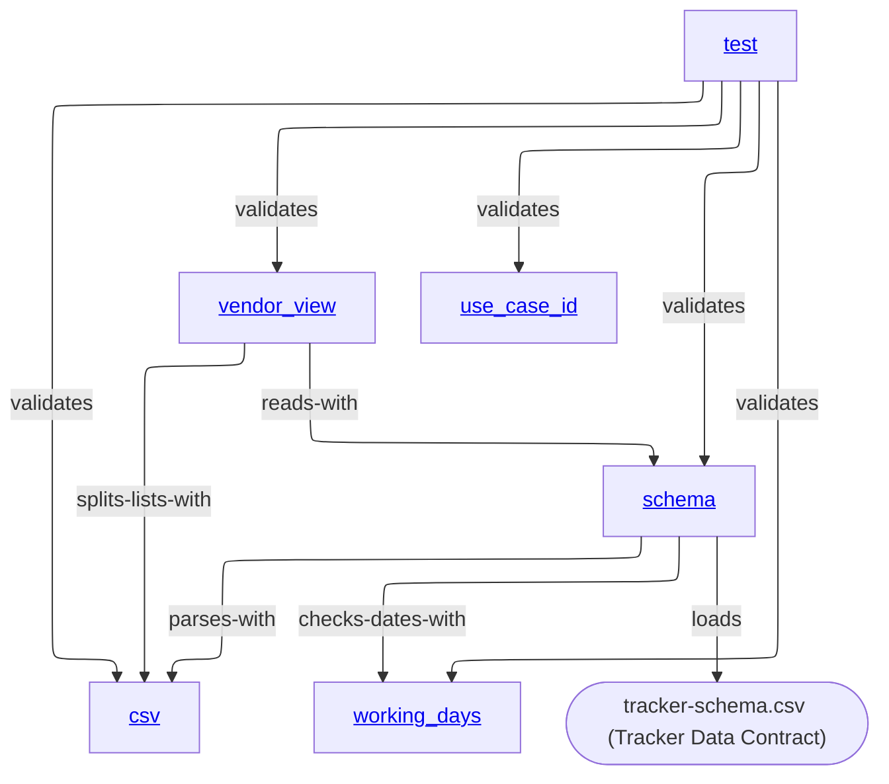

# Tracker Tables

## Purpose

A Node library that reads and writes the tracker's CSV tables, validates them against the shared schema, builds vendor views and does working-day arithmetic, so the reconciler and the summary share one correct implementation.

## Navigation

[Job Behavior Specifications](../../README.md#navigation) / [Tracker Tools](../README.md#navigation) / **Tracker Tables**

- [Design](#design)
  - [Diagram](#diagram)
- [Technology](#technology)
- [Behavior](#behavior)
- [Relationships](#relationships)
- [Links](#links)
- [Plan](#plan)
  - [Planned Navigation](#planned-navigation)
  - [Planned Design](#planned-design)
  - [Planned Diagram](#planned-diagram)
  - [Planned Behavior](#planned-behavior)
  - [Steps](#steps)
  - [Acceptance Mapping](#acceptance-mapping)
  - [Assumptions And Open Questions](#assumptions-and-open-questions)
  - [Planned Relationships](#planned-relationships)
  - [Planned Links](#planned-links)

## Design

A library of four small modules with no entry point; the reconciler and the summary import it by relative path. [csv](src/csv.ts) parses and formats RFC 4180 text: it strips a byte order mark, accepts CRLF, LF or a bare CR as a line end, skips blank lines, pads a short row, rejects a long row, an unterminated quote and a duplicate column (each naming the file), and writes UTF-8 with LF, quoting only a value that holds a comma, a quote or a line break. It also splits and joins the `;` multi-value fields, trimming items and keeping their order. [schema](src/schema.ts) loads `tracker-schema.csv` into tabs and columns (key, owner, vendor or internal visibility, type, allowed values), orders a header in schema order with unknown columns after it, derives the kebab-case tab file name, and validates a table. [vendor_view](src/vendor_view.ts) projects the tables for one vendor. [working_days](src/working_days.ts) validates `YYYY-MM-DD` dates, adds working days, computes `due_on`, decides overdue and reads a holidays file.

Decisions (record of the build; override in chat):

- A required column is a schema key column. A missing one is an error naming the file and column; a column outside the schema is a warning and is kept.
- Statuses and enumerations are never listed in code: a value is checked against the schema column's `allowed_values`, so question status, vendor answer status, source status and authentication type all come from the file. A date column also accepts its own listed literal (`unknown` for `expected_availability`).
- A reference is checked by format only (two capital letters, a hyphen, three or more digits); the schema has no per-column prefix. Whether a referenced row exists is not checked.
- A finding is `{ severity, file, row?, field, message }`. `row` counts the header as row 1, as a spreadsheet does.
- The vendor view keeps the tabs that have vendor columns (so no Question Groups, Question Links or Mappings tab), the rows whose `vendor` equals the vendor name exactly (surrounding spaces of the row value are ignored; an empty vendor name is an error, so unassigned rows are never released), and, for a tab with `released_on` (Questions and Batches), only rows with it set. Its columns are the tab's vendor columns in schema order. A `ref` value or a reference inside a `list` value that does not name a row kept in the view is blanked or dropped, so no unreleased row, group, link or other vendor's row is referenced; `due_on` and the answer fields pass through untouched.
- A working day is Monday to Friday minus the holidays; the release day is day 0 even on a weekend. `isOverdue` is true when today is after `due_on`, the status is `released` or `clarification-requested`, and either the status is `clarification-requested` or the answer status is not `answered`; the due date comes only from the release day, so a response never moves it.
- The holidays file is one `YYYY-MM-DD` date per line; blank lines are ignored and nothing is built in.

### Diagram

## Technology

Inherited from [Tracker Tools](../README.md#technology): Node 26 with native TypeScript (erasable syntax, `.ts` import extensions), no dependencies, `node:test`, ES modules. The declared checks are `test` and `coverage`; no typecheck, lint or boundaries check exists because each would need a dev dependency. Tests use real temporary directories and read the real `tracker-data-contract/tracker-schema.csv` by relative path.

## Behavior

- **B01** When a CSV is read, then quoted fields, embedded commas, newlines and doubled quotes, a byte order mark and LF or CRLF line ends are parsed correctly.
- **B02** When rows are written, then the output has the schema column order, LF line ends and quoting only where needed, and a read followed by a write is stable.
- **B03** When a header lacks a required column, then it errors naming the file and column, and unknown columns are warned about and preserved.
- **B04** When the schema is loaded from the contract's `tracker-schema.csv`, then the tabs, columns, owner classes and visibility match that file.
- **B05** When a status or a reference value is outside its list or format (including question status, vendor answer status, source status and authentication type), then it is reported with the file, row and field.
- **B06** When a vendor view is requested, then only that vendor's rows and vendor-visible columns come out, question rows only after release and with no group, link or other-row reference, and no Question Groups, Question Links or Mappings tab.
- **B07** When due dates are computed, then two working days are added per question row from release, weekends and listed holidays are skipped, `due_on` is never moved by a response, and overdue is true after `due_on` for an open row whose lead-owned status is clarification-requested or whose vendor-owned answer status is not-answered, partially-answered or cannot-answer, so those rows stay overdue with their original due date until a lead resolves them, and a complete answer awaiting lead review is not vendor-overdue.
- **B08** When a multi-value field is read or written, then `;` is the separator and the order is preserved.
- **B09** When a date is not `YYYY-MM-DD`, then it errors with the field name.
- **B10** When an unknown tab name is given, then it errors and lists the known tabs.

## Relationships

- [Tracker Data Contract](../../tracker-data-contract/README.md#purpose) — the `tracker-schema.csv` file the library loads, and the CSV encoding and status lists it validates.

## Links

- [requirements.md](requirements.md#requirements) — what the component must do and what it need not.
- [contract.md](contract.md#contract) — the shapes, formats and wording rules.
- [src/csv.ts](src/csv.ts) — CSV read, write and multi-value fields.
- [src/schema.ts](src/schema.ts) — schema loading and table validation.
- [src/vendor_view.ts](src/vendor_view.ts) — the vendor projection.
- [src/working_days.ts](src/working_days.ts) — dates, due dates, overdue and the holidays file.
- [test/vendor_view.test.ts](test/vendor_view.test.ts) — tests for B06; `csv.test.ts` covers B01, B02 and B08, `schema.test.ts` B02 to B05, B09 and B10, and `working_days.test.ts` B07 and B09.

## Plan

### Planned Navigation

[Job Behavior Specifications](../../README.md#plan) / [Tracker Tools](../README.md#plan) / **Tracker Tables**

- [Planned Design](#planned-design)
  - [Planned Diagram](#planned-diagram)
- [Planned Behavior](#planned-behavior)
- [Steps](#steps)
- [Acceptance Mapping](#acceptance-mapping)
- [Assumptions And Open Questions](#assumptions-and-open-questions)
- [Planned Relationships](#planned-relationships)
- [Planned Links](#planned-links)

### Planned Design

One shared helper so no tool keeps its own copy of the use case ID rule. A new small module `src/use_case_id.ts` exports one function, `useCaseId(vendor, name)`: it reduces the vendor and the use case name each to a slug (lower case, each run of characters outside `a-z` and `0-9` becomes one `-`, leading and trailing `-` trimmed) and returns `uc-<vendor-slug>-<use-case-slug>`, or `undefined` when either slug is empty, because with no vendor or no name there is no ID. The slug function stays private to the module; the ID is derived and never stored, so `tracker-schema.csv`, the table readers and the vendor view do not change. The reconciler, the review CSV exporter and both workbook updaters import it by relative path. The exact wording is in [contract.md](contract.md#planned-use-case-id-helper).

This is a small addition that has no effect on a build that does not call it, so it builds after the Tracker Data Contract and the three skill components and before the Tracker Reconciler, the Review CSV Exporter and the two workbook updaters. The reconciler's own `slug` (used for the mapping candidate and the vendor folder name) is not a use case ID copy and stays.

### Planned Diagram

### Planned Behavior

New behavior; the existing `B01` to `B10` are unchanged.

- **B11** When a use case ID is requested for a vendor and a use case name, then it is `uc-<vendor-slug>-<use-case-slug>` with each part reduced to lower case, each run of characters outside `a-z` and `0-9` becomes one `-` and leading and trailing `-` trimmed, the same inputs always give the same ID, two vendors with the same use case name give two different IDs, and a vendor or name whose slug is empty gives no ID (`undefined`), never a partial one.

### Steps

1. Add `src/use_case_id.ts` (erasable TypeScript, no dependency) with a private `slug(text)` and the exported `useCaseId(vendor: string, name: string): string | undefined`. Do not edit `csv.ts`, `schema.ts`, `vendor_view.ts` or `working_days.ts`.
2. Add `test/use_case_id.test.ts` for `B11`: the website example from the contract (`useCaseId("Example Vendor", "Website Availability Check")` is `uc-example-vendor-website-availability-check`), punctuation, accents and repeated separators collapsing to one `-`, leading and trailing separators trimmed, two vendors with one name, a stable result on repeat, and `undefined` for an empty or all-symbol vendor and for an empty or all-symbol name. Name the test `[B11] ...` like the other tests.
3. [README.md](README.md): extend the Design first sentence (five small modules, `use_case_id` derives the use case ID), add the module to the Diagram, add `B11` to Behavior, add the module and its test to Links, and move this plan's content into the record; [contract.md](contract.md): move the planned section into the module table and the data rules; [requirements.md](requirements.md): one bullet that the library derives the use case ID once for every tool.
4. Run the component's `test` and `coverage` checks; the new module is fully covered.

### Acceptance Mapping

| Acceptance | Behaviors | Step | Check |
| --- | --- | --- | --- |
| 1. `useCaseId(vendor, name)` returns `uc-<vendor-slug>-<use-case-slug>` by the slug rule and gives the same ID for the same inputs and different IDs for two vendors with one name. | B11 | 1, 2 | `test/use_case_id.test.ts` |
| 2. A vendor or name whose slug is empty gives no ID. | B11 | 1, 2 | `test/use_case_id.test.ts` |
| 3. No other module, the schema or any existing test changes, and the component's checks pass. | B01 to B10 | 1, 4 | `test` and `coverage` |

### Assumptions And Open Questions

Assumptions (override by telling the builder, or by editing the file named):

- **A new module, not an addition to an existing one.** None of the four modules is about names or references; the module name and the single export are the build's choice. Override by naming another module.
- **`undefined` for no ID**, not an empty string or a throw, so a caller must handle the missing case explicitly; the tools turn it into their own error naming the file and line.
- **Slug is private.** Only `useCaseId` is exported, as the brief asks; the reconciler keeps its own `slug` for the mapping candidate and the vendor folder, and the discovery orchestrator and skills state the same rule in prose. Override by also exporting `slug`.
- **The slug rule is ASCII only**, so an accented letter becomes `-` (the rule recorded in the Discovery Orchestrator contract); an all-non-ASCII name therefore has no ID.
- **The library does not check that the ID is unique;** the reconciler adds the one input error for two export Use Cases rows with one ID.

Open questions: none.

### Planned Relationships

It is used by [Tracker Reconciler](../tracker-reconciler/README.md#planned-design), [Review CSV Exporter](../review-csv-exporter/README.md#planned-design), [Vendor Workbook Updater](../vendor-workbook-updater/README.md#design) and [Master Workbook Updater](../master-workbook-updater/README.md#design); the rule it implements is defined in [Tracker Data Contract](../../tracker-data-contract/README.md#planned-design) and must build after it and after the three skill components that copy that contract.

### Planned Links

- [contract.md](contract.md#planned-use-case-id-helper) — the exact planned wording.
