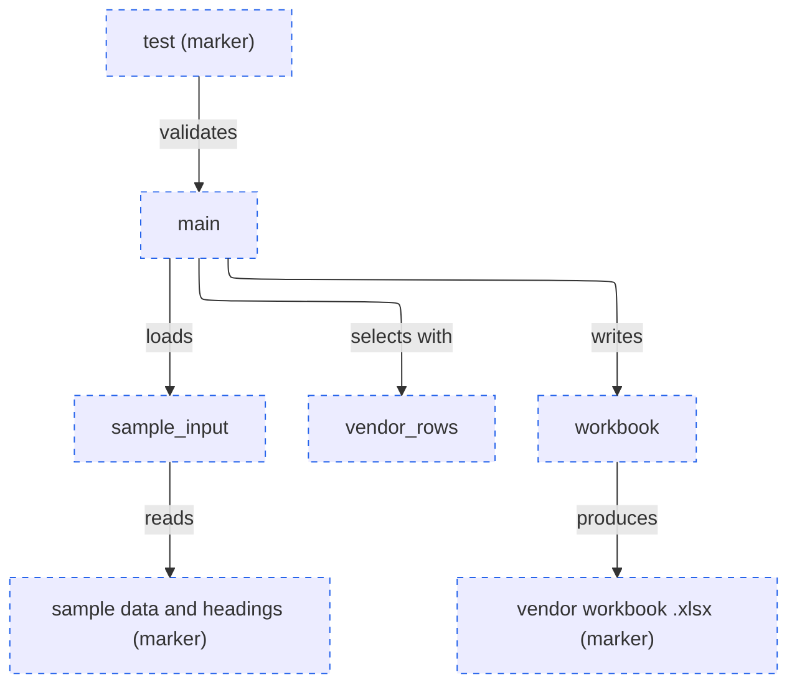

# Vendor Sample Workbook

## Purpose

A Node command line tool that writes a small, realistic vendor-only sample workbook for one vendor from the Sample Tracker Workbook's fictional data, with only that vendor's rows and the vendor-visible columns, so the team can review what a vendor would receive and the Vendor Workbook Updater has a representative input.

## Navigation

[Job Behavior Specifications](../../README.md#navigation) / [Tracker Tools](../README.md#navigation) / **Vendor Sample Workbook**

- [Design](#design)
- [Technology](#technology)
- [Behavior](#behavior)
- [Relationships](#relationships)
- [Links](#links)

## Design

Not built yet.

## Technology

Inherited from [Tracker Tools](../README.md#technology), with one departure shared with the sample and the updater: this component adds the pinned `exceljs` package to write the workbook (see [requirements.md](requirements.md#requirements)).

## Behavior

- **B1** When `generate --vendor <name> --out <file>` runs on the sample data, then it writes one `.xlsx` with the sheets Read Me, Use Cases, Questions and Identity & Access.
- **B2** When rows are chosen, then only that vendor's rows appear, and a question appears only once it is released.
- **B3** When columns are chosen, then only vendor-visible columns appear, with the sample's headings and column groups, and no internal column, other vendor, note, mapping, proposed change, review row or unreleased question reaches the file.
- **B4** When questions are written, then each due date is the release date plus two working days.
- **B5** When cells are written, then the vendor-editable columns from the updater's list are shaded and the Read Me names them, and everything else is plain read-only text.
- **B6** When the file is read back, then it meets the Vendor Workbook Updater's input rules (the header row in row 1 or 2 with the sample headings) and the updater's own reader accepts it.
- **B7** When it runs twice on the same data and as-of date, then the two files match cell for cell.
- **B8** When the vendor is unknown, the data is invalid or a value looks like a secret, then it stops, names the problem and writes no file.

## Relationships

- [Tracker Data Contract](../../tracker-data-contract/README.md#purpose) — the schema, visibility classes and due-date rule the vendor view follows.
- [Tracker Tables](../tracker-tables/README.md#purpose) — the library that loads the schema, validates the data, builds the vendor view where it fits and does the working-day arithmetic.
- [Sample Tracker Workbook](../sample-tracker-workbook/README.md#purpose) — the fictional data and the headings the vendor workbook is projected from.
- [Vendor Workbook Updater](../vendor-workbook-updater/README.md#purpose) — the tool whose input rules and workbook reader the sample must satisfy.

## Links

- [requirements.md](requirements.md#requirements) — what the component must do, what must match the source and what need not, and the follow-on work.
- [contract.md](contract.md#contract) — the command, the sheets and columns, and the rules for rows, shading and dates.

## Plan

### Planned Navigation

[Job Behavior Specifications](../../README.md#navigation) / [Tracker Tools](../README.md#plan) / **Vendor Sample Workbook**

- [Planned Design](#planned-design)
  - [Planned Diagram](#planned-diagram)
- [Steps](#steps)
- [Acceptance Mapping](#acceptance-mapping)
- [Assumptions And Open Questions](#assumptions-and-open-questions)
- [Planned Relationships](#planned-relationships)
- [Planned Links](#planned-links)

### Planned Design

`generate --vendor <name> --out <file> --as-of <date> [--data <folder>]` is a thin adapter (`src/main.ts`) that loads the Sample Tracker Workbook's data and headings, validates them with Tracker Tables, picks the vendor's rows and the vendor-visible columns, computes `Due on`, and writes the four-sheet workbook with `exceljs`, writing nothing when any check fails. `vendor_rows` chooses rows (the vendor's use cases, released questions, access rows) and columns (the `V` columns of `headings.csv`, in file order), reusing Tracker Tables' `vendor_view` where it fits. `workbook` writes the Read Me and the three main sheets under a group band with blue headers, frozen headers, filters and widths, shades the vendor-editable columns read from the Vendor Workbook Updater's `data/vendor-edited.csv`, and fixes the timestamps so repeat runs match. The first sample is Harborline Analytics at 2026-11-16, with no holidays.

#### Planned Diagram

### Steps

1. **Scaffold.** `package.json` (private, ES module, Node 26, one exact-pinned `exceljs` 4.4.0, a `generate` script), `package-lock.json`, `.gitignore` for `node_modules/`. The lockfile needs one network `npm install`, an external effect the builder must have the user approve in that turn.
2. **`src/sample_input.ts`** (B3, B8): loads the sample's four tables and `headings.csv` by relative path, validates them with Tracker Tables, scans every cell for secret-like values, reports every finding in one error.
3. **`src/vendor_rows.ts`** (B2, B3, B4): chooses rows by vendor and release, columns by visibility, computes `Due on` (release plus two working days), reusing `vendor_view` where it fits.
4. **`src/workbook.ts`** (B1, B3, B5, B7): writes Read Me and the three sheets as `contract.md` sets out, shades the vendor-editable columns, fixed timestamps.
5. **`src/main.ts`** (B1, B8): the command, temporary file then rename, exit codes.
6. **Tests** in `test/`, real temporary directories, tagged `[B#]`: `generate`, `vendor_rows`, `leak` (no internal content anywhere in the file), `updater` (the Vendor Workbook Updater's reader accepts the file), `repeat`, `input`.
7. **Generate** `vendor-sample-workbook-harborline.xlsx` at the as-of date, replacing the throwaway prototype.
8. **Docs:** the built `Design` and diagram in this README, kept in step with `requirements.md` and `contract.md`.
9. **Validate:** `npm ci --prefix tracker-tools/vendor-sample-workbook`, then `node --test "tracker-tools/vendor-sample-workbook/test/*.test.ts"` and the coverage check.

### Acceptance Mapping

| Acceptance | Behaviors | Step | Test |
| --- | --- | --- | --- |
| 1. Four-sheet vendor-only sample, one vendor's released rows, vendor-visible columns, working-day due dates, editable columns shaded | B1, B2, B3, B4, B5 | 2 to 5 | `generate.test.ts` `[B1]` `[B5]`; `vendor_rows.test.ts` `[B2]` `[B4]`; `leak.test.ts` `[B3]` |
| 2. Accepted by the Vendor Workbook Updater | B6 | 6 | `updater.test.ts` `[B6]` (the updater's reader and header rule) |
| 3. Repeat runs match; bad input stops with no file | B7, B8 | 5, 6 | `repeat.test.ts` `[B7]`; `input.test.ts` `[B8]` |

Validation: the commands in step 9, narrowest first.

### Assumptions And Open Questions

Assumptions (override by telling the builder, or by editing the file named):

- **Planner substitution.** The planner agent is blocked in this session by an administrator's 403 error, so this plan was written from a direct read of the repository by the planning session. Nothing was renamed or reworded to work around it.
- **A separate component**, not part of the Sample Tracker Workbook, because that component is at the ten-behavior limit and the vendor view has its own rules. To fold it in, raise the cap or drop behaviors there.
- **Node and `exceljs`**, like the sample and the updater, with the throwaway Python script as the reference that was checked. The alternative is a hand-written OOXML writer.
- **Vendor-editable columns** come from the updater's `data/vendor-edited.csv` at run time, so the two cannot drift. `Acknowledgement requested on` stays read-only because a lead sets it.
- **One vendor per run**; the first sample is Harborline Analytics. The Meridian file is a follow-on (one command).
- **Visible columns follow the sample's `headings.csv`**, including `Our coordinator` and `Ticket` on Identity & Access, which the sample marks vendor-visible. The team may want those hidden from vendors; that is a change to the headings, not to this tool.
- **The output `.xlsx` is committed** beside the sample, as the sample's own `.xlsx` is. To untrack it, add it to `.gitignore`.
- **The build needs the user's approval in its turn** for one network `npm install`.
- **Budget:** USD 4 and 3,600 s; reuse Tracker Tables and keep the tests compact.

Open questions (behavior or real ambiguity): none.

### Planned Relationships

- [Tracker Data Contract](../../tracker-data-contract/README.md#purpose) — the schema, visibility classes and due-date rule the vendor view follows.
- [Tracker Tables](../tracker-tables/README.md#purpose) — schema loading, validation, vendor view and working-day arithmetic, imported by relative path.
- [Sample Tracker Workbook](../sample-tracker-workbook/README.md#plan) — the fictional data and headings the vendor workbook is projected from.
- [Vendor Workbook Updater](../vendor-workbook-updater/README.md#purpose) — the input rules, editable-column list and reader the sample must satisfy.

### Planned Links

- [requirements.md](requirements.md#requirements) — requirements, departures and follow-on work.
- [contract.md](contract.md#contract) — command, sheets, rows, columns and Read Me.
