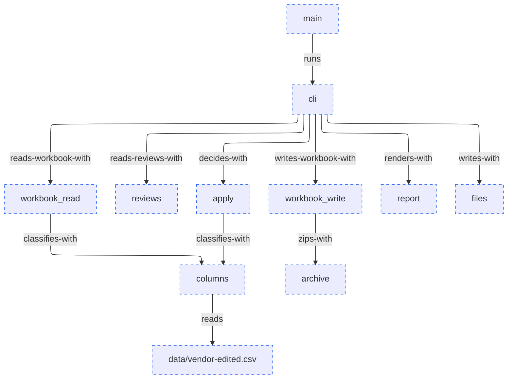

# Vendor Workbook Updater

## Purpose

A Node command line tool that applies the review rows a lead accepted to one vendor's vendor-facing tracker workbook, starting from the copy downloaded from SharePoint, and writes a new vendor-safe `.xlsx` the lead uploads by hand, so accepted values no longer have to be copied into the vendor workbook.

## Navigation

[Job Behavior Specifications](../../README.md#navigation) / [Tracker Tools](../README.md#navigation) / **Vendor Workbook Updater**

- [Design](#design)
- [Technology](#technology)
- [Behavior](#behavior)
- [Plan](#plan)
  - [Planned Navigation](#planned-navigation)
  - [Planned Design](#planned-design)
    - [Planned Diagram](#planned-diagram)
  - [Steps](#steps)
  - [Acceptance Mapping](#acceptance-mapping)
  - [Assumptions And Open Questions](#assumptions-and-open-questions)
  - [Planned Relationships](#planned-relationships)
  - [Planned Links](#planned-links)
- [Relationships](#relationships)
- [Links](#links)

## Design

Not built yet.

## Technology

- Inherited from Tracker Tools (Node 26 with native TypeScript and `node:test`), plus one exact-pinned dependency, `exceljs` 4.4.0, to read and write `.xlsx`, as the Sample Tracker Workbook does. Detail is in [requirements.md](requirements.md#requirements).

## Behavior

- **B1** When it runs on a downloaded vendor workbook, the review CSVs, a tracker export and a vendor, then it writes a new `.xlsx` in the sample workbook's format and leaves the input untouched.
- **B2** When a review row has `review_status` `accepted`, then it applies, and a blank, `rejected` or `clarify` row never applies.
- **B3** When a row has `applied_on` set and an unchanged content digest, then it is skipped, and the same inputs and run date give a byte-identical workbook with no duplicate rows.
- **B4** When the workbook is written, then it holds only that vendor's rows and vendor-visible columns on Use Cases, Questions and Identity & Access, with no internal column, Mappings, other vendor's row, hidden sheet or column, comment or link to the master.
- **B5** When an accepted new question row is applied and the lead named a release, then it is added with `released_on`, `batch_ref` and a `due_on` of release plus two working days, and without a release it is left pending and listed.
- **B6** When a row is applied, then the vendor's answers, answer status, acknowledgements and vendor-side access fields, and the `released_on` and `due_on` of existing rows, never change.
- **B7** When a row's current value differs from the workbook's, or the row changed since review, then nothing is applied for that row and a conflict is listed.
- **B8** When a new record is added, then it takes the exporter's suggested reference, and a collision stops the run.
- **B9** When a run succeeds, then `applied_on` is set on the applied rows of the review files, written atomically, and when any step fails nothing is written.
- **B10** When an input is invalid or a value looks like a secret, then the run stops naming the file and line and writes nothing, and the report lists what was applied, what was skipped and why, and the accepted internal-column values left for the internal tracker.

## Plan

### Planned Navigation

[Job Behavior Specifications](../../README.md#navigation) / [Tracker Tools](../README.md#plan) / **Vendor Workbook Updater**

- [Planned Design](#planned-design)
  - [Planned Diagram](#planned-diagram)
- [Steps](#steps)
- [Acceptance Mapping](#acceptance-mapping)
- [Assumptions And Open Questions](#assumptions-and-open-questions)
- [Planned Relationships](#planned-relationships)
- [Planned Links](#planned-links)

### Planned Design

One command, `update-vendor-workbook`, behind a thin adapter. `main` only connects the process to `cli`, which parses the arguments, collects every input problem, runs the modules and returns the exit status (0 done, 1 input problem or reference collision, 2 bad usage). `columns` builds the vendor columns of each tab from the sample's headings data and the schema and reads the vendor-owned columns from `data/vendor-edited.csv`. `workbook_read` reads the downloaded workbook back to rows with a strict header check. `reviews` reads and validates the three review CSVs and stages the `applied_on` rewrite. `apply` is the pure decision core: scope, already applied, conflict, existing record, new record and release. `workbook_write` produces the vendor-safe workbook; `archive` rewrites its zip with fixed timestamps and entry order, and is kept only if a first spike shows the bytes vary run to run. `report` renders the Markdown report and `files` checks the paths and writes through temporary names.

Reading, validating and secret detection are imported by relative path from the [Tracker Tables](../tracker-tables/README.md#design), the [Tracker Reconciler](../tracker-reconciler/README.md#design), the [Review CSV Exporter](../review-csv-exporter/README.md#design) and, for layout and headings only, the [Sample Tracker Workbook](../sample-tracker-workbook/README.md#design); none is changed. The Excel table, band, dropdown and style code is small and is written here, because the sample's workbook module imports `exceljs` and would resolve it from the sample's own folder. The vendor-safe differences from the sample are in [contract.md](contract.md#outputs).

#### Planned Diagram

### Steps

1. **Scaffold:** `package.json` (`type` module, `engines.node` 26, `exceljs` 4.4.0, script `test`), `package-lock.json`, `.gitignore`, `craft.json` check `install`, and `data/vendor-edited.csv`. Spike: write the workbook twice two seconds apart and compare bytes; if identical, drop `archive` and its test and say so in the task narrative.
2. `src/archive.ts` and its test, only if the spike needs it.
3. `src/columns.ts` and `test/columns.test.ts`.
4. `src/workbook_read.ts` and `test/workbook_read.test.ts`.
5. `src/workbook_write.ts` and `test/format.test.ts`.
6. `src/reviews.ts` and `test/reviews.test.ts`.
7. `src/apply.ts` with `accept`, `release`, `owned`, `conflict` and `refs` tests.
8. `src/report.ts` and `src/files.ts`.
9. `src/cli.ts`, `src/main.ts`, `test/support.ts` and the `repeat`, `applied_on`, `input`, `vendor_only` and `cli` tests, including a round trip from real `export-review` output.
10. At build close, merge this Plan into the Design, diagram, Relationships and Links, and have the group's owner record the `exceljs` exception and the new member.

### Acceptance Mapping

| Acceptance | Behaviors | Step | Test |
| --- | --- | --- | --- |
| Accepted rows appear once in a vendor-safe workbook in the agreed format; a second run is identical | B1, B3, B4 | 2, 5, 9 | `format`, `repeat`, `vendor_only` (checked against Tracker Tables `vendorView`, with a hostile input holding a hidden sheet, a hidden column, comments, an internal heading and another vendor's row), `cli` round trip |
| Not accepted, applied, conflicting or changed rows are left alone and listed | B2, B3, B7 | 7 | `accept`, `repeat`, `conflict` |
| A question is added only on release; vendor cells and dates never change | B5, B6 | 7 | `release` (due date, holidays, another vendor's batch), `owned` |
| New record reference, collision stop, `applied_on` set only after success | B8, B9 | 6, 7, 8 | `refs`, `applied_on` |
| Invalid input or a secret stops with the file and line; the report is complete | B10 | 4, 6, 9 | `input`, report content test |

Each test title starts with its `[B#]` tag. Validation, narrowest first: one test file with `node --test`, then the declared `test`, then `coverage`. No `typecheck`, `lint` or `boundaries` check is declared in the group.

### Assumptions And Open Questions

Assumptions (override any in chat):

1. The tool rebuilds the whole workbook from the downloaded rows plus applied changes; formatting a vendor added is lost. Sheet protection has no password, because a password adds a random salt and breaks byte identity; it is a guard, not security.
2. Paths are flags and this component creates no workbook folder; the parents of `--out` and `--report` are created at write time.
3. A mixed row applies its vendor part and gets `applied_on`; its internal part is only in the report. A row applies when a cell changed or a row was added, so an internal-only or no-change row gets no `applied_on`.
4. The internal tracker apply, SharePoint reads and writes and the internal workbook are out of scope (backlog item `internal-tracker-apply`).
5. An input header that is not a vendor column stops the run; to drop and report it instead, change that rule in the contract.
6. The vendor-owned columns are data (`data/vendor-edited.csv`); `released_on` and `due_on` of existing rows are protected in code.
7. Other vendors' rows are counted, not applied. A master row missing from the workbook, and a new question whose use case is not in the workbook, are skipped and listed.
8. Vendor fields that appear only in `other_changes`, and vendor-owned fields proposed on a new row, are not applied and are listed; widening the headings file (data) gives them columns.
9. There is no Holidays sheet; `due_on` is a value and `--holidays` is optional.
10. A conflict or held field state is always a conflict, since a lead cannot resolve it in the CSV.
11. The `applied_on` rewrite uses the library's CSV writer, which normalizes a hand-formatted file.
12. Risks: a rerun on an older download skips rows already marked `applied_on`, and the report states the starting workbook and the skipped count; `exceljs` bytes may vary beyond timestamps, which would be fixed by post-processing, not redesign; if the task budget proves too small, `archive` moves to its own child.

Open question (behavior, recommended answer first): should the tool refresh `acknowledgement_requested_on` from the export for existing use cases? Recommended no: it is lead-set, no review row carries it, and it falls outside applying accepted review rows. If yes, it needs its own behavior and a rule for use cases missing from the workbook.

### Planned Relationships

- [Tracker Data Contract](../../tracker-data-contract/README.md#purpose) — the schema, owner classes, vendor-view rule and reference scheme the tool reads.
- [Tracker Tables](../tracker-tables/README.md#purpose) — CSV and schema functions and the due-date arithmetic.
- [Tracker Reconciler](../tracker-reconciler/README.md#purpose) — the export loader and the secret detection.
- [Review CSV Exporter](../review-csv-exporter/README.md#purpose) — the review CSV header, content digest, statuses and suggested references.
- [Sample Tracker Workbook](../sample-tracker-workbook/README.md#purpose) — the layout rules and column headings the vendor workbook follows.

### Planned Links

- [requirements.md](requirements.md#requirements) — what the tool must do, what must match the source and what need not.
- [contract.md](contract.md#contract) — the command, inputs, field classification, decision order, outputs and writing rules.

## Relationships

- [Tracker Data Contract](../../tracker-data-contract/README.md#purpose) — the schema, owner classes, vendor-view rule and reference scheme the tool reads.
- [Tracker Tables](../tracker-tables/README.md#purpose) — CSV and schema functions and the due-date arithmetic.
- [Tracker Reconciler](../tracker-reconciler/README.md#purpose) — the export loader and the secret detection.
- [Review CSV Exporter](../review-csv-exporter/README.md#purpose) — the review CSV header, content digest, statuses and suggested references.
- [Sample Tracker Workbook](../sample-tracker-workbook/README.md#purpose) — the layout rules and column headings the vendor workbook follows.

## Links

- [requirements.md](requirements.md#requirements) — what the tool must do, what must match the source and what need not.
- [contract.md](contract.md#contract) — the command, inputs, field classification, decision order, outputs and writing rules.
