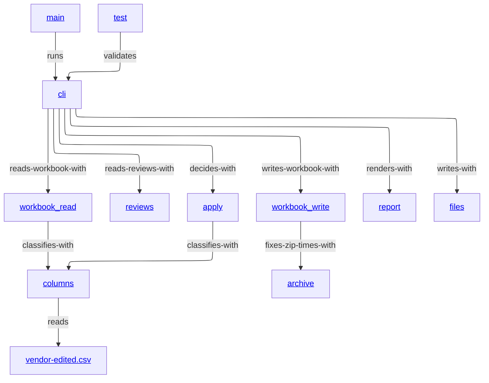

# Vendor Workbook Updater

## Purpose

A Node command line tool that applies the review rows a lead accepted to one vendor's vendor-facing tracker workbook, starting from the copy downloaded from SharePoint, and writes a new vendor-safe `.xlsx` the lead uploads by hand, so accepted values no longer have to be copied into the vendor workbook.

## Navigation

[Job Behavior Specifications](../../README.md#navigation) / [Tracker Tools](../README.md#navigation) / **Vendor Workbook Updater**

- [Design](#design)
  - [Diagram](#diagram)
- [Technology](#technology)
- [Behavior](#behavior)
- [Relationships](#relationships)
- [Links](#links)

## Design

One command, `update-vendor-workbook`, behind a thin adapter. [main](src/main.ts) only connects the process to [cli](src/cli.ts), which parses the arguments, collects every input problem, runs the modules and returns the exit status (0 done, 1 input problem or reference collision, 2 bad usage). [columns](src/columns.ts) builds the vendor columns of each tab from the sample's headings data and the schema and reads the vendor-owned columns from [vendor-edited.csv](data/vendor-edited.csv). [workbook_read](src/workbook_read.ts) reads the downloaded workbook back to rows with a strict header check. [reviews](src/reviews.ts) reads and validates the three review CSVs and stages the `applied_on` rewrite. [apply](src/apply.ts) is the decision core: scope, already applied, conflict, existing record, new record and release. [workbook_write](src/workbook_write.ts) produces the vendor-safe workbook and [archive](src/archive.ts) fixes the entry times of its zip. [report](src/report.ts) renders the Markdown report and [files](src/files.ts) checks the paths and writes through temporary names.

Reading, validating and secret detection are imported by relative path from the [Tracker Tables](../tracker-tables/README.md#design), the [Tracker Reconciler](../tracker-reconciler/README.md#design), the [Review CSV Exporter](../review-csv-exporter/README.md#design) and, for layout and headings only, the [Sample Tracker Workbook](../sample-tracker-workbook/README.md#design); none is changed. The Excel table, band, dropdown and style code is small and is written here, because the sample's workbook module imports `exceljs` and would resolve it from the sample's own folder. The vendor-safe differences from the sample are in [contract.md](contract.md#outputs).

How a run goes: the headings, columns, export, review files, downloaded workbook and output paths are all read and validated first and every decision is computed; any problem stops the run with exit 1 and one `file: line N: message` per problem before anything is written. Then the workbook, report and changed review files are written to temporary names and renamed, the review files last.

Decisions (record of the build; override in chat):

- **Byte repeatability (spike result).** `exceljs` 4.4.0 output differs between two runs two seconds apart only in the zip entry times, which its zip library takes from the clock. `archive` therefore sets every entry's DOS time and date to 1980-01-01 in the local and central headers; the same rows and run date then give identical bytes (a test builds twice two seconds apart). Document properties use the run date. Sheet protection has no password, because a password adds a random salt; it is a guard against slips, not security.
- **Whole-workbook rebuild.** The workbook is rebuilt from the downloaded rows plus applied changes, so formatting a vendor added is lost. A tab with no rows still gets a table with one blank row, since Excel needs a data row.
- **Scope first.** Every review row is scoped to the vendor before anything else: another vendor's row is only counted, a not-accepted row of this vendor is listed as skipped with its status, and a row whose record or vendor cannot be found is skipped with the reason. A master row missing from the workbook, and a new question or access row whose use case ID is in the export or is an unaccepted new use case of this vendor but not in the workbook, are skipped and listed.
- **Fields.** A shown field is applied when its schema visibility is `V`, its owner is `spec` or `human`, it is a column of the vendor workbook and it is not in `vendor-edited.csv`; `released_on` and `due_on` are also protected by name. Other fields are listed under "Fields not applied" (vendor-visible) or "Left for the internal tracker" (internal columns, plus the row's `other_changes` text), for every in-scope accepted row that is not a conflict. A mixed row applies its vendor part. An internal-only or no-change row gets no `applied_on`.
- **Conflicts.** `changed_since_review`, a held or conflicting field, a `conflict` cell, a recomputed digest that differs from the file's, or a current value that differs from the workbook's (trimmed, line endings normalized) is a conflict and the whole row is left alone and listed. A row with `applied_on` set is skipped, or listed as a conflict when it changed since.
- **New records.** A new record takes `suggested_ref`; a blank or malformed one, or one that exists in the export, the workbook or earlier in the run, stops the run. A new use case needs a proposed `vendor` equal to `--vendor` and a proposed `use_case_name`, which is what it is written with; the ID derived from them must equal its `use_case` cell and must not exist in the workbook or earlier in the run, else the run stops. A new question or access row finds its use case by the ID in its `use_case` cell and takes `use_case_ref`, `use_case_name` and `vendor` from the matched workbook row. A new question needs `--release-batch` and `--release-date` and gets `released_on`, `batch_ref`, `due_on` (release plus two working days, `--holidays` optional) and `answer_status` `not-answered`, whatever the row proposes; without a release it stays pending. Rows are added by tab, in review `order`. Values outside the schema's list, date or reference format stop the run.
- **Release check.** If the export holds the batch, its vendor must be `--vendor` and its `released_on`, if set, must equal `--release-date`.
- **Review CSV rewrite.** Only files with an applied row are rewritten, through the library's CSV writer; only `applied_on` of the applied rows changes. Review rows must be valid under the exporter's rules (`review_status`, dates, whole-number `order`, field states).
- **Use case ID matching.** A use case is matched only by the ID `uc-<vendor-slug>-<use-case-slug>`, derived by the one `useCaseId` helper of the [Tracker Tables](../tracker-tables/README.md#design) (imported by relative path, no private copy), so two vendors' same-named use cases are never matched. `apply` keeps three ID maps: the workbook's Use Cases rows (two rows with one ID stop the run naming the sheet row), the export's (all vendors) and the new use case rows of the review files (any status, so a question for another vendor's new use case is counted as that vendor's). An ID in none of them, and a `use_case` cell in the name or slug-alone form, stop the run naming file and line; an existing-record row may leave the cell blank. Decision (override in chat): a new use case whose cell differs from its derived ID, and duplicate IDs in the workbook, stop the run rather than being listed.
- **Out of scope.** The internal tracker apply, SharePoint, the internal workbook and refreshing `acknowledgement_requested_on` (backlog item `internal-tracker-apply`).
- **Risks.** A rerun on an older download skips rows already marked `applied_on`; the report says so. A multi-value proposed cell (` | ` joined by the exporter) is applied as shown, since that is what the lead accepted.

### Diagram

## Technology

- Inherited from Tracker Tools (Node 26 with native TypeScript and `node:test`), plus one exact-pinned dependency, `exceljs` 4.4.0, to read and write `.xlsx`, as the Sample Tracker Workbook does (component-local `package.json` and lockfile; `npm ci` is the `install` check). Built-ins only otherwise; the zip entry times are fixed with `Buffer` writes, no extra dependency. Detail is in [requirements.md](requirements.md#requirements).

## Behavior

- **B1** When it runs on a downloaded vendor workbook, the review CSVs, a tracker export and a vendor, then it writes a new `.xlsx` in the sample workbook's format and leaves the input untouched.
- **B2** When a review row has `review_status` `accepted`, then it applies, and a blank, `rejected` or `clarify` row never applies.
- **B3** When a row has `applied_on` set and an unchanged content digest, then it is skipped, and the same inputs and run date give a byte-identical workbook with no duplicate rows.
- **B4** When the workbook is written, then it holds only that vendor's rows and vendor-visible columns on Use Cases, Questions and Identity & Access, with no internal column, Mappings, other vendor's row, hidden sheet or column, comment or link to the master.
- **B5** When an accepted new question row is applied for a use case found by its use case ID in the workbook, and the lead named a release, then it is added with `released_on`, `batch_ref` and a `due_on` of release plus two working days, and without a release it is left pending and listed.
- **B6** When a row is applied, then the vendor's answers, answer status, acknowledgements and vendor-side access fields, and the `released_on` and `due_on` of existing rows, never change.
- **B7** When a row's current value differs from the workbook's, or the row changed since review, then nothing is applied for that row and a conflict is listed.
- **B8** When a new record is added, then it takes the exporter's suggested reference, a new use case takes its `use_case_name` from its proposed field and a new question or access row takes the use case's name and reference from the matched row, and a reference or use case ID collision stops the run.
- **B9** When a run succeeds, then `applied_on` is set on the applied rows of the review files, written atomically, and when any step fails nothing is written.
- **B10** When an input is invalid, a value looks like a secret, or a `use_case` cell names an unknown use case ID or is in the old name or slug form, then the run stops naming the file and line and writes nothing, and the report lists what was applied, what was skipped and why, and the accepted internal-column values left for the internal tracker.

## Relationships

- [Tracker Data Contract](../../tracker-data-contract/README.md#purpose) — the schema, owner classes, vendor-view rule and reference scheme the tool reads.
- [Tracker Tables](../tracker-tables/README.md#purpose) — CSV and schema functions, the due-date arithmetic and the one `useCaseId` helper.
- [Tracker Reconciler](../tracker-reconciler/README.md#purpose) — the export loader and the secret detection.
- [Review CSV Exporter](../review-csv-exporter/README.md#purpose) — the review CSV header, content digest, statuses and suggested references.
- [Sample Tracker Workbook](../sample-tracker-workbook/README.md#purpose) — the layout rules and column headings the vendor workbook follows.

## Links

- [requirements.md](requirements.md#requirements) — what the tool must do, what must match the source and what need not.
- [contract.md](contract.md#contract) — the command, inputs, field classification, decision order, outputs and writing rules.
