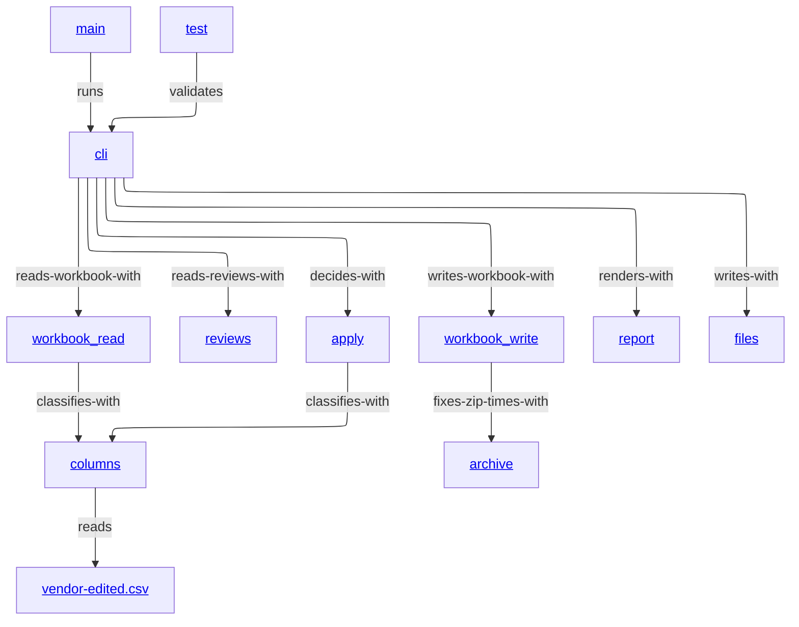

# Vendor Workbook Updater

## Purpose

A Node command line tool that applies the review rows a lead accepted to one vendor's vendor-facing tracker workbook, starting from the copy downloaded from SharePoint, and writes a new vendor-safe `.xlsx` the lead uploads by hand, so accepted values no longer have to be copied into the vendor workbook.

## Navigation

[Job Behavior Specifications](../../README.md#navigation) / [Tracker Tools](../README.md#navigation) / **Vendor Workbook Updater**

- [Design](#design)
  - [Diagram](#diagram)
- [Technology](#technology)
- [Behavior](#behavior)
- [Plan](#plan)
  - [Planned Navigation](#planned-navigation)
  - [Planned Design](#planned-design)
  - [Planned Behavior](#planned-behavior)
  - [Steps](#steps)
  - [Acceptance Mapping](#acceptance-mapping)
  - [Assumptions And Open Questions](#assumptions-and-open-questions)
  - [Planned Relationships](#planned-relationships)
  - [Planned Links](#planned-links)
- [Relationships](#relationships)
- [Links](#links)

## Design

One command, `update-vendor-workbook`, behind a thin adapter. [main](src/main.ts) only connects the process to [cli](src/cli.ts), which parses the arguments, collects every input problem, runs the modules and returns the exit status (0 done, 1 input problem or reference collision, 2 bad usage). [columns](src/columns.ts) builds the vendor columns of each tab from the sample's headings data and the schema and reads the vendor-owned columns from [vendor-edited.csv](data/vendor-edited.csv). [workbook_read](src/workbook_read.ts) reads the downloaded workbook back to rows with a strict header check. [reviews](src/reviews.ts) reads and validates the three review CSVs and stages the `applied_on` rewrite. [apply](src/apply.ts) is the decision core: scope, already applied, conflict, existing record, new record and release. [workbook_write](src/workbook_write.ts) produces the vendor-safe workbook and [archive](src/archive.ts) fixes the entry times of its zip. [report](src/report.ts) renders the Markdown report and [files](src/files.ts) checks the paths and writes through temporary names.

Reading, validating and secret detection are imported by relative path from the [Tracker Tables](../tracker-tables/README.md#design), the [Tracker Reconciler](../tracker-reconciler/README.md#design), the [Review CSV Exporter](../review-csv-exporter/README.md#design) and, for layout and headings only, the [Sample Tracker Workbook](../sample-tracker-workbook/README.md#design); none is changed. The Excel table, band, dropdown and style code is small and is written here, because the sample's workbook module imports `exceljs` and would resolve it from the sample's own folder. The vendor-safe differences from the sample are in [contract.md](contract.md#outputs).

How a run goes: the headings, columns, export, review files, downloaded workbook and output paths are all read and validated first and every decision is computed; any problem stops the run with exit 1 and one `file: line N: message` per problem before anything is written. Then the workbook, report and changed review files are written to temporary names and renamed, the review files last.

Decisions (record of the build; override in chat):

- **Byte repeatability (spike result).** `exceljs` 4.4.0 output differs between two runs two seconds apart only in the zip entry times, which its zip library takes from the clock. `archive` therefore sets every entry's DOS time and date to 1980-01-01 in the local and central headers; the same rows and run date then give identical bytes (a test builds twice two seconds apart). Document properties use the run date. Sheet protection has no password, because a password adds a random salt; it is a guard against slips, not security.
- **Whole-workbook rebuild.** The workbook is rebuilt from the downloaded rows plus applied changes, so formatting a vendor added is lost. A tab with no rows still gets a table with one blank row, since Excel needs a data row.
- **Scope first.** Every review row is scoped to the vendor before anything else: another vendor's row is only counted, a not-accepted row of this vendor is listed as skipped with its status, and a row whose record, use case or vendor cannot be found is skipped with the reason. A master row missing from the workbook, and a new question or access row whose use case is not in the workbook or an accepted new use case of the same run, are skipped and listed.
- **Fields.** A shown field is applied when its schema visibility is `V`, its owner is `spec` or `human`, it is a column of the vendor workbook and it is not in `vendor-edited.csv`; `released_on` and `due_on` are also protected by name. Other fields are listed under "Fields not applied" (vendor-visible) or "Left for the internal tracker" (internal columns, plus the row's `other_changes` text), for every in-scope accepted row that is not a conflict. A mixed row applies its vendor part. An internal-only or no-change row gets no `applied_on`.
- **Conflicts.** `changed_since_review`, a held or conflicting field, a `conflict` cell, a recomputed digest that differs from the file's, or a current value that differs from the workbook's (trimmed, line endings normalized) is a conflict and the whole row is left alone and listed. A row with `applied_on` set is skipped, or listed as a conflict when it changed since.
- **New records.** A new record takes `suggested_ref`; a blank or malformed one, or one that exists in the export, the workbook or earlier in the run, stops the run. A new use case takes `use_case_name` from the row's `use_case` cell and needs a proposed `vendor` equal to `--vendor`; a new question or access row finds its use case by that name. A new question needs `--release-batch` and `--release-date` and gets `released_on`, `batch_ref`, `due_on` (release plus two working days, `--holidays` optional) and `answer_status` `not-answered`, whatever the row proposes; without a release it stays pending. Rows are added by tab, in review `order`. Values outside the schema's list, date or reference format stop the run.
- **Release check.** If the export holds the batch, its vendor must be `--vendor` and its `released_on`, if set, must equal `--release-date`.
- **Review CSV rewrite.** Only files with an applied row are rewritten, through the library's CSV writer; only `applied_on` of the applied rows changes. Review rows must be valid under the exporter's rules (`review_status`, dates, whole-number `order`, field states).
- **Out of scope.** The internal tracker apply, SharePoint, the internal workbook and refreshing `acknowledgement_requested_on` (backlog item `internal-tracker-apply`).
- **Risks.** A rerun on an older download skips rows already marked `applied_on`; the report says so. A multi-value proposed cell (` | ` joined by the exporter) is applied as shown, since that is what the lead accepted.

### Diagram

## Technology

- Inherited from Tracker Tools (Node 26 with native TypeScript and `node:test`), plus one exact-pinned dependency, `exceljs` 4.4.0, to read and write `.xlsx`, as the Sample Tracker Workbook does (component-local `package.json` and lockfile; `npm ci` is the `install` check). Built-ins only otherwise; the zip entry times are fixed with `Buffer` writes, no extra dependency. Detail is in [requirements.md](requirements.md#requirements).

## Behavior

- **B1** When it runs on a downloaded vendor workbook, the review CSVs, a tracker export and a vendor, then it writes a new `.xlsx` in the sample workbook's format and leaves the input untouched.
- **B2** When a review row has `review_status` `accepted`, then it applies, and a blank, `rejected` or `clarify` row never applies.
- **B3** When a row has `applied_on` set and an unchanged content digest, then it is skipped, and the same inputs and run date give a byte-identical workbook with no duplicate rows.
- **B4** When the workbook is written, then it holds only that vendor's rows and vendor-visible columns on Use Cases, Questions and Identity & Access, with no internal column, Mappings, other vendor's row, hidden sheet or column, comment or link to the master.
- **B5** When an accepted new question row is applied and the lead named a release, then it is added with `released_on`, `batch_ref` and a `due_on` of release plus two working days, and without a release it is left pending and listed.
- **B6** When a row is applied, then the vendor's answers, answer status, acknowledgements and vendor-side access fields, and the `released_on` and `due_on` of existing rows, never change.
- **B7** When a row's current value differs from the workbook's, or the row changed since review, then nothing is applied for that row and a conflict is listed.
- **B8** When a new record is added, then it takes the exporter's suggested reference, and a collision stops the run.
- **B9** When a run succeeds, then `applied_on` is set on the applied rows of the review files, written atomically, and when any step fails nothing is written.
- **B10** When an input is invalid or a value looks like a secret, then the run stops naming the file and line and writes nothing, and the report lists what was applied, what was skipped and why, and the accepted internal-column values left for the internal tracker.

## Plan

### Planned Navigation

[Job Behavior Specifications](../../README.md#plan) / [Tracker Tools](../README.md#plan) / **Vendor Workbook Updater**

- [Planned Design](#planned-design)
- [Planned Behavior](#planned-behavior)
- [Steps](#steps)
- [Acceptance Mapping](#acceptance-mapping)
- [Assumptions And Open Questions](#assumptions-and-open-questions)
- [Planned Relationships](#planned-relationships)
- [Planned Links](#planned-links)

This plan is extended on 2026-11-16 for the use case ID change; the earlier text below is kept and only corrected where the build made it stale.

### Planned Design

Earlier note (corrected): the [Master Workbook Updater](../master-workbook-updater/README.md#design) was built with its own copies of `loadReviews`, `cellText` and `headerRow`, so the two small exports it once asked for are no longer needed; it reuses this tool's `columns`, `workbook_read`, `workbook_write`, `archive`, `files` and `valueProblem`, and its `data/vendor-edited.csv`. The tool's "Out of scope" line points to the Master Workbook Updater for the internal tracker apply.

Use case ID change (extended plan). The tool stops matching a use case by its name and matches by the derived use case ID `uc-<vendor-slug>-<use-case-slug>` defined in the [Tracker Data Contract](../../tracker-data-contract/contract.md#planned-use-case-id-and-local-references), through the one `useCaseId(vendor, name)` helper added to the [Tracker Tables](../tracker-tables/README.md#purpose) library (imported by relative path, no private copy). The review CSVs' `use_case` cell now carries the ID. The structure is unchanged, so there is no new diagram; the changes are inside [apply](src/apply.ts) and [reviews](src/reviews.ts):

- **Known use cases.** `apply` builds three ID maps once: the workbook's Use Cases rows (ID from each row's `vendor` and `use_case_name`; two rows with the same ID stop the run naming the workbook sheet row), the export's Use Cases rows (all vendors; the reconciler already stops on a duplicate ID) and the new use case rows of the review files (ID from the proposed `vendor` and `use_case_name`, whatever the review status, so a question for another vendor's new use case is still known and is counted as that vendor's). Today's `useCaseRow(name)` (line 84) searches the workbook by name and the export search at line 100 searches all vendors by name, which can pick the wrong vendor's row; both become ID lookups.
- **Scope of a new question or access row** (`scopeOf`, lines 99-102): the `use_case` cell must have the ID form and be known. In the workbook or accepted as a new use case of this vendor in this run: this vendor's. In the export or in the review files for another vendor: counted as another vendor's. This vendor's but not in the workbook (export row, or a new use case row not accepted): skipped with the reason "use case <ID> is not in the workbook". Not known, or not in the ID form (the old name form or the slug alone): the run stops with `file: line N: message` naming the expected form `uc-<vendor-slug>-<use-case-slug>`, writing nothing. The old "in neither the workbook, the export nor this run" skip goes.
- **A new use case** (lines 94-98 and 191-192): it still needs a proposed `vendor` equal to `--vendor`, and now also a proposed `use_case_name`; with no name it is skipped and listed. The name written to `use_case_name` is that proposed field (line 192 no longer copies the `use_case` cell, which holds the ID), found by the existing field loop because `use_case_name` is a vendor `spec` column. The ID derived from the proposed vendor and name must equal the row's `use_case` cell and must not already exist in the workbook or earlier in the run; a mismatch or a duplicate stops the run, like a reference collision.
- **A new question or access row** (lines 194-195) takes `use_case_ref`, `use_case_name` and `vendor` from the matched workbook row, not from the review row, so the readable name always comes from the matched row.
- **Existing records** map by `record` as today. Their `use_case` cell is only checked for the ID form (reviews), and a blank cell is accepted on an existing record because an update never needs the ID to find its row.
- **Reviews** (`reviews.ts` line 94): a non-blank `use_case` cell that is not in the ID form stops the run naming file and line.

### Planned Behavior

Reworded behaviors (IDs kept, the other behaviors are unchanged):

- **B5** When an accepted new question row is applied for a use case found by its use case ID in the workbook, and the lead named a release, then it is added with `released_on`, `batch_ref` and a `due_on` of release plus two working days, and without a release it is left pending and listed.
- **B8** When a new record is added, then it takes the exporter's suggested reference, a new use case takes its `use_case_name` from its proposed field and a new question or access row takes the use case's name and reference from the matched row, and a reference or use case ID collision stops the run.
- **B10** When an input is invalid, a value looks like a secret, or a `use_case` cell names an unknown use case ID or is in the old name or slug form, then the run stops naming the file and line and writes nothing, and the report lists what was applied, what was skipped and why, and the accepted internal-column values left for the internal tracker.

### Steps

1. Read the helper `useCaseId` in `tracker-tables/src` as built by the Tracker Tables component and import it by relative path in `apply.ts` and `reviews.ts`; write no slug code here.
2. `src/reviews.ts` (B10, line 94): validate a non-blank `use_case` cell against the ID form `uc-<slug>(-<slug>)*`, pushing `file: line N: use case "<cell>" is not a use case ID such as uc-example-vendor-daily-report` to the problems.
3. `src/apply.ts` (B5, B8, B10): replace `useCaseRow(name)` (line 84) with the ID maps described in Planned Design; rewrite `scopeOf` (lines 86-103) for the cases above; for a new use case take the name from the proposed `use_case_name` field, check the ID against the cell and the maps (lines 191-192); take name, reference and vendor from the matched row for a new question or access row (lines 194-195). Keep the decision order, so a new use case exists before its new questions.
4. `src/workbook_read.ts`: no code change; the duplicate-ID check on workbook Use Cases rows lives in `apply.ts` and reports the sheet row through the workbook's line numbers.
5. `contract.md`: merge the planned section below into Inputs (the Review CSVs and Identity bullets, lines 21-22) and Decision order (items 1 and 7); `requirements.md` needs no change (it names no key text).
6. Tests in `test/`, using a helper in `support.ts` that builds the ID with the library's `useCaseId`: update every fixture whose `useCase` is a name (`accept`, `applied_on`, `conflict`, `input`, `owned`, `refs`, `release`, `repeat`, `format`, `vendor_only`, `reviews` and `support.ts`; the planner list named fewer, these all pass `useCase`) to the ID of its use case, and its `key` values to the new local references (`<id>/Q9@v2`, `<id>/<endpoint>/<environment>`); in `cli.test.ts` the exporter fixtures (`set(...)`, `add(...)` lines 12-19) use IDs, and `spec_refs` uses `<id>/Q9@v2`. Change the expected report text in `accept.test.ts` (lines 25-37) and add tests: `[B5]` a new question for a use case of this vendor that exists only in the export is skipped; `[B8]` the name comes from the proposed field, a missing name is skipped, an ID that differs from the cell or duplicates a workbook row stops the run, and a use case with the same name at two vendors is never matched across vendors (the new root B09 in miniature); `[B10]` an unknown ID, a name-form cell and a slug-alone cell each stop naming file and line with nothing written; `[B3]` repeat is still byte-identical.
7. Run the component's tests and the coverage check, then the Master Workbook Updater's and Review CSV Exporter's tests, to confirm nothing they read changed.

### Acceptance Mapping

| Acceptance | Behaviors | Step | Test |
| --- | --- | --- | --- |
| 1. New question and access rows find their use case by ID, never by name, and two vendors' same-named use cases are not matched to each other | B5, B8 | 3, 6 | `accept.test.ts` scope cases; `refs.test.ts`; `release.test.ts` |
| 2. A new use case takes its name from the proposed field and a wrong or duplicate ID stops the run | B8 | 3, 6 | `refs.test.ts`, `release.test.ts`, `accept.test.ts` |
| 3. An unknown ID or a name or slug-alone reference stops naming file and line and writes nothing | B10 | 2, 3, 6 | `reviews.test.ts`, `input.test.ts`, `cli.test.ts` |
| 4. One shared helper, no private slug code, contract merged and all fixtures regenerated, all tests green | B3, B5, B8, B10 | 1, 5, 6, 7 | every test file listed in step 6; the repeat test stays byte-identical |

Validation: `npm ci`, then `node --test "tracker-tools/vendor-workbook-updater/test/*.test.ts"`, the coverage check, narrowest first.

### Assumptions And Open Questions

Assumptions (override by telling the builder, or by editing the file named):

- **The exporter shows `use_case_name` for a new use case.** Today `review-csv-exporter/data/review-headings.csv` has no `Use Cases,use_case_name` row, so a review row has no proposed name cell. The Review CSV Exporter's plan must add it (this plan depends on that); if it does not, the only name source left is `other_changes`, which this tool does not read. Override by changing the exporter plan first.
- **Build order.** After tracker-data-contract, the skills and Tracker Tables (the helper); the Review CSV Exporter and Tracker Reconciler first, because the export loader's duplicate-ID check and the review `use_case` cell come from them.
- **Unknown ID stops the run** instead of the old skip, as the brief fixes (B10 of the root). A question for another vendor's new use case counts as another vendor's, so it does not stop.
- **Duplicate IDs in the downloaded workbook stop the run** (the workbook is the vendor's own file, so a duplicate is an input problem). Override: list it as a conflict instead.
- **A new use case whose cell differs from its derived ID stops the run**, because later questions would point at a different ID. Override: skip and list it.
- **A blank `use_case` cell on an existing-record row is accepted**, since the row maps by `record`.
- **Old fixtures are regenerated, not migrated**; no code reads the name form.

Open questions: none.

### Planned Relationships

- [Master Workbook Updater](../master-workbook-updater/README.md#design) — reuses this tool's reader, writer, review loader and vendor-owned column list.
- [Tracker Data Contract](../../tracker-data-contract/README.md#plan) — defines the use case ID, the slug rule and the local references; this tool builds after it.
- [Tracker Tables](../tracker-tables/README.md#purpose) — will hold the one `useCaseId(vendor, name)` helper this tool imports.
- [Review CSV Exporter](../review-csv-exporter/README.md#purpose) — writes the use case ID in the `use_case` cell and must show `use_case_name` for a new use case.
- [Tracker Reconciler](../tracker-reconciler/README.md#purpose) — its export loader stops on two Use Cases rows with the same ID.

### Planned Links

- [contract.md](contract.md#planned-use-case-id-matching) — the exact replacement text for the Inputs and Decision order bullets.

## Relationships

- [Tracker Data Contract](../../tracker-data-contract/README.md#purpose) — the schema, owner classes, vendor-view rule and reference scheme the tool reads.
- [Tracker Tables](../tracker-tables/README.md#purpose) — CSV and schema functions and the due-date arithmetic.
- [Tracker Reconciler](../tracker-reconciler/README.md#purpose) — the export loader and the secret detection.
- [Review CSV Exporter](../review-csv-exporter/README.md#purpose) — the review CSV header, content digest, statuses and suggested references.
- [Sample Tracker Workbook](../sample-tracker-workbook/README.md#purpose) — the layout rules and column headings the vendor workbook follows.

## Links

- [requirements.md](requirements.md#requirements) — what the tool must do, what must match the source and what need not.
- [contract.md](contract.md#contract) — the command, inputs, field classification, decision order, outputs and writing rules.
