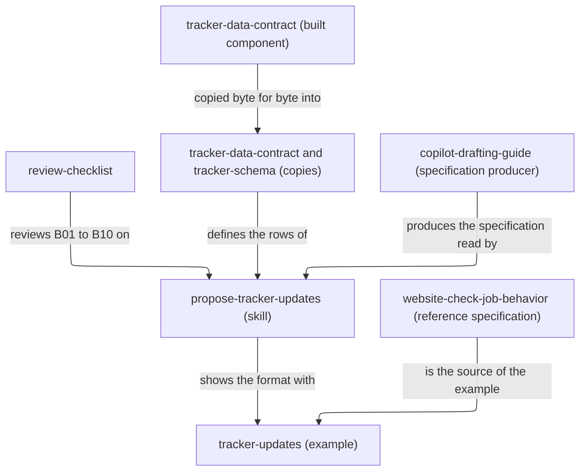

# Tracker Update Proposer

## Purpose

A GitHub Copilot agent skill that turns a use case specification into proposed use case and question rows in `tracker-updates.csv`, so developers hand a lead reviewable tracker changes with each specification and no one retypes questions.

## Navigation

[Job Behavior Specifications](../README.md#navigation) / **Tracker Update Proposer**

- [Design](#design)
  - [Diagram](#diagram)
- [Behavior](#behavior)
- [Plan](#plan)
  - [Planned Navigation](#planned-navigation)
  - [Planned Design](#planned-design)
  - [Planned Behavior](#planned-behavior)
  - [Steps](#steps)
  - [Acceptance Mapping](#acceptance-mapping)
  - [Assumptions And Open Questions](#assumptions-and-open-questions)
  - [Planned Relationships](#planned-relationships)
  - [Planned Links](#planned-links)
- [Relationships](#relationships)
- [Links](#links)

## Design

The component delivers one skill folder, [propose-tracker-updates](propose-tracker-updates/SKILL.md), and one internal checklist. The folder holds the instructions written once ([SKILL.md](propose-tracker-updates/SKILL.md)), byte-identical copies of the contract ([tracker-data-contract.md](propose-tracker-updates/tracker-data-contract.md)) and the schema ([tracker-schema.csv](propose-tracker-updates/tracker-schema.csv)) from the built Tracker Data Contract, and an example proposal for the website use case ([tracker-updates.csv](propose-tracker-updates/tracker-updates.csv)). The folder name and the skill `name` stay `propose-tracker-updates`. The drafting skill produces the specification and tells developers to run this skill next, so there is one flow.

The skill has two modes and owns the Use Cases and Questions tabs only. It writes no link or group rows, so similarity checking is the reconciler's alone.

- **Source screening** runs first, over the whole inventory and its source locations, before any specification exists and in parallel with access discovery. For a use case whose source is missing, empty or of uncertain mapping it suggests the source status (`not-located`, `empty`, `uncertain-mapping`), blocker reason, note and owner (the inventory's named owner, otherwise `unassigned`), with `inventory:<row>` or `source-screen:<path>` as the source and no specification anchor. It never writes `confirmed-unavailable`, and supporting documents are preliminary support that never verifies the source.
- **Specification update** runs later and proposes rows only from the resulting specification. A first run adds the use case (name, vendor, link, version, revision) and one Questions `add` per use case per open question, with the exact wording as `current_spec_text` and a source anchor with version. A revised specification `set`s the current version with `base_value`, the change class (`behavior-change` or `non-behavior-change`) and, separately, the grouping impact (`could-affect`, `not-expected` or `unknown`) with its short reason in the row's `reason`; `unknown` is never treated as no impact. A reworded question keeps its row, with the new wording in `current_spec_text` and a `text_review` suggestion of `wording-edit` or `possible-meaning-change`; the released wording, the answer and the row's status are never touched, and a lead decides any replacement. An answered question is suggested as incorporated. Supplied findings and questions that are not yet in a specification get no row and are reported.

Both modes follow the contract's field classes: spec fields are `add`ed or `set` with `base_value`, human fields only `suggest`ed on an existing record or given as an initial suggestion on an `add`, and forbidden and computed fields are never written. Rows are composed with deterministic `update_id` values, so a rerun on the same input gives the same rows and no duplicate; unchanged rows keep their `created_on`, and local references are never renumbered. Output goes only to `tracker-updates/<proposal-id>/tracker-updates.csv` and is never applied. The skill ends with a report of content with no row, supplied items not yet in a specification, rows without a source, unread files, unassigned source owners and use cases with only document support, and behavior changes with their grouping impact.

The example file is written from the built website specification: one use case record and one Questions record for each of Q1 to Q6, with local references `website-availability-check/Q<n>`, `spec_refs` `website-availability-check/Q<n>@v1` and a `@v1#q<n>` source on every question row. It has no vendor and no specification link, because neither is stated in the specification or was given, and says so in the row's reason. It has no source-screening rows, because the website specification has no inventory row to cite; the screening rows are described in `SKILL.md` with invented names. [review-checklist.md](review-checklist.md) is internal, with one item per behavior; the skill folder never mentions the internal records.

Testing policy: the behaviors are checked by the file review and by the user's manual client-environment testing on real use cases, and are marked `untested: benchmark pending`. No Copilot run has been made for this skill.

### Diagram

## Behavior

- **B01** When a use case is first listed or its specification is first drafted, then the skill proposes an `add` for the use case (name, vendor, link, version, revision) and never a central reference. (untested: benchmark pending)
- **B02** When it runs in source-screening mode over the entire inventory and its source locations before any specification exists, then each use case with a missing, empty or uncertain source mapping gets `suggest` rows for source status (not-located, empty or uncertain-mapping), blocker reason, note and owner (the inventory's named owner, otherwise `unassigned`), the evidence is the inventory or source-screening finding and needs no specification anchor, it never marks a source confirmed unavailable, and available documents only note preliminary work and never claim the source is verified. (untested: benchmark pending)
- **B03** When a specification has open questions, then each open question becomes one Questions `add` per use case (local reference, exact text as the latest specification wording, source anchor with version) and never a shared answer, and it writes no link or group rows, because similarity checking belongs to the reconciler. (untested: benchmark pending)
- **B04** When a specification is updated, then it proposes a `set` of `current_version` with `base_value`, marks the change as behavior-change or non-behavior-change, separately suggests whether it could affect grouping (could-affect, not-expected or unknown) with a short reason in the proposal row's `reason` for a lead to override, never treats unknown as no impact, and suggests an answered question as incorporated, and rerunning on the same input gives the same rows with no duplicate record. (untested: benchmark pending)
- **B05** When the wording of a released question changed, then the row keeps its identity, the new wording goes to `current_spec_text` with a `text_review` of wording-edit or possible-meaning-change, and it never withdraws, replaces or rewrites the released text or an earlier answer; a lead decides any replacement. (untested: benchmark pending)
- **B06** When it writes rows, then it never writes released dates, batch, answers, answer status, resolver, acknowledgement, ticket, verification or decisions, and it writes a human-owned field only as a `suggest` on an existing record or as an initial suggestion on an `add`. (untested: benchmark pending)
- **B07** When a value is not shown by its evidence, then the cell is blank and never guessed, and every row carries a `source` pointer: a specification anchor and version for specification rows, and the inventory or source-screening evidence for screening rows, so supplied findings, questions and corrections count only through the specification that records them. (untested: benchmark pending)
- **B08** When it writes the file, then it follows the contract's encoding, rewrites only its own tabs in its own proposal directory, and never releases or applies anything. (untested: benchmark pending)
- **B09** When it finishes, then it reports content with no row, supplied items not yet in a specification, rows without a source, unread files, use cases with an unassigned source owner or only document support, and use cases whose behavior changed with the suggested grouping impact (so affected workflow recommendations can be re-reviewed), and says a lead reviews it all. (untested: benchmark pending)
- **B10** When its folder is read, then it contains no Craft term, needs nothing installed in VS Code agent mode, and holds byte-identical copies of the contract and schema and an example `tracker-updates.csv` for the website use case. (untested: benchmark pending)

## Relationships

- [Tracker Data Contract](../tracker-data-contract/README.md#purpose) — the schema, reference scheme and proposal format this skill follows, copied into its folder.
- [Copilot Drafting Guide](../copilot-drafting-guide/README.md#purpose) — the drafting skill that produces the specifications this skill reads, and that tells developers to run this skill next.
- [Website Check Job Behavior](../website-check-job-behavior/README.md#purpose) — the reference specification the example proposal rows are written from.

## Links

- [requirements.md](requirements.md#requirements) — what the component must do and what it need not.
- [contract.md](contract.md#contract) — the shapes, formats and wording rules.
- [review-checklist.md](review-checklist.md) — the internal review items tagged B01 to B10.
- [propose-tracker-updates/SKILL.md](propose-tracker-updates/SKILL.md) — the skill instructions.
- [propose-tracker-updates/tracker-updates.csv](propose-tracker-updates/tracker-updates.csv) — the example proposal for the website use case.

## Plan

This plan was a wording-only change about the slug. It is extended, not replaced: the wording change is kept inside a larger change, the use case ID as the key of every row this skill writes (confirmed by the user on 2026-11-16).

### Planned Navigation

[Job Behavior Specifications](../README.md#plan) / **Tracker Update Proposer**

- [Planned Design](#planned-design)
- [Planned Behavior](#planned-behavior)
- [Steps](#steps)
- [Acceptance Mapping](#acceptance-mapping)
- [Assumptions And Open Questions](#assumptions-and-open-questions)
- [Planned Relationships](#planned-relationships)
- [Planned Links](#planned-links)

### Planned Design

Every row the skill writes is keyed by the use case ID `uc-<vendor-slug>-<use-case-slug>`, defined once in the [Tracker Data Contract](../tracker-data-contract/README.md#planned-design) (the vendor and the use case name, each as a slug, derived and never stored). A use case record's `record_key` is the use case ID, a Questions row's is `<use-case-id>/Q<n>`, and its `spec_refs` entry is `<use-case-id>/Q<n>@v<version>`. The readable name stays in the `use_case_name` column. The use case name or the slug alone is no longer a key. Source-screening `suggest` rows are keyed by the use case ID as well.

The ID needs a vendor. The skill takes the vendor from the inventory row, the input or the specification. When none shows it, the skill asks the lead once for the vendor, never invents one, and writes no keyed row for that use case until it is known; it names the use case in the report. This replaces today's rule that a blank vendor row is written and explained, because a row with no key cannot be written.

The earlier wording fix is kept. The `record_key` sentence no longer says the use case slug is "the same slug the specification folder and `spec_refs` use". The slug is the use case name in lower case with hyphens, and the specification's location comes from the use case index, not from the slug, so no wording ties the slug to a folder name. The slug rule is the contract's and the orchestrator's: lower case, each run of characters outside `a-z` and `0-9` becomes one `-`, leading and trailing `-` trimmed.

The example proposal is regenerated for the website use case under a fictional vendor (`Example Vendor`, so the ID is `uc-example-vendor-website-availability-check`), so every `record_key`, `spec_refs` entry and composed `update_id` shows the new form; its `proposal_id` stays `website-check-example`, a branch-style proposal ID. The specification path in each `source` is a file path and does not change. The skill's copy of `tracker-data-contract.md` is replaced by the contract component's file as built; `tracker-schema.csv` is unchanged. No diagram: the structure of the component does not change.

### Planned Behavior

These replace the current wording of the named behaviors when built; the other behaviors (`B02` and `B04` to `B09`) are unchanged in wording.

- **B01** When a use case is first listed or its specification is first drafted, then the skill proposes an `add` for the use case, keyed by its use case ID, with name, vendor, link, version and revision, and never a central reference; when the vendor is not known it asks the lead once, never invents one, and writes no keyed row for that use case until the vendor is known. (untested: benchmark pending)
- **B03** When a specification has open questions, then each open question becomes one Questions `add` per use case, keyed `<use-case-id>/Q<n>`, with `spec_refs` `<use-case-id>/Q<n>@v<version>`, the exact text as the latest specification wording and a source anchor with version, and never a shared answer, and it writes no link or group rows, because similarity checking belongs to the reconciler. (untested: benchmark pending)
- **B10** When its folder is read, then it contains no Craft term, needs nothing installed in VS Code agent mode, and holds a copy of the contract that equals the Tracker Data Contract component's file as built, a byte-identical copy of the schema, and an example `tracker-updates.csv` for the website use case under a fictional vendor whose keys, `spec_refs` and `update_id` values use the use case ID. (untested: benchmark pending)

### Steps

1. [propose-tracker-updates/SKILL.md](propose-tracker-updates/SKILL.md), the `record_key` bullet (line 43): a use case's key is the use case ID; a question row's is `<use-case-id>/Q<n>`; say how the ID is built (vendor and use case name as slugs, the contract's slug rule, `uc-` prefix), that the name stays in `use_case_name`, that the specification's location comes from the use case index and not from the slug, and that the old "same slug the specification folder and `spec_refs` use" is removed. Add the vendor-unknown rule once, near the proposal file rules: ask the lead once, never invent a vendor, write no keyed row until it is known, and list the use case in the report.
2. Same file, the other places that name a key: line 76 (screening `suggest` rows are keyed by the use case ID, from the inventory's vendor), line 88 (the invented-name illustration shows `uc-example-vendor-example-use-case` as the key), line 100 (the first-run vendor rule: replace "leave `value` blank and say so" with the vendor-unknown rule), lines 101 and 103 (the Questions add rule: record key `<use-case-id>/Q<n>`, `spec_refs` `<use-case-id>/Q<n>@v<version>`), and the `Use Cases` rows of the Inputs section if a search finds a name key there. A search for `use-case-slug`, `use case name, exactly` and `record key is the use case name` finds nothing left.
3. [propose-tracker-updates/tracker-updates.csv](propose-tracker-updates/tracker-updates.csv) (48 rows): regenerate with the fictional vendor `Example Vendor`. The use case rows and the six question records use the ID as key and in `update_id`; the `vendor` rows of the use case and of each question carry `Example Vendor` with a reason that it is a fictional vendor given for the example; `spec_refs` values are `uc-example-vendor-website-availability-check/Q<n>@v1`. Everything else (fields, order, sources, dates) stays, and the file is checked with a throwaway script outside the repository (header, schema fields, composed unique `update_id`, source on every row).
4. [propose-tracker-updates/tracker-data-contract.md](propose-tracker-updates/tracker-data-contract.md): replace with the contract component's file as built; check with `cmp`. Do not touch [tracker-schema.csv](propose-tracker-updates/tracker-schema.csv) (the copy stays byte-identical).
5. This README: the Design paragraphs that describe the key, the vendor, the example and the Tracker Data Contract copy; `B01`, `B03` and `B10` as above. [review-checklist.md](review-checklist.md): `[B01]` (vendor never blank, keyed by the ID, ask once), `[B03]` (`<use-case-id>/Q<n>` and `spec_refs`) and `[B10]` (the contract copy equals the built file, the example under a fictional vendor). [contract.md](contract.md): move the planned section below into the update rules. [requirements.md](requirements.md): move the planned bullet in.
6. Validate: search the skill folder, README and checklist for `use-case-slug`, a name-only key and wording that ties the slug to a folder name (none left); `cmp` of the contract copy with the contract component's file and of the schema copy with its file; the example check in step 3; the file hygiene scan; then the root `test` check, whose contract-copy test (root `B05`) passes only once the other two skill copies have landed.

### Acceptance Mapping

| Acceptance | Behaviors | Step | Check |
| --- | --- | --- | --- |
| 1. The skill keys a use case by its use case ID and a question row by `<use-case-id>/Q<n>` with `spec_refs` `<use-case-id>/Q<n>@v<version>`, says how the ID is built, and no wording ties the slug to a folder name. | B01, B03 | 1, 2 | checklist `[B01]`, `[B03]` and the search in step 6 |
| 2. With no vendor known the skill asks once, invents none and writes no keyed row. | B01 | 1, 2 | checklist `[B01]` |
| 3. Source-screening rows and the illustration use the use case ID as key (rule text unchanged). | B02 | 2 | checklist `[B02]` |
| 4. The example proposal is regenerated under a fictional vendor with every key, `spec_refs` and `update_id` in the new form. | B03, B10 | 3 | checklist `[B10]` and the throwaway check |
| 5. The contract copy equals the contract component's file as built, the schema copy is unchanged, and the README, contract, requirements and checklist agree. | B10 | 4, 5, 6 | `cmp`, checklist `[B10]`, the root `test` check |

Validation: the commands in step 6.

### Assumptions And Open Questions

Assumptions (override by telling the builder, or by editing the file named):

- **The key change is confirmed behavior** (user, 2026-11-16): the use case ID is the key; an old name form or slug-alone form is not valid, with no migration and no fallback. It replaces the earlier assumption that the key form is decided later; the backlog items `local-reference-form-decision` and `cross-vendor-use-case-name-collision` are planned in the Tracker Data Contract plan, and `proposer-spec-folder-wording` is already removed.
- **The ID is derived, never stored**, so no column and no schema change (the schema copy stays byte-identical). Override by adding a stored ID column, which changes every consumer.
- **The vendor comes from the inventory row, the input or the specification.** Through the orchestrator it comes from `use-case-index.csv`. A vendor correction changes the ID; rows already proposed still trace through their `update_id`.
- **B01 is reworded as well as B03 and B10**, because today's rule writes a blank-vendor row, which cannot be keyed. Override by keeping a blank-vendor row, which needs a key that does not use the vendor.
- **B02's wording is unchanged**; only the key shown in its rows changes.
- **The example keeps `proposal_id` `website-check-example`.** Override by using the use case ID as the proposal ID, as the orchestrator does.
- **Build order:** after the Tracker Data Contract component is built, before the root test for the contract copies is run; the copy is this component's acceptance.

Open questions: none.

### Planned Relationships

- [Tracker Data Contract](../tracker-data-contract/README.md#planned-design) — defines the use case ID and the local references; its built `tracker-data-contract.md` is copied here, so it must be built first.
- [Discovery Orchestrator](../discovery-orchestrator/README.md#design) — keeps the use case index that holds each specification's folder and vendor, and derives the same string as its proposal ID.

### Planned Links

- [propose-tracker-updates/SKILL.md](propose-tracker-updates/SKILL.md) — the skill whose key rules change.
- [propose-tracker-updates/tracker-updates.csv](propose-tracker-updates/tracker-updates.csv) — the example to regenerate.
- [contract.md](contract.md#planned-use-case-id-keys) — the planned wording.
