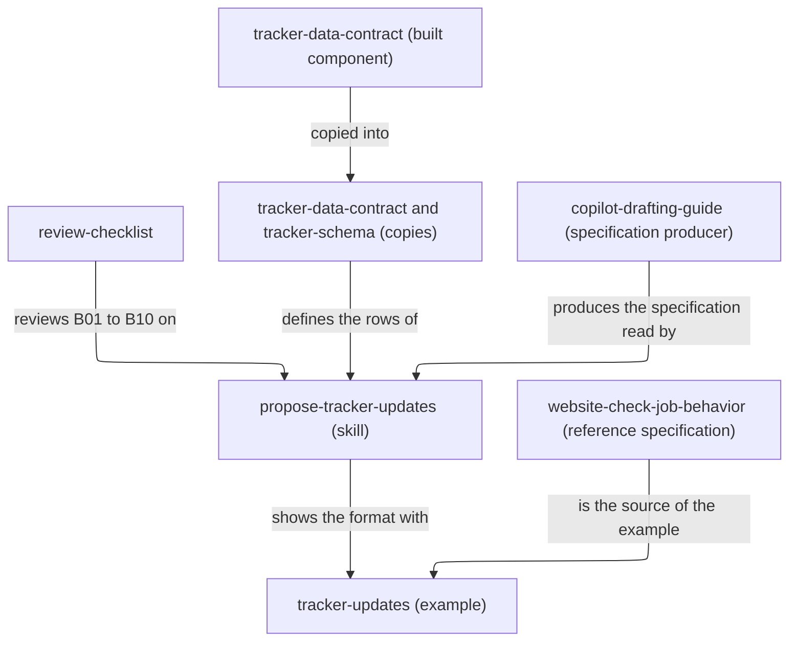
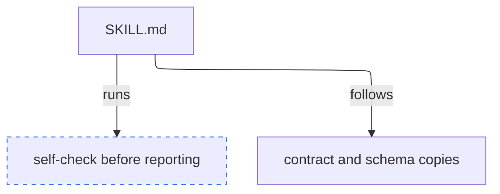

# Tracker Update Proposer

## Purpose

A GitHub Copilot agent skill that turns a use case specification into proposed use case and question rows in `tracker-updates.csv`, so developers hand a lead reviewable tracker changes with each specification and no one retypes questions.

## Navigation

[Job Behavior Specifications](../README.md#navigation) / **Tracker Update Proposer**

- [Design](#design)
  - [Diagram](#diagram)
- [Behavior](#behavior)
- [Plan](#plan)
  - [Planned Navigation](#planned-navigation)
  - [Planned Design](#planned-design)
    - [Planned Diagram](#planned-diagram)
  - [Steps](#steps)
  - [Acceptance Mapping](#acceptance-mapping)
  - [Assumptions And Open Questions](#assumptions-and-open-questions)
  - [Planned Relationships](#planned-relationships)
  - [Planned Links](#planned-links)
- [Relationships](#relationships)
- [Links](#links)

## Design

The component delivers one skill folder, [propose-tracker-updates](propose-tracker-updates/SKILL.md), and one internal checklist. The folder holds the instructions written once ([SKILL.md](propose-tracker-updates/SKILL.md)), a copy of the contract ([tracker-data-contract.md](propose-tracker-updates/tracker-data-contract.md)) that equals the file of the built Tracker Data Contract, a byte-identical copy of its schema ([tracker-schema.csv](propose-tracker-updates/tracker-schema.csv)), and an example proposal for the website use case ([tracker-updates.csv](propose-tracker-updates/tracker-updates.csv)). The folder name and the skill `name` stay `propose-tracker-updates`. The drafting skill produces the specification and tells developers to run this skill next, so there is one flow.

The skill has two modes and owns the Use Cases and Questions tabs only. It writes no link or group rows, so similarity checking is the reconciler's alone.

- **Source screening** runs first, over the whole inventory and its source locations, before any specification exists and in parallel with access discovery. For a use case whose source is missing, empty or of uncertain mapping it suggests the source status (`not-located`, `empty`, `uncertain-mapping`), blocker reason, note and owner (the inventory's named owner, otherwise `unassigned`), with `inventory:<row>` or `source-screen:<path>` as the source and no specification anchor. It never writes `confirmed-unavailable`, and supporting documents are preliminary support that never verifies the source.
- **Specification update** runs later and proposes rows only from the resulting specification. A first run adds the use case (name, vendor, link, version, revision) and one Questions `add` per use case per open question, with the exact wording as `current_spec_text` and a source anchor with version. A revised specification `set`s the current version with `base_value`, the change class (`behavior-change` or `non-behavior-change`) and, separately, the grouping impact (`could-affect`, `not-expected` or `unknown`) with its short reason in the row's `reason`; `unknown` is never treated as no impact. A reworded question keeps its row, with the new wording in `current_spec_text` and a `text_review` suggestion of `wording-edit` or `possible-meaning-change`; the released wording, the answer and the row's status are never touched, and a lead decides any replacement. An answered question is suggested as incorporated. Supplied findings and questions that are not yet in a specification get no row and are reported.

Every row is keyed by the use case ID `uc-<vendor-slug>-<use-case-slug>`, built from the vendor and the use case name as defined in the contract and never stored: a use case record's `record_key` is the ID and a Questions row's is `<use-case-id>/Q<n>`, with `spec_refs` `<use-case-id>/Q<n>@v<version>`. The readable name stays in `use_case_name`, and the specification's location comes from the use case index, not from the slug. Source-screening rows are keyed by the ID too. The vendor comes from the inventory row, the input or the specification; when none shows it, the skill asks the lead once, invents none and writes no keyed row for that use case until it is known, and names the use case in the report.

Both modes follow the contract's field classes: spec fields are `add`ed or `set` with `base_value`, human fields only `suggest`ed on an existing record or given as an initial suggestion on an `add`, and forbidden and computed fields are never written. Rows are composed with deterministic `update_id` values, so a rerun on the same input gives the same rows and no duplicate; unchanged rows keep their `created_on`, and local references are never renumbered. Output goes only to `tracker-updates/<proposal-id>/tracker-updates.csv` and is never applied. The skill ends with a report of content with no row, supplied items not yet in a specification, rows without a source, unread files, unassigned source owners and use cases with only document support, and behavior changes with their grouping impact.

The example file is written from the built website specification: one use case record and one Questions record for each of Q1 to Q6, under the fictional vendor `Example Vendor`, so the use case ID is `uc-example-vendor-website-availability-check`, with record keys `<use-case-id>/Q<n>`, `spec_refs` `<use-case-id>/Q<n>@v1` and a `@v1#q<n>` source on every question row; its proposal ID is `website-check-example`. It has no specification link, because none was given, and says so in the row's reason. It has no source-screening rows, because the website specification has no inventory row to cite; the screening rows are described in `SKILL.md` with invented names. [review-checklist.md](review-checklist.md) is internal, with one item per behavior; the skill folder never mentions the internal records.

Testing policy: the behaviors are checked by the file review and by the user's manual client-environment testing on real use cases, and are marked `untested: benchmark pending`. No Copilot run has been made for this skill.

### Diagram

## Behavior

- **B01** When a use case is first listed or its specification is first drafted, then the skill proposes an `add` for the use case, keyed by its use case ID, with name, vendor, link, version and revision, and never a central reference; when the vendor is not known it asks the lead once, never invents one, and writes no keyed row for that use case until the vendor is known. (untested: benchmark pending)
- **B02** When it runs in source-screening mode over the entire inventory and its source locations before any specification exists, then each use case with a missing, empty or uncertain source mapping gets `suggest` rows for source status (not-located, empty or uncertain-mapping), blocker reason, note and owner (the inventory's named owner, otherwise `unassigned`), the evidence is the inventory or source-screening finding and needs no specification anchor, it never marks a source confirmed unavailable, and available documents only note preliminary work and never claim the source is verified. (untested: benchmark pending)
- **B03** When a specification has open questions, then each open question becomes one Questions `add` per use case, keyed `<use-case-id>/Q<n>`, with `spec_refs` `<use-case-id>/Q<n>@v<version>`, the exact text as the latest specification wording and a source anchor with version, and never a shared answer, and it writes no link or group rows, because similarity checking belongs to the reconciler. (untested: benchmark pending)
- **B04** When a specification is updated, then it proposes a `set` of `current_version` with `base_value`, marks the change as behavior-change or non-behavior-change, separately suggests whether it could affect grouping (could-affect, not-expected or unknown) with a short reason in the proposal row's `reason` for a lead to override, never treats unknown as no impact, and suggests an answered question as incorporated, and rerunning on the same input gives the same rows with no duplicate record. (untested: benchmark pending)
- **B05** When the wording of a released question changed, then the row keeps its identity, the new wording goes to `current_spec_text` with a `text_review` of wording-edit or possible-meaning-change, and it never withdraws, replaces or rewrites the released text or an earlier answer; a lead decides any replacement. (untested: benchmark pending)
- **B06** When it writes rows, then it never writes released dates, batch, answers, answer status, resolver, acknowledgement, ticket, verification or decisions, and it writes a human-owned field only as a `suggest` on an existing record or as an initial suggestion on an `add`. (untested: benchmark pending)
- **B07** When a value is not shown by its evidence, then the cell is blank and never guessed, and every row carries a `source` pointer: a specification anchor and version for specification rows, and the inventory or source-screening evidence for screening rows, so supplied findings, questions and corrections count only through the specification that records them. (untested: benchmark pending)
- **B08** When it writes the file, then it follows the contract's encoding, rewrites only its own tabs in its own proposal directory, and never releases or applies anything. Before reporting, the skill runs a self-check on the proposal file: every row has exactly 12 fields, any value with a comma, a double quote or a line break is quoted, the header is exact, `created_on` and any date value are `YYYY-MM-DD`, each `record_key` has the form of its tab, and the file ends with exactly one line feed; when appending to the shared file it first makes sure the file ends with a line feed so its first row starts on a new line; and when the toolkit is available it also runs `validate <file>` of the Tracker Reconciler and fixes every error before reporting. (untested: benchmark pending)
- **B09** When it finishes, then it reports content with no row, supplied items not yet in a specification, rows without a source, unread files, use cases with an unassigned source owner or only document support, and use cases whose behavior changed with the suggested grouping impact (so affected workflow recommendations can be re-reviewed), and says a lead reviews it all. (untested: benchmark pending)
- **B10** When its folder is read, then it contains no Craft term, needs nothing installed in VS Code agent mode, and holds a copy of the contract that equals the Tracker Data Contract component's file as built, a byte-identical copy of the schema, and an example `tracker-updates.csv` for the website use case under a fictional vendor whose keys, `spec_refs` and `update_id` values use the use case ID. (untested: benchmark pending)

## Plan

### Planned Navigation

[Job Behavior Specifications](../README.md#plan) / **Tracker Update Proposer**

- [Planned Design](#planned-design)
  - [Planned Diagram](#planned-diagram)
- [Steps](#steps)
- [Acceptance Mapping](#acceptance-mapping)
- [Assumptions And Open Questions](#assumptions-and-open-questions)
- [Planned Relationships](#planned-relationships)
- [Planned Links](#planned-links)

### Planned Design

The skill file `tracker-update-proposer/propose-tracker-updates/SKILL.md` gains a short self-check section: the checklist above, run after writing and before reporting, and the rule to make sure the shared file ends with a line feed before appending a row. It stays plain Markdown and needs nothing installed (the root `B02`): the validator step reads "if the toolkit is available". Its keys are the use case ID alone and `<use-case-id>/Q<n>`. The copies of the contract and schema are recopied byte for byte from the Tracker Data Contract after its own build, and the example proposal file is checked against the new rules.

#### Planned Diagram

### Steps

1. After the Tracker Data Contract is built, recopy `tracker-data-contract.md` and `tracker-schema.csv` into `tracker-update-proposer/propose-tracker-updates/` byte for byte.
2. In `tracker-update-proposer/propose-tracker-updates/SKILL.md`, add the self-check and the append rule; state that blank `base_value` stays blank; keep the example proposal file well formed (12 fields, one final line feed).
3. Update this README's `B08`, `contract.md`, `requirements.md` and `review-checklist.md`, then dissolve this Plan into Design.
4. Run the scan in `review-checklist.md` and the root `B05` test.

### Acceptance Mapping

| Acceptance | Behaviors | Step | Check |
| --- | --- | --- | --- |
| The skill self-checks the file and ensures a final line feed before appending, with the validator optional | B08 | 2 | review-checklist `[B08]` |
| The contract and schema copies equal the originals | B10 | 1 | root `B05` test |

### Assumptions And Open Questions

Assumptions (override any in chat):

1. **Policy and scope.** Planned under `deciding-what-to-ask`; the change is part of one request (validation of proposal files) that also touches the other components named in the root request, each planned in its own README. Nothing is built.
2. **Choices.** An empty `base_value` stays blank (no dot); on a `set` a blank `base_value` means the field was blank when seen. The exact 12-field check and the final-line-feed check catch a lost trailing field and a fused row. Validation lives in the existing Tracker Reconciler `validate` command; the exporter shares its loader and gains no new mode. Recorded from the user's answers of 2026-11-17.
3. **Optional validator.** The pack skills stay Markdown-only (root `B02`); the validator is named as optional for developers who have the toolkit, as the user chose. The mandatory run is in the Discovery Batch Agent, which already needs Node.
4. **Order.** Built after the Tracker Data Contract.

Open questions: none. The behavior changes and the choices on the base value (kept blank, with checks) and on the pack skills (a self-check checklist, the validator optional) were confirmed by the user on 2026-11-17.

### Planned Relationships

- [Tracker Data Contract](../tracker-data-contract/README.md#purpose) — the originals the copies follow.
- [Tracker Reconciler](../tracker-tools/tracker-reconciler/README.md#purpose) — the optional `validate` command.

### Planned Links

- [requirements.md](requirements.md#requirements) — what the change must do, with the planned change section.
- [contract.md](contract.md#contract) — the interface, with the planned change section.

## Relationships

- [Tracker Data Contract](../tracker-data-contract/README.md#purpose) — the schema, the use case ID, reference scheme and proposal format this skill follows, copied into its folder.
- [Copilot Drafting Guide](../copilot-drafting-guide/README.md#purpose) — the drafting skill that produces the specifications this skill reads, and that tells developers to run this skill next.
- [Discovery Orchestrator](../discovery-orchestrator/README.md#design) — keeps the use case index that holds each specification's folder and vendor, and derives the same string as its proposal ID.
- [Website Check Job Behavior](../website-check-job-behavior/README.md#purpose) — the reference specification the example proposal rows are written from.

## Links

- [requirements.md](requirements.md#requirements) — what the component must do and what it need not.
- [contract.md](contract.md#contract) — the shapes, formats and wording rules.
- [review-checklist.md](review-checklist.md) — the internal review items tagged B01 to B10.
- [propose-tracker-updates/SKILL.md](propose-tracker-updates/SKILL.md) — the skill instructions.
- [propose-tracker-updates/tracker-updates.csv](propose-tracker-updates/tracker-updates.csv) — the example proposal for the website use case, under a fictional vendor.
