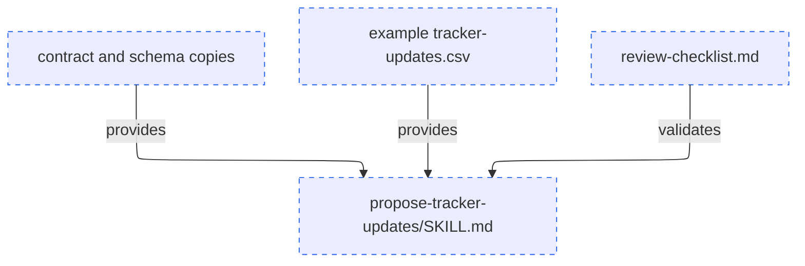

# Tracker Update Proposer

## Purpose

A GitHub Copilot agent skill that turns a use case specification into proposed use case and question rows in `tracker-updates.csv`, so developers hand a lead reviewable tracker changes with each specification and no one retypes questions.

## Navigation

[Job Behavior Specifications](../README.md#navigation) / **Tracker Update Proposer**

- [Design](#design)
- [Behavior](#behavior)
- [Plan](#plan)
- [Relationships](#relationships)
- [Links](#links)

## Design

Not built yet.

## Behavior

- **B01** When a use case is first listed or its specification is first drafted, then the skill proposes an `add` for the use case (name, vendor, link, version, revision) and never a central reference. (untested: benchmark pending)
- **B02** When it runs in source-screening mode over the entire inventory and its source locations before any specification exists, then each use case with a missing, empty or uncertain source mapping gets `suggest` rows for source status (not-located, empty or uncertain-mapping), blocker reason, note and owner (the inventory's named owner, otherwise `unassigned`), the evidence is the inventory or source-screening finding and needs no specification anchor, it never marks a source confirmed unavailable, and available documents only note preliminary work and never claim the source is verified. (untested: benchmark pending)
- **B03** When a specification has open questions, then each open question becomes one Questions `add` per use case (local reference, exact text as the latest specification wording, source anchor with version) and never a shared answer, and it writes no link or group rows, because similarity checking belongs to the reconciler. (untested: benchmark pending)
- **B04** When a specification is updated, then it proposes a `set` of `current_version` with `base_value`, marks the change as behavior-change or non-behavior-change, separately suggests whether it could affect grouping (could-affect, not-expected or unknown) with a short reason in the proposal row's `reason` for a lead to override, never treats unknown as no impact, and suggests an answered question as incorporated, and rerunning on the same input gives the same rows with no duplicate record. (untested: benchmark pending)
- **B05** When the wording of a released question changed, then the row keeps its identity, the new wording goes to `current_spec_text` with a `text_review` of wording-edit or possible-meaning-change, and it never withdraws, replaces or rewrites the released text or an earlier answer; a lead decides any replacement. (untested: benchmark pending)
- **B06** When it writes rows, then it never writes released dates, batch, answers, answer status, resolver, acknowledgement, ticket, verification or decisions, and it writes a human-owned field only as a `suggest` on an existing record or as an initial suggestion on an `add`. (untested: benchmark pending)
- **B07** When a value is not shown by its evidence, then the cell is blank and never guessed, and every row carries a `source` pointer: a specification anchor and version for specification rows, and the inventory or source-screening evidence for screening rows, so supplied findings, questions and corrections count only through the specification that records them. (untested: benchmark pending)
- **B08** When it writes the file, then it follows the contract's encoding, rewrites only its own tabs in its own proposal directory, and never releases or applies anything. (untested: benchmark pending)
- **B09** When it finishes, then it reports content with no row, supplied items not yet in a specification, rows without a source, unread files, use cases with an unassigned source owner or only document support, and use cases whose behavior changed with the suggested grouping impact (so affected workflow recommendations can be re-reviewed), and says a lead reviews it all. (untested: benchmark pending)
- **B10** When its folder is read, then it contains no Craft term, needs nothing installed in VS Code agent mode, and holds byte-identical copies of the contract and schema and an example `tracker-updates.csv` for the website use case. (untested: benchmark pending)

## Plan

### Planned Navigation

[Job Behavior Specifications](../README.md#plan) / **Tracker Update Proposer**

- [Planned Design](#planned-design)
  - [Planned Diagram](#planned-diagram)
- [Steps](#steps)
- [Acceptance Mapping](#acceptance-mapping)
- [Assumptions And Open Questions](#assumptions-and-open-questions)
- [Planned Relationships](#planned-relationships)
- [Planned Links](#planned-links)

### Planned Design

The component delivers one skill folder, `propose-tracker-updates/`, holding `SKILL.md`, byte-identical copies of the contract and schema, and an example proposal file for the website use case, plus an internal checklist. The drafting skill turns the developer's supplied inputs into the specification and tells developers to run this one next, so there is one flow. It has two modes. Source screening runs first over the whole inventory and its source locations, before any specification exists and in parallel with access discovery, and needs no specification. Specification update runs later and proposes rows only from the resulting specification; supplied findings and questions that are not yet in a specification are reported, not rowed. It supports a first run and repeat runs: the same specification gives the same rows, and a revised specification gives updates to existing records and not duplicates.

#### Planned Diagram

### Steps

1. Write `propose-tracker-updates/SKILL.md` (inputs, the operations, per-use-case question rows (no link or group rows), the source screening, minor versus meaning edits, the field classes, the idempotence and the report).
2. Copy `tracker-data-contract.md` and `tracker-schema.csv` byte for byte into the skill folder and write the example `tracker-updates.csv` for the website use case from the reference specification (including per-use-case question rows and a source status suggestion).
3. Write `review-checklist.md` with one item per behavior and run the file review and the hygiene scan.

### Acceptance Mapping

| Acceptance condition | Behaviors | Step | Validation |
| --- | --- | --- | --- |
| On the website specification the skill's output equals the example file, field for field, with one question row per use case per question and a source anchor with version on every row (B01, B03, B04, B07, B08). | B01, B03, B04, B07, B08 | 2 | [B01], [B03], [B04], [B07], [B08], example compared with the user's manual test output on a real use case |
| Screening runs on the whole inventory before any specification, suggests source status, blocker, owner or `unassigned` from inventory or source-screening evidence, and never marks a source confirmed unavailable (B02). | B02 | 1 | [B02], rules read; the user's manual test results recorded when reported |
| A revised specification updates existing records without duplicates and suggests grouping impact separately from the change class with unknown kept visible, a wording edit keeps the row and its answer, a meaning change is flagged for a lead, and nothing forbidden or human-owned is written (B04, B05, B06). | B04, B05, B06 | 1 | [B04] to [B06], rules read; the user's manual test results recorded when reported |
| The folder passes the hygiene check, its contract copies match, and the report exposes unrowed content, unassigned source owners and behavior changes with their grouping impact (B09, B10). | B09, B10 | 3 | [B09], [B10], scan and copy comparison |

Checks: none declared; verification is the component's `review-checklist.md` file review, plus the record validators at the end of each plan and build.

### Assumptions And Open Questions

Assumptions (override any of them in chat before `/craft:build`):

1. Emission is a companion skill and not part of `document-job-behavior`, because that skill is at the ten-behavior cap and its behaviors were confirmed. The drafting skill's guidance tells developers to run this skill next. Override: fold it into the drafting skill and restructure that skill's behaviors.
2. The skill writes only to `tracker-updates/<proposal-id>/tracker-updates.csv`, outside the authoritative tracker.
3. Behaviors are checked by file review and by the user's manual client-environment testing on real use cases (testing policy in the [root requirements](../requirements.md#requirements)), and marked `untested: benchmark pending`, like the other skills; the backlog item `prompt-skill-benchmark` covers them later.
4. The skill reads the resulting specification and does not itself rewrite supplied findings into one; the drafting skill does that from the developer's supplied inputs. A supplied question that is not yet in a specification is listed in the report and gets no row until it is. This replaces the earlier rule that refused chat or call questions. Override: let this skill structure supplied items into rows directly, with the source pointing to the supplied file.
5. Behavior change and grouping impact are separate (confirmed): the skill classes the change as `behavior-change` or `non-behavior-change` from the behavior IDs that changed, and separately suggests `grouping_impact` (could-affect, not-expected or unknown) with a short reason; a lead overrides, and unknown is never treated as no impact. The recommender and the reconciler use the impact for re-review.
6. Source screening is a confirmed mode of this skill (it owns the Use Cases tab). It works on the whole inventory and the source locations before specifications exist, uses inventory or source-screening evidence and no specification anchor, names an owner only from the inventory and otherwise `unassigned`, keeps not-located apart from confirmed-unavailable (never set by the skill), and notes supporting documents as preliminary support without verifying the source. It reports and suggests only.
7. The skill owns the Use Cases and Questions tabs only. It writes no Question Links or Question Groups rows, so similarity checking is the reconciler's alone and the skill needs no export. Override: let the skill read an export and suggest links.
8. It writes a human-owned column only as a `suggest` on an existing record or an initial suggestion on an `add` (the contract's rule), for example `source_status`, `text_review` and incorporated status.
9. The short reason for a grouping impact travels in the proposal row's `reason` field, not in a tracker column.

Open questions: the optional `same as` shortcut for vendor answers is undecided and not planned here.

### Planned Relationships

- [Tracker Data Contract](../tracker-data-contract/README.md#plan) — the schema, reference scheme and proposal format this skill follows, copied into its folder.
- [Copilot Drafting Guide](../copilot-drafting-guide/README.md#plan) — the drafting skill that produces the specifications this skill reads, and that tells developers to run this skill next.
- [Website Check Job Behavior](../website-check-job-behavior/README.md#plan) — the reference specification the example proposal rows are written from.

### Planned Links

- [requirements.md](requirements.md#requirements) — what the component must do and what it need not.
- [contract.md](contract.md#contract) — the shapes, formats and wording rules.

## Relationships

- [Tracker Data Contract](../tracker-data-contract/README.md#purpose) — the schema, reference scheme and proposal format this skill follows, copied into its folder.
- [Copilot Drafting Guide](../copilot-drafting-guide/README.md#purpose) — the drafting skill that produces the specifications this skill reads, and that tells developers to run this skill next.
- [Website Check Job Behavior](../website-check-job-behavior/README.md#purpose) — the reference specification the example proposal rows are written from.

## Links

- [requirements.md](requirements.md#requirements) — what the component must do and what it need not.
- [contract.md](contract.md#contract) — the shapes, formats and wording rules.
