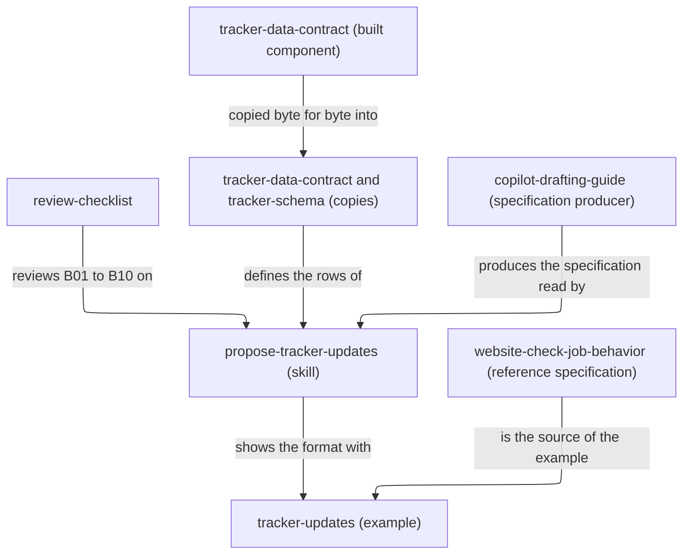

# Tracker Update Proposer

## Purpose

A GitHub Copilot agent skill that turns a use case specification into proposed use case and question rows in `tracker-updates.csv`, so developers hand a lead reviewable tracker changes with each specification and no one retypes questions.

## Navigation

[Job Behavior Specifications](../README.md#navigation) / **Tracker Update Proposer**

- [Design](#design)
  - [Diagram](#diagram)
- [Behavior](#behavior)
- [Plan](#plan)
  - [Planned Navigation](#planned-navigation)
  - [Planned Design](#planned-design)
  - [Steps](#steps)
  - [Acceptance Mapping](#acceptance-mapping)
  - [Assumptions And Open Questions](#assumptions-and-open-questions)
  - [Planned Relationships](#planned-relationships)
  - [Planned Links](#planned-links)
- [Relationships](#relationships)
- [Links](#links)

## Design

The component delivers one skill folder, [propose-tracker-updates](propose-tracker-updates/SKILL.md), and one internal checklist. The folder holds the instructions written once ([SKILL.md](propose-tracker-updates/SKILL.md)), byte-identical copies of the contract ([tracker-data-contract.md](propose-tracker-updates/tracker-data-contract.md)) and the schema ([tracker-schema.csv](propose-tracker-updates/tracker-schema.csv)) from the built Tracker Data Contract, and an example proposal for the website use case ([tracker-updates.csv](propose-tracker-updates/tracker-updates.csv)). The folder name and the skill `name` stay `propose-tracker-updates`. The drafting skill produces the specification and tells developers to run this skill next, so there is one flow.

The skill has two modes and owns the Use Cases and Questions tabs only. It writes no link or group rows, so similarity checking is the reconciler's alone.

- **Source screening** runs first, over the whole inventory and its source locations, before any specification exists and in parallel with access discovery. For a use case whose source is missing, empty or of uncertain mapping it suggests the source status (`not-located`, `empty`, `uncertain-mapping`), blocker reason, note and owner (the inventory's named owner, otherwise `unassigned`), with `inventory:<row>` or `source-screen:<path>` as the source and no specification anchor. It never writes `confirmed-unavailable`, and supporting documents are preliminary support that never verifies the source.
- **Specification update** runs later and proposes rows only from the resulting specification. A first run adds the use case (name, vendor, link, version, revision) and one Questions `add` per use case per open question, with the exact wording as `current_spec_text` and a source anchor with version. A revised specification `set`s the current version with `base_value`, the change class (`behavior-change` or `non-behavior-change`) and, separately, the grouping impact (`could-affect`, `not-expected` or `unknown`) with its short reason in the row's `reason`; `unknown` is never treated as no impact. A reworded question keeps its row, with the new wording in `current_spec_text` and a `text_review` suggestion of `wording-edit` or `possible-meaning-change`; the released wording, the answer and the row's status are never touched, and a lead decides any replacement. An answered question is suggested as incorporated. Supplied findings and questions that are not yet in a specification get no row and are reported.

Both modes follow the contract's field classes: spec fields are `add`ed or `set` with `base_value`, human fields only `suggest`ed on an existing record or given as an initial suggestion on an `add`, and forbidden and computed fields are never written. Rows are composed with deterministic `update_id` values, so a rerun on the same input gives the same rows and no duplicate; unchanged rows keep their `created_on`, and local references are never renumbered. Output goes only to `tracker-updates/<proposal-id>/tracker-updates.csv` and is never applied. The skill ends with a report of content with no row, supplied items not yet in a specification, rows without a source, unread files, unassigned source owners and use cases with only document support, and behavior changes with their grouping impact.

The example file is written from the built website specification: one use case record and one Questions record for each of Q1 to Q6, with local references `website-availability-check/Q<n>`, `spec_refs` `website-availability-check/Q<n>@v1` and a `@v1#q<n>` source on every question row. It has no vendor and no specification link, because neither is stated in the specification or was given, and says so in the row's reason. It has no source-screening rows, because the website specification has no inventory row to cite; the screening rows are described in `SKILL.md` with invented names. [review-checklist.md](review-checklist.md) is internal, with one item per behavior; the skill folder never mentions the internal records.

Testing policy: the behaviors are checked by the file review and by the user's manual client-environment testing on real use cases, and are marked `untested: benchmark pending`. No Copilot run has been made for this skill.

### Diagram

## Behavior

- **B01** When a use case is first listed or its specification is first drafted, then the skill proposes an `add` for the use case (name, vendor, link, version, revision) and never a central reference. (untested: benchmark pending)
- **B02** When it runs in source-screening mode over the entire inventory and its source locations before any specification exists, then each use case with a missing, empty or uncertain source mapping gets `suggest` rows for source status (not-located, empty or uncertain-mapping), blocker reason, note and owner (the inventory's named owner, otherwise `unassigned`), the evidence is the inventory or source-screening finding and needs no specification anchor, it never marks a source confirmed unavailable, and available documents only note preliminary work and never claim the source is verified. (untested: benchmark pending)
- **B03** When a specification has open questions, then each open question becomes one Questions `add` per use case (local reference, exact text as the latest specification wording, source anchor with version) and never a shared answer, and it writes no link or group rows, because similarity checking belongs to the reconciler. (untested: benchmark pending)
- **B04** When a specification is updated, then it proposes a `set` of `current_version` with `base_value`, marks the change as behavior-change or non-behavior-change, separately suggests whether it could affect grouping (could-affect, not-expected or unknown) with a short reason in the proposal row's `reason` for a lead to override, never treats unknown as no impact, and suggests an answered question as incorporated, and rerunning on the same input gives the same rows with no duplicate record. (untested: benchmark pending)
- **B05** When the wording of a released question changed, then the row keeps its identity, the new wording goes to `current_spec_text` with a `text_review` of wording-edit or possible-meaning-change, and it never withdraws, replaces or rewrites the released text or an earlier answer; a lead decides any replacement. (untested: benchmark pending)
- **B06** When it writes rows, then it never writes released dates, batch, answers, answer status, resolver, acknowledgement, ticket, verification or decisions, and it writes a human-owned field only as a `suggest` on an existing record or as an initial suggestion on an `add`. (untested: benchmark pending)
- **B07** When a value is not shown by its evidence, then the cell is blank and never guessed, and every row carries a `source` pointer: a specification anchor and version for specification rows, and the inventory or source-screening evidence for screening rows, so supplied findings, questions and corrections count only through the specification that records them. (untested: benchmark pending)
- **B08** When it writes the file, then it follows the contract's encoding, rewrites only its own tabs in its own proposal directory, and never releases or applies anything. (untested: benchmark pending)
- **B09** When it finishes, then it reports content with no row, supplied items not yet in a specification, rows without a source, unread files, use cases with an unassigned source owner or only document support, and use cases whose behavior changed with the suggested grouping impact (so affected workflow recommendations can be re-reviewed), and says a lead reviews it all. (untested: benchmark pending)
- **B10** When its folder is read, then it contains no Craft term, needs nothing installed in VS Code agent mode, and holds byte-identical copies of the contract and schema and an example `tracker-updates.csv` for the website use case. (untested: benchmark pending)

## Relationships

- [Tracker Data Contract](../tracker-data-contract/README.md#purpose) — the schema, reference scheme and proposal format this skill follows, copied into its folder.
- [Copilot Drafting Guide](../copilot-drafting-guide/README.md#purpose) — the drafting skill that produces the specifications this skill reads, and that tells developers to run this skill next.
- [Website Check Job Behavior](../website-check-job-behavior/README.md#purpose) — the reference specification the example proposal rows are written from.

## Links

- [requirements.md](requirements.md#requirements) — what the component must do and what it need not.
- [contract.md](contract.md#contract) — the shapes, formats and wording rules.
- [review-checklist.md](review-checklist.md) — the internal review items tagged B01 to B10.
- [propose-tracker-updates/SKILL.md](propose-tracker-updates/SKILL.md) — the skill instructions.
- [propose-tracker-updates/tracker-updates.csv](propose-tracker-updates/tracker-updates.csv) — the example proposal for the website use case.

## Plan

### Planned Navigation

[Job Behavior Specifications](../README.md#plan) / **Tracker Update Proposer**

- [Planned Design](#planned-design)
- [Steps](#steps)
- [Acceptance Mapping](#acceptance-mapping)
- [Assumptions And Open Questions](#assumptions-and-open-questions)
- [Planned Relationships](#planned-relationships)
- [Planned Links](#planned-links)

### Planned Design

One wording change and no behavior change. The skill's `record_key` rule for a question row says the use case slug is "the same slug the specification folder and `spec_refs` use", which is no longer literally true now that use case folders sit at any depth under a vendor folder and the [Discovery Orchestrator](../discovery-orchestrator/README.md#design) keeps the folder in the use case index. The build rewords that sentence to say the slug is the use case name in lower case with hyphens and that the specification's location comes from the index, so no wording ties the slug to a folder name. The slug rule, the `<use-case-slug>/Q<n>` form, `spec_refs`, the example proposal and the byte-identical copies of the contract and schema do not change.

### Steps

1. [propose-tracker-updates/SKILL.md](propose-tracker-updates/SKILL.md), the `record_key` bullet in the proposal rules: replace "the same slug the specification folder and `spec_refs` use" with "the use case name in lower case with hyphens; the specification's location comes from the use case index, not from the slug".
2. Check [review-checklist.md](review-checklist.md), the Design above and [contract.md](contract.md#contract) for any wording that ties the slug to a folder name (a search found none), and change only what the search finds.
3. Validate: a search of the skill folder, the README and the checklist shows no wording that ties the slug to a folder name, then the root `test` check shows the contract copies unchanged.

### Acceptance Mapping

| Acceptance | Behaviors | Step | Check |
| --- | --- | --- | --- |
| 1. The skill says the slug is the use case name in lower case with hyphens and that the specification's location comes from the index, and no wording in the skill, README, contract or checklist ties the slug to a folder name. | B03, B10 | 1, 2 | checklist `[B03]`, `[B10]` and the search in step 3 |
| 2. The contract and schema copies, the slug rule and `spec_refs` are unchanged. | B10 | 3 | the root `test` check, root `B05` |

Validation: the commands in step 3.

### Assumptions And Open Questions

Assumptions (override by telling the builder, or by editing the file named):

- **A wording change only**, so no behavior is added or reworded and the behaviors stay as they are. Override by asking for a behavior change.
- **The backlog item `proposer-spec-folder-wording` is removed** in the commit that records this plan, as the backlog rules say.
- **The local reference form is not decided here.** Which form the contract names for a question row's local reference (the exact name, the slug, or the derived use case ID `uc-<vendor-slug>-<use-case-slug>` that the proposal ID already uses) is the separate backlog item `local-reference-form-decision`; this wording keeps today's slug form. Override by deciding that item first.

Open questions: none.

### Planned Relationships

- [Discovery Orchestrator](../discovery-orchestrator/README.md#design) — keeps the use case index that holds each specification's folder, which the reworded sentence points to.

### Planned Links

- [propose-tracker-updates/SKILL.md](propose-tracker-updates/SKILL.md) — the skill whose sentence changes.
