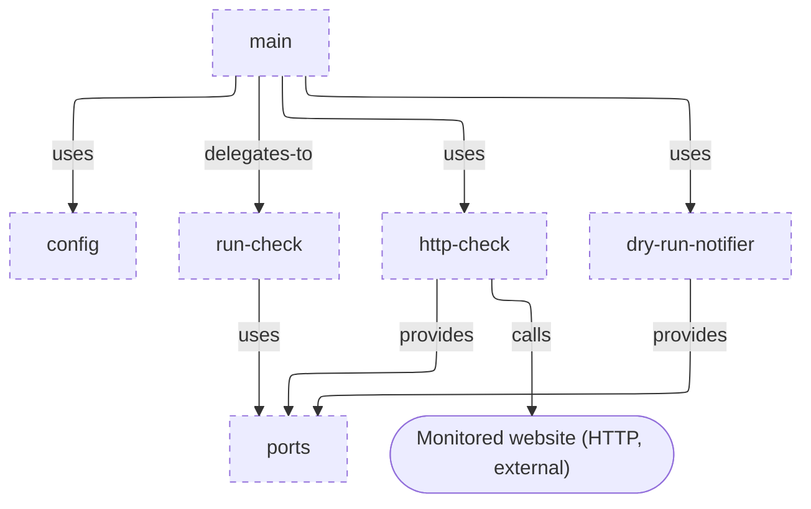

# Website Availability Check

## Purpose

A scheduled job script that checks one configured website URL: when the site is up it stays silent, and when it is down it requests one email alert through a notifier.

## Navigation

[Website Availability Example](../README.md#navigation) / **Website Availability Check**

- [Design](#design)
- [Technology](#technology)
- [Behavior](#behavior)
- [Plan](#plan)
- [Relationships](#relationships)
- [Links](#links)

## Design

Not built yet.

## Technology

Inherited from [Website Availability Example](../README.md#technology): Node 26 with native TypeScript, no dependencies, `node:test` with injected mocks.

## Behavior

- **B01** When the configured URL answers 2xx or 3xx within the timeout, then the job reports up and requests no notification.
- **B02** When the URL answers 4xx or 5xx, then the job reports down and requests one email alert through the notifier naming the URL, status and time.
- **B03** When the request times out or the connection fails, then the job reports down and requests one email alert with the error reason.
- **B04** When the URL is missing or not http(s), then the job fails with a configuration error and requests no alert.
- **B05** When the notifier itself fails, then the job exits non-zero and reports the alert as undelivered.
- **B06** When mocks are injected, then no real network call and no real email is made.

## Plan

### Planned Navigation

[Website Availability Example](../README.md#plan) / **Website Availability Check**

- [Planned Purpose](#planned-purpose)
- [Planned Design](#planned-design)
  - [Planned Diagram](#planned-diagram)
- [Steps](#steps)
- [Acceptance Mapping](#acceptance-mapping)
- [Assumptions And Open Questions](#assumptions-and-open-questions)
- [Planned Relationships](#planned-relationships)
- [Planned Links](#planned-links)

### Planned Purpose

A scheduled job script that checks one configured website URL: when the site is up it stays silent, and when it is down it requests one email alert through a notifier.

### Planned Design

One run performs one check and exits. `main` reads the configuration from the environment, wires the real HTTP check and the dry-run notifier into `run-check`, prints the outcome and sets the exit code. `run-check` holds the decision and takes the HTTP check, the notifier and the clock as arguments, so it never touches the network or email itself. `ports` holds the types of the HTTP check and of the notifier, the abstract port. `http-check` is the real check over global `fetch` (no redirect following, a timeout). `dry-run-notifier` is the only notifier adapter: it prints the alert and sends nothing. `config` validates the environment.

#### Planned Diagram

### Steps

1. Create `src/config.ts`: `loadConfig(env)` reads `CHECK_URL`, `CHECK_TIMEOUT_MS` (default 5000) and `ALERT_RECIPIENTS`, and throws `ConfigError` when the URL is missing or not `http:` or `https:`.
2. Create `src/ports.ts`: the types `CheckResult`, `HttpCheck`, `Alert` and `Notifier`.
3. Create `src/http-check.ts`: `fetchCheck` over global `fetch` with `redirect: "manual"` and `AbortSignal.timeout`; 200 to 399 is ok, 400 and above is not ok with the status, a timeout or connection error is not ok with the reason.
4. Create `src/dry-run-notifier.ts`: `DryRunNotifier` implements `Notifier` and prints the alert to stdout.
5. Create `src/run-check.ts`: `runCheck({config, check, notifier, now})` returns the state, the alert outcome (`none`, `sent`, `undelivered`) and the exit code; an up site calls no notifier, a down site calls it once, a failing notifier gives `undelivered` and exit code 1.
6. Create `src/main.ts`: the entry point run as `node src/main.ts`; a `ConfigError` goes to stderr with exit code 1 and no alert.
7. Create `test/config.test.ts` and `test/run-check.test.ts`, every test title tagged with its behavior ID.
8. Create `package.json` (`"type": "module"`, private, `engines.node` `>=26`, `scripts.test` `node --test`, no dependencies).

Imports carry the `.ts` extension and the code uses erasable TypeScript syntax only.

### Acceptance Mapping

| Acceptance condition | Behaviors | Step | Validation check |
| --- | --- | --- | --- |
| Tests tagged B01 to B06 pass with a mocked HTTP check and a mocked notifier, no real network call, no real email | B01 | 5, 7 | `[B01]` in `test/run-check.test.ts`: mock check answers 200 and 301, the mock notifier has no call |
| | B02 | 5, 7 | `[B02]` in `test/run-check.test.ts`: mock answers 404 and 500, one call, alert holds URL, status and time |
| | B03 | 3, 5, 7 | `[B03]` in `test/run-check.test.ts`: mock fails with a reason, one call carrying the reason |
| | B04 | 1, 6, 7 | `[B04]` in `test/config.test.ts`: a missing, empty and `ftp://` URL throw `ConfigError`; `run-check` is not reached |
| | B05 | 5, 7 | `[B05]` in `test/run-check.test.ts`: the mock notifier rejects, outcome is undelivered with exit code 1 |
| | B06 | 5, 7 | `[B06]` in `test/run-check.test.ts`: global `fetch` is replaced by a function that fails when called, the mocks run, call counts are asserted |

Checks, narrowest first: `test`, then `coverage`, both declared in the root `craft.json`.

### Assumptions And Open Questions

Assumptions (override any of them in chat before `/craft:build`):

1. The component is one leaf in the project root, named `website-availability-check`; the mock notifier and HTTP check are modules, not components. Override: ask for a different name or placement.
2. Configuration comes from environment variables `CHECK_URL`, `CHECK_TIMEOUT_MS` (default 5000) and `ALERT_RECIPIENTS`. Override: name other sources.
3. A 3xx answer counts as up without following the redirect (`redirect: "manual"`), per B01. Override: ask to follow redirects.
4. An empty recipient list is not a configuration error; the alert is still requested. Override: ask for a new behavior that makes it one.
5. Exit code 0 when the site is up, and also when it is down and the alert was handed over; 1 for a configuration error or an undelivered alert. Override: ask for a non-zero exit for a down site.
6. Time is an ISO 8601 UTC string from an injected clock.
7. The dry-run notifier prints the alert to stdout and writes no file.
8. The real email transport, the choice of notification system, the scheduler (cron or other) and deployment are out of scope. The reference repositories hold no email transport, only the Backstage notifications plugin in the app, so the notification system stays an unresolved decision behind the `Notifier` port.
9. The root declares `test` and `coverage` only: there is no `typecheck`, `lint` or `boundaries` check because each would need a dev dependency (for example `tsc`). The coverage flags are unverified against Node 26; the builder confirms them. Override: allow a dev dependency.
10. Behavior IDs keep the confirmed `B01` form, which the behavior traceability check matches as `B\d+`.

Open questions: none about behavior. Unresolved decisions for the user: which notification system and email transport will implement the port, how the job is scheduled, whether a down site should exit non-zero, and whether repeated alerts for one outage should be suppressed.

### Planned Relationships

- None outside its lineage. The monitored website and the notification system are external and appear in the diagram and the contract.

### Planned Links

- [requirements.md](requirements.md#requirements) — what the component must do and what it need not.
- [contract.md](contract.md#contract) — the notifier port, alert shape and outputs.

## Relationships

- None outside its lineage.

## Links

- [requirements.md](requirements.md#requirements) — what the component must do and what it need not.
- [contract.md](contract.md#contract) — the notifier port, alert shape and outputs.
