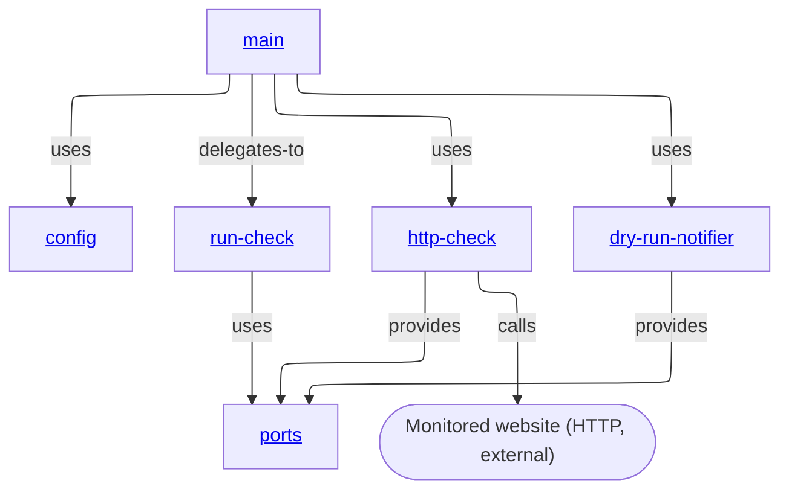

# Website Availability Check

## Purpose

A scheduled job script that checks one configured website URL: when the site is up it stays silent, and when it is down it requests one email alert through a notifier.

## Navigation

[Website Availability Example](../README.md#navigation) / **Website Availability Check**

- [Design](#design)
  - [Diagram](#diagram)
- [Technology](#technology)
- [Behavior](#behavior)
- [Relationships](#relationships)
- [Links](#links)

## Design

One run performs one check and exits. [main](src/main.ts) reads the configuration from the environment, wires the real HTTP check and the dry-run notifier into `run-check`, prints one outcome line and sets the exit code; a `ConfigError` goes to stderr with exit code 1 and no alert. [run-check](src/run-check.ts) holds the decision and takes the HTTP check, the notifier and the clock (`now`, epoch milliseconds, as `Date.now`) as arguments, so it never touches the network or email itself. [ports](src/ports.ts) holds the types of the HTTP check and of the notifier, the abstract port. [http-check](src/http-check.ts) is the real check over global `fetch` (`redirect: "manual"`, `AbortSignal.timeout`): 200 to 399 is ok, 400 and above is not ok with the status, a timeout or connection error is not ok with the reason. [dry-run-notifier](src/dry-run-notifier.ts) is the only notifier adapter: it prints the alert and sends nothing. [config](src/config.ts) validates `CHECK_URL`, `CHECK_TIMEOUT_MS` (default 5000) and `ALERT_RECIPIENTS`.

Decisions: a 3xx answer is up without following the redirect; an empty recipient list is not an error; exit code 0 when up or when the alert was handed over, 1 for a configuration error or an undelivered alert; alert time is an ISO 8601 UTC string. The real email transport, the notification system and the scheduler are out of scope and stay behind the `Notifier` port.

### Diagram

## Technology

Inherited from [Website Availability Example](../README.md#technology): Node 26 with native TypeScript, no dependencies, `node:test` with injected mocks. Imports carry the `.ts` extension and the code uses erasable TypeScript syntax only. The root declares `test` and `coverage` checks only; no typecheck, lint or boundaries check exists because each would need a dev dependency.

## Behavior

- **B01** When the configured URL answers 2xx or 3xx within the timeout, then the job reports up and requests no notification.
- **B02** When the URL answers 4xx or 5xx, then the job reports down and requests one email alert through the notifier naming the URL, status and time.
- **B03** When the request times out or the connection fails, then the job reports down and requests one email alert with the error reason.
- **B04** When the URL is missing or not http(s), then the job fails with a configuration error and requests no alert.
- **B05** When the notifier itself fails, then the job exits non-zero and reports the alert as undelivered.
- **B06** When mocks are injected, then no real network call and no real email is made.

## Relationships

- None outside its lineage.

## Links

- [requirements.md](requirements.md#requirements) — what the component must do and what it need not.
- [contract.md](contract.md#contract) — the notifier port, alert shape and outputs.
- [src/main.ts](src/main.ts) — entry point and wiring.
- [src/run-check.ts](src/run-check.ts) — the up/down decision and alert request.
- [test/run-check.test.ts](test/run-check.test.ts) — tests for B01 to B06 with injected mocks.
