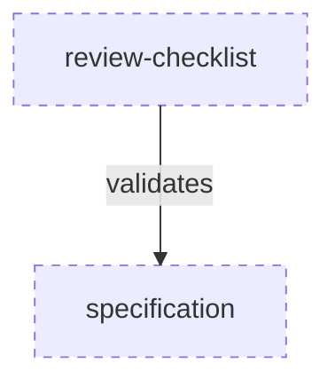

# Website Check Job Behavior

## Purpose

The completed reference specification of the website-check job in plain business language, filled in from the template using the job's source, so a vendor can see what a finished version looks like and review the job's current behavior.

## Navigation

[Job Behavior Specifications](../README.md#navigation) / **Website Check Job Behavior**

- [Design](#design)
- [Behavior](#behavior)
- [Plan](#plan)
- [Relationships](#relationships)
- [Links](#links)

## Design

Not built yet.

## Behavior

- **B01** When a vendor reads the specification, then every statement is in plain business language and the one-box diagram shows the monitored website, the alert request going out and the response coming back. (untested: benchmark pending)
- **B02** When the source is compared with the specification, then each of these appears as current behavior with its source pointer: up on an answer of 200 to 399, down on 400 and above, down on a timeout or connection failure, configuration error with no alert, notifier failure, the exit codes, the default timeout of 5000 milliseconds, an empty recipient list allowed, and redirects not followed. (untested: benchmark pending)
- **B03** When the real email system, the schedule and frequency, retries, repeated alerts for one outage or the meaning of "one email" are not in the source, then they appear as separate assumptions and unknowns for the vendor to answer one by one, and are never stated as fact. (untested: benchmark pending)
- **B04** When the specification is read, then it holds only current behavior and assumptions and unknowns, with no requested changes and no approved items. (untested: benchmark pending)
- **B05** When the specification is shown, then its header gives Version 1, the date, the status draft, the source revision with the script link and a stable job ID, and its acknowledgement block is blank, with any sample marked as a worked example. (untested: benchmark pending)
- **B06** When the acceptance scenarios are read, then each has a "covers" line naming current behavior IDs and each current behavior is covered by at least one scenario. (untested: benchmark pending)
- **B07** When the parameters are listed, then `CHECK_URL`, `CHECK_TIMEOUT_MS` and `ALERT_RECIPIENTS` appear as this job's parameters with their values or defaults, without any similarity or grouping field. (untested: benchmark pending)
- **B08** When the document is scanned, then no internal module, class or function name appears in its business text or its diagram, and file names appear only in source pointers. (untested: benchmark pending)
- **B09** When it is compared with the template, then it uses all of the template's sections, adds none, and fills operational context as unknown where the source is silent. (untested: benchmark pending)

## Plan

### Planned Navigation

[Job Behavior Specifications](../README.md#plan) / **Website Check Job Behavior**

- [Planned Purpose](#planned-purpose)
- [Planned Design](#planned-design)
  - [Planned Diagram](#planned-diagram)
- [Steps](#steps)
- [Acceptance Mapping](#acceptance-mapping)
- [Assumptions And Open Questions](#assumptions-and-open-questions)
- [Planned Relationships](#planned-relationships)
- [Planned Links](#planned-links)

### Planned Purpose

The completed reference specification of the website-check job in plain business language, filled in from the template using the job's source, so a vendor can see what a finished version looks like and review the job's current behavior.

### Planned Design

The component is one finished Markdown specification for Version 1 and one internal review checklist. The specification is the only file this component delivers, and the one the vendor receives. It is written from the source evidence and from the template's sections.

#### Planned Diagram

### Steps

1. Read the source evidence read-only: the sibling component Website Availability Check, its `README.md`, `requirements.md`, `contract.md`, `src/` and `test/`. Change nothing there and write nothing outside this component.
2. Create `website-check-job-behavior-v1.md` (one file per version) by filling in the finished [Job Behavior Template](../job-behavior-template/README.md#purpose), using only its sections.
3. Create `review-checklist.md` with one item per behavior, tagged `[B01]` to `[B09]`.
4. Keep Craft names, commands and paths out of the specification.

### Acceptance Mapping

| Acceptance condition | Behaviors | Step | Validation check |
| --- | --- | --- | --- |
| Specification passes the dry-run review | B01–B09 | 1, 2, 3 | review-checklist.md items [B01]–[B09], dry-run review |
| Source behaviors present as current behavior and unknowns not stated as fact | B02, B03 | 2 | review-checklist.md items [B02], [B03] compared with the source evidence |

Checks: the root declares no automated check for documents. The validation is the component's `review-checklist.md` dry-run review (see the verification gap in `requirements.md`) plus the record validators.

### Assumptions And Open Questions

Assumptions (override any of them in chat before `/craft:build`). This plan replaces the earlier plan of commit `8c80eed`, as the user revised the content on 2026-11-14 (two statement kinds, "version", one overall confirmation, a skill):

1. The source evidence stays in the built sibling `website-availability-check`, unchanged and read-only, not moved into this component. Override: ask for it to be moved.
2. The specification is Version 1, a draft worked example, and is not presented as acknowledged. Override: ask for a sample acknowledgement.
3. The file is named `website-check-job-behavior-v1.md`, one file per version. Override: ask for a single file with the version inside.
4. The reference has no requested changes; the template has no place for them in this as-is migration.
5. Items the source cannot answer, the real email system, schedule and frequency, retries, repeated alerts for one outage and what "one email" means, are listed as unknowns for the vendor to answer. They are the unresolved decisions the user already has: which notification system and email transport the job will use, how it is scheduled, whether a down site exits non-zero, and whether repeated alerts for one outage are suppressed. Open questions: none about behavior.
6. The build depends on the template being built first. Override: build in a different order.

### Planned Relationships

- [Job Behavior Template](../job-behavior-template/README.md#purpose) — the form this specification is filled in from, so it uses only that form's sections.
- [Website Availability Check](../website-availability-check/README.md#purpose) — the illustrative job and its source, the read-only evidence the specification is written from.

### Planned Links

- [requirements.md](requirements.md#requirements) — what the component must do and what it need not.
- [contract.md](contract.md#contract) — the content the document must carry and the wording rules.
- [review-checklist.md](review-checklist.md) — the dry-run review items, tagged by behavior (created by the build).

## Relationships

- [Job Behavior Template](../job-behavior-template/README.md#purpose) — the form this specification is filled in from, so it uses only that form's sections.
- [Website Availability Check](../website-availability-check/README.md#purpose) — the illustrative job and its source, the read-only evidence the specification is written from.

## Links

- [requirements.md](requirements.md#requirements) — what the component must do and what it need not.
- [contract.md](contract.md#contract) — the content the document must carry and the wording rules.
