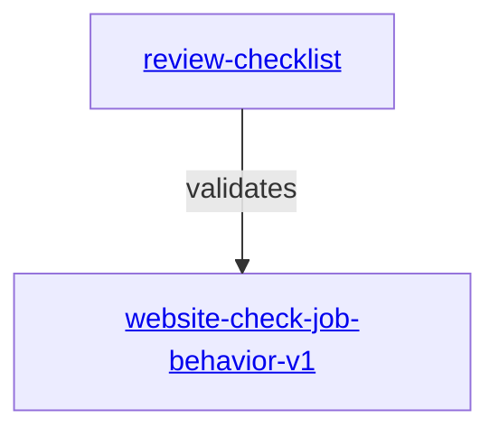
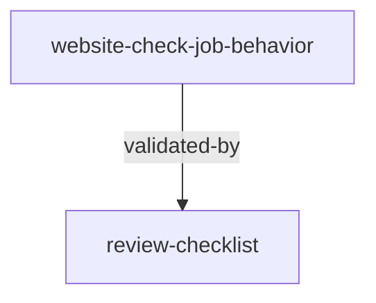

# Website Check Job Behavior

## Purpose

The completed reference specification of the website-check job in plain business language, filled in from the template using the job's source, so a vendor can see what a finished version looks like and review the job's current behavior.

## Navigation

[Job Behavior Specifications](../README.md#navigation) / **Website Check Job Behavior**

- [Design](#design)
  - [Diagram](#diagram)
- [Behavior](#behavior)
- [Plan](#plan)
- [Relationships](#relationships)
- [Links](#links)

## Design

The component is one finished Markdown specification, [website-check-job-behavior-v1.md](website-check-job-behavior-v1.md), the file sent to the vendor, and one internal checklist, [review-checklist.md](review-checklist.md), with one item per behavior. The specification is written from the read-only source evidence of Website Availability Check and fills in only the template's 11 parts. It holds 14 current behaviors, six separate unknowns and 11 acceptance scenarios that cover every current behavior.

### Diagram

## Behavior

- **B01** When a vendor reads the specification, then every statement is in plain business language and the one-box diagram shows the monitored website, the alert request going out and the response coming back. (untested: benchmark pending)
- **B02** When the source is compared with the specification, then each of these appears as current behavior with its source pointer: up on an answer of 200 to 399, down on 400 and above, down on a timeout or connection failure, configuration error with no alert, notifier failure, the exit codes, the default timeout of 5000 milliseconds, an empty recipient list allowed, and redirects not followed. (untested: benchmark pending)
- **B03** When the real email system, the schedule and frequency, retries, repeated alerts for one outage or the meaning of "one email" are not in the source, then they appear as separate assumptions and unknowns for the vendor to answer one by one, and are never stated as fact. (untested: benchmark pending)
- **B04** When the specification is read, then it holds only current behavior and assumptions and unknowns, with no requested changes and no approved items. (untested: benchmark pending)
- **B05** When the specification is shown, then its header gives Version 1, the date, the status draft, the source revision with the script link and a stable job ID, and its acknowledgement block is blank, with any sample marked as a worked example. (untested: benchmark pending)
- **B06** When the acceptance scenarios are read, then each has a "covers" line naming current behavior IDs and each current behavior is covered by at least one scenario. (untested: benchmark pending)
- **B07** When the parameters are listed, then `CHECK_URL`, `CHECK_TIMEOUT_MS` and `ALERT_RECIPIENTS` appear as this job's parameters with their values or defaults, without any similarity or grouping field. (untested: benchmark pending)
- **B08** When the document is scanned, then no internal module, class or function name appears in its business text or its diagram, and file names appear only in source pointers. (untested: benchmark pending)
- **B09** When it is compared with the template, then it uses all of the template's sections, adds none, and fills operational context as unknown where the source is silent. (untested: benchmark pending)

## Plan

### Planned Navigation

[Job Behavior Specifications](../README.md#plan) / **Website Check Job Behavior**

- [Planned Design](#planned-design)
  - [Planned Diagram](#planned-diagram)
- [Planned Behavior](#planned-behavior)
- [Steps](#steps)
- [Acceptance Mapping](#acceptance-mapping)
- [Assumptions And Open Questions](#assumptions-and-open-questions)
- [Planned Relationships](#planned-relationships)
- [Planned Links](#planned-links)

### Planned Design

The specification is rebuilt from the revised template: one file `website-availability-check.md` with a change log, no job ID, a header, "About this document" and a contents list, `B`, `Q` and `AC` IDs, linked scenarios, a vertical one-box diagram, only the questions that pass the question rule, evidence-based operational context and a blank acknowledgement log. The built Design above stays the current truth until the build.

#### Planned Diagram

### Planned Behavior

The plan changes these behaviors. The build merges them into `## Behavior` and deletes this subsection.

- **B01** When a vendor reads the specification, then every statement is in plain business language and the one-box diagram, laid out vertically, shows the monitored website, the alert request going out and the response coming back, with the behavior IDs in the edge labels. (untested: benchmark pending)
- **B02** When the source is compared with the specification, then each of these appears as a current behavior with its source pointer: up on an answer of 200 to 399, down on 400 and above, down on a timeout or connection failure, configuration error with no alert, notifier failure, the exit codes, the default timeout of 5000 milliseconds, an empty recipient list allowed, and redirects not followed. (untested: benchmark pending)
- **B03** When the real notification system, the schedule and frequency, retries, repeated alerts for one outage or the meaning of "one email" are not in the source and would change the workflow, then each is a separate question for the vendor, and no question asks about anything the source already states. (untested: benchmark pending)
- **B04** When the specification is read, then it holds only current behaviors and questions, with no requested changes, no approved items and no reasons the source does not show. (untested: benchmark pending)
- **B05** When the specification is shown, then its header gives the use case name, Version 1, the date, the status draft and the source revision with the script link and no job ID, the "About this document" part and contents list come before the change log, and the acknowledgement log is blank. (untested: benchmark pending)
- **B06** When the acceptance scenarios are read, then each (`AC1`, `AC2`, ...) has a "covers" line that links the behavior rows it proves and each current behavior is covered by at least one scenario. (untested: benchmark pending)
- **B07** When the parameters are listed, then `CHECK_URL`, `CHECK_TIMEOUT_MS` and `ALERT_RECIPIENTS` appear as this job's parameters with their values or defaults, without any similarity or grouping field. (untested: benchmark pending)
- **B08** When the document is scanned, then no internal module, class or function name appears in its business text or its diagram, and file names appear only in evidence pointers. (untested: benchmark pending)
- **B09** When it is compared with the template, then it uses all of the template's parts, adds none, and fills operational context only from evidence or as `unknown`. (untested: benchmark pending)

### Steps

1. Read the source evidence read-only: the sibling component Website Availability Check, its `README.md`, `requirements.md`, `contract.md`, `src/` and `test/`. Change nothing there and write nothing outside this component.
2. Rebuild the specification from the revised [Job Behavior Template](../job-behavior-template/README.md#purpose) as `website-availability-check.md`, one file with a change log, using only its parts; rename the current `website-check-job-behavior-v1.md` with `git mv` so its history follows, and rework its content (no job ID, `B`/`Q`/`AC` IDs, "About this document" and contents, linked scenarios, vertical diagram, questions filtered by the question rule, an acknowledgement log left blank).
3. Revise `review-checklist.md` with one item per behavior tagged `[B01]` to `[B09]`, left unticked until a fresh dry-run review passes.
4. Keep Craft names, commands and paths out of the specification.

### Acceptance Mapping

| Acceptance condition | Behaviors | Step | Validation check |
| --- | --- | --- | --- |
| Specification passes the dry-run review | B01–B09 | 1, 2, 3 | review-checklist.md items [B01]–[B09], dry-run review |
| Source behaviors present as current behaviors and questions that pass the question rule | B02, B03 | 2 | review-checklist.md items [B02], [B03] compared with the source evidence |

Checks: the root declares no automated check for documents. The validation is the component's `review-checklist.md` dry-run review (see the verification gap in `requirements.md`) plus the record validators.

### Assumptions And Open Questions

Assumptions (override any of them in chat before `/craft:build`). This plan follows the user's review of a generated specification on 2026-11-15 and replaces the earlier plan:

1. The document has no job ID. The use case name, the vendor's own name for it, is the identity and the file name and is never renamed. Our internal ID lives only in the later tracker. Developers create each use case's document when they pick up the job, not all stubbed up front, and the tracker rows for all use cases are created up front. Override: keep a job ID in the header, or stub all documents first.
2. One file per use case with a version and change log; after acknowledgement a change adds a change-log entry and bumps the version, and our team tags the repository at each acknowledgement (for example `<use-case-name>-v<n>`) so that version is recoverable. This replaces the earlier "one file per version" design. Override: go back to a copy per version.
3. Question rule: ask the vendor only what the source cannot show and whose answer would change what the migrated workflow must do. Never ask what the source already states (a value, an address, a setting: it is a current behavior or a parameter, covered by the vendor's overall confirmation), and never ask the reason behind a behavior the source shows (for example why a certificate check is off): state the behavior and leave any security or design review to our team. Our team may answer questions from its own knowledge before sending, by running the skill with those answers. Override: list the kinds of question to add or remove.
4. The source evidence stays in the built sibling `website-availability-check`, unchanged and read-only. Override: ask for it to be moved.
5. The file is renamed from `website-check-job-behavior-v1.md` to `website-availability-check.md`, named after the use case (the file name is the use case name in kebab-case, per the rule), not after this component with `git mv`, since there is one file with a version log. Override: keep the old name.
6. The earlier retry question is kept as two questions only if both change the workflow: retries of the website check and retries of the alert request. The reviewer notes that "one alert email" overstates the source (it only shows an alert request) and that blank values count as empty for the address and the timeout; the revision words both accurately.
7. The reference has no vendor-provided documents, so every pointer cites the source. Override: add a sample vendor document.
8. The build depends on the revised template being built first. Override: build in a different order.

### Planned Relationships

- [Job Behavior Template](../job-behavior-template/README.md#purpose) — the form this specification is filled in from, so it uses only that form's parts.
- [Website Availability Check](../website-availability-check/README.md#purpose) — the illustrative job and its source, the read-only evidence the specification is written from.

### Planned Links

- [website-availability-check.md](website-availability-check.md) — the completed specification (created by the build, renamed from the earlier v1 file).
- [requirements.md](requirements.md#requirements) — what the component must do and what it need not.
- [contract.md](contract.md#contract) — the content the document must carry and the wording rules.
- [review-checklist.md](review-checklist.md) — the dry-run review items, tagged by behavior.

## Relationships

- [Job Behavior Template](../job-behavior-template/README.md#purpose) — the form this specification is filled in from, so it uses only that form's sections.
- [Website Availability Check](../website-availability-check/README.md#purpose) — the illustrative job and its source, the read-only evidence the specification is written from.

## Links

- [requirements.md](requirements.md#requirements) — what the component must do and what it need not.
- [contract.md](contract.md#contract) — the content the document must carry and the wording rules.
- [website-check-job-behavior-v1.md](website-check-job-behavior-v1.md) — the completed Version 1 specification.
- [review-checklist.md](review-checklist.md) — the dry-run review items, tagged by behavior.
