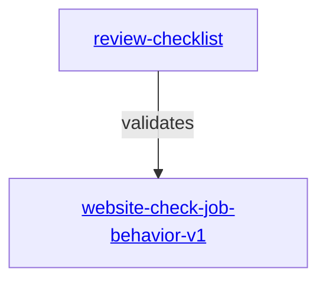

# Website Check Job Behavior

## Purpose

The completed reference specification of the website-check job in plain business language, filled in from the template using the job's source, so a vendor can see what a finished version looks like and review the job's current behavior.

## Navigation

[Job Behavior Specifications](../README.md#navigation) / **Website Check Job Behavior**

- [Design](#design)
  - [Diagram](#diagram)
- [Behavior](#behavior)
- [Relationships](#relationships)
- [Links](#links)

## Design

The component is one finished Markdown specification, [website-check-job-behavior-v1.md](website-check-job-behavior-v1.md), the file sent to the vendor, and one internal checklist, [review-checklist.md](review-checklist.md), with one item per behavior. The specification is written from the read-only source evidence of Website Availability Check and fills in only the template's 11 parts. It holds 14 current behaviors, six separate unknowns and 11 acceptance scenarios that cover every current behavior.

### Diagram

## Behavior

- **B01** When a vendor reads the specification, then every statement is in plain business language and the one-box diagram shows the monitored website, the alert request going out and the response coming back. (untested: benchmark pending)
- **B02** When the source is compared with the specification, then each of these appears as current behavior with its source pointer: up on an answer of 200 to 399, down on 400 and above, down on a timeout or connection failure, configuration error with no alert, notifier failure, the exit codes, the default timeout of 5000 milliseconds, an empty recipient list allowed, and redirects not followed. (untested: benchmark pending)
- **B03** When the real email system, the schedule and frequency, retries, repeated alerts for one outage or the meaning of "one email" are not in the source, then they appear as separate assumptions and unknowns for the vendor to answer one by one, and are never stated as fact. (untested: benchmark pending)
- **B04** When the specification is read, then it holds only current behavior and assumptions and unknowns, with no requested changes and no approved items. (untested: benchmark pending)
- **B05** When the specification is shown, then its header gives Version 1, the date, the status draft, the source revision with the script link and a stable job ID, and its acknowledgement block is blank, with any sample marked as a worked example. (untested: benchmark pending)
- **B06** When the acceptance scenarios are read, then each has a "covers" line naming current behavior IDs and each current behavior is covered by at least one scenario. (untested: benchmark pending)
- **B07** When the parameters are listed, then `CHECK_URL`, `CHECK_TIMEOUT_MS` and `ALERT_RECIPIENTS` appear as this job's parameters with their values or defaults, without any similarity or grouping field. (untested: benchmark pending)
- **B08** When the document is scanned, then no internal module, class or function name appears in its business text or its diagram, and file names appear only in source pointers. (untested: benchmark pending)
- **B09** When it is compared with the template, then it uses all of the template's sections, adds none, and fills operational context as unknown where the source is silent. (untested: benchmark pending)

## Relationships

- [Job Behavior Template](../job-behavior-template/README.md#purpose) — the form this specification is filled in from, so it uses only that form's sections.
- [Website Availability Check](../website-availability-check/README.md#purpose) — the illustrative job and its source, the read-only evidence the specification is written from.

## Links

- [requirements.md](requirements.md#requirements) — what the component must do and what it need not.
- [contract.md](contract.md#contract) — the content the document must carry and the wording rules.
- [website-check-job-behavior-v1.md](website-check-job-behavior-v1.md) — the completed Version 1 specification.
- [review-checklist.md](review-checklist.md) — the dry-run review items, tagged by behavior.
