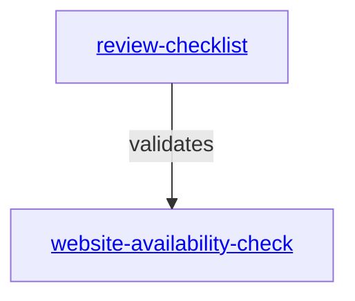

# Website Check Job Behavior

## Purpose

The completed reference specification of the website-check job in plain business language, filled in from the template using the job's source, so a vendor can see what a finished version looks like and review the job's current behavior.

## Navigation

[Job Behavior Specifications](../README.md#navigation) / **Website Check Job Behavior**

- [Design](#design)
  - [Diagram](#diagram)
- [Behavior](#behavior)
- [Relationships](#relationships)
- [Links](#links)

## Design

The component is one finished Markdown specification, [website-availability-check.md](website-availability-check.md), the file sent to the vendor, and one internal checklist, [review-checklist.md](review-checklist.md), with one item per behavior. The specification is filled in from the revised [Job Behavior Template](../job-behavior-template/README.md#purpose) using only its parts, from the read-only source evidence of Website Availability Check. It is one file named after the use case, with a change log and no job ID; it holds 14 current behaviors (`B1` to `B14`), six questions that pass the question rule (`Q1` to `Q6`), a vertical one-box diagram, 11 linked acceptance scenarios (`AC1` to `AC11`) that cover every current behavior, operational context filled in as `unknown` and a blank acknowledgement log. It was renamed from the earlier version file with `git mv`.

### Diagram

## Behavior

- **B01** When a vendor reads the specification, then every statement is in plain business language and the one-box diagram, laid out vertically, shows the monitored website, the alert request going out and the response coming back, with the behavior IDs in the edge labels. (untested: benchmark pending)
- **B02** When the source is compared with the specification, then each of these appears as a current behavior with its source pointer: up on an answer of 200 to 399, down on any answer code outside 200 to 399 (400 and above, or below 200), down on a timeout or connection failure, configuration error with no alert, notifier failure, the exit codes, the default timeout of 5000 milliseconds, an empty recipient list allowed, and redirects not followed. (untested: benchmark pending)
- **B03** When the real notification system, the schedule and frequency, retries, repeated alerts for one outage or the meaning of "one email" are not in the source and would change the workflow, then each is a separate question for the vendor, and no question asks about anything the source already states. (untested: benchmark pending)
- **B04** When the specification is read, then it holds only current behaviors and questions, with no requested changes, no approved items and no reasons the source does not show. (untested: benchmark pending)
- **B05** When the specification is shown, then its header gives the use case name, Version 1, the date, the status draft and the source revision with the script link and no job ID, the "About this document" part and contents list come before the change log, and the acknowledgement log is blank. (untested: benchmark pending)
- **B06** When the acceptance scenarios are read, then each (`AC1`, `AC2`, ...) has a "covers" line that links the behavior rows it proves and each current behavior is covered by at least one scenario. (untested: benchmark pending)
- **B07** When the parameters are listed, then `CHECK_URL`, `CHECK_TIMEOUT_MS` and `ALERT_RECIPIENTS` appear as this job's parameters with their values or defaults, without any similarity or grouping field. (untested: benchmark pending)
- **B08** When the document is scanned, then no internal module, class or function name appears in its business text or its diagram, and file names appear only in evidence pointers. (untested: benchmark pending)
- **B09** When it is compared with the template, then it uses all of the template's parts, adds none, and fills operational context only from evidence or as `unknown`. (untested: benchmark pending)

## Relationships

- [Job Behavior Template](../job-behavior-template/README.md#purpose) — the form this specification is filled in from, so it uses only that form's sections.
- [Website Availability Check](../website-availability-check/README.md#purpose) — the illustrative job and its source, the read-only evidence the specification is written from.

## Links

- [requirements.md](requirements.md#requirements) — what the component must do and what it need not.
- [contract.md](contract.md#contract) — the content the document must carry and the wording rules.
- [website-availability-check.md](website-availability-check.md) — the completed Version 1 specification.
- [review-checklist.md](review-checklist.md) — the dry-run review items, tagged by behavior.
