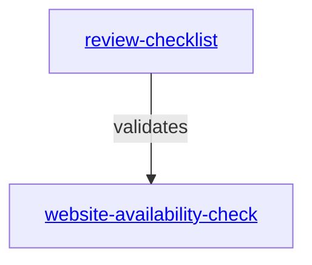
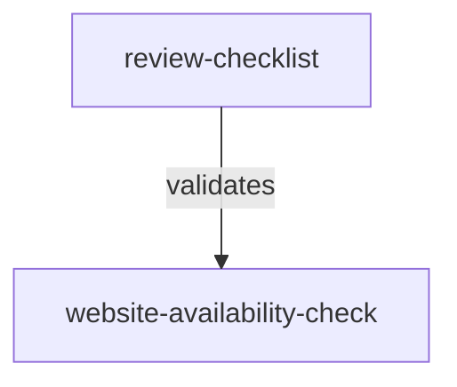

# Website Check Job Behavior

## Purpose

The completed reference specification of the website-check job in plain business language, filled in from the template using the job's source, so a vendor can see what a finished version looks like and review the job's current behavior.

## Navigation

[Job Behavior Specifications](../README.md#navigation) / **Website Check Job Behavior**

- [Design](#design)
  - [Diagram](#diagram)
- [Behavior](#behavior)
- [Plan](#plan)
- [Relationships](#relationships)
- [Links](#links)

## Design

The component is one finished Markdown specification, [website-availability-check.md](website-availability-check.md), the file sent to the vendor, and one internal checklist, [review-checklist.md](review-checklist.md), with one item per behavior. The specification is filled in from the revised [Job Behavior Template](../job-behavior-template/README.md#purpose) using only its parts, from the read-only source evidence of Website Availability Check. It is one file named after the use case, with a change log and no job ID; it holds 14 current behaviors (`B1` to `B14`), six questions that pass the question rule (`Q1` to `Q6`), a vertical one-box diagram, 11 linked acceptance scenarios (`AC1` to `AC11`) that cover every current behavior, operational context filled in as `unknown` and a blank acknowledgement log. It was renamed from the earlier version file with `git mv`.

### Diagram

## Behavior

- **B01** When a vendor reads the specification, then every statement is in plain business language and the one-box diagram, laid out vertically, shows the monitored website, the alert request going out and the response coming back, with the behavior IDs in the edge labels. (untested: benchmark pending)
- **B02** When the source is compared with the specification, then each of these appears as a current behavior with its source pointer: up on an answer of 200 to 399, down on any answer code outside 200 to 399 (400 and above, or below 200), down on a timeout or connection failure, configuration error with no alert, notifier failure, the exit codes, the default timeout of 5000 milliseconds, an empty recipient list allowed, and redirects not followed. (untested: benchmark pending)
- **B03** When the real notification system, the schedule and frequency, retries, repeated alerts for one outage or the meaning of "one email" are not in the source and would change the workflow, then each is a separate question for the vendor, and no question asks about anything the source already states. (untested: benchmark pending)
- **B04** When the specification is read, then it holds only current behaviors and questions, with no requested changes, no approved items and no reasons the source does not show. (untested: benchmark pending)
- **B05** When the specification is shown, then its header gives the use case name, Version 1, the date, the status draft and the source revision with the script link and no job ID, the "About this document" part and contents list come before the change log, and the acknowledgement log is blank. (untested: benchmark pending)
- **B06** When the acceptance scenarios are read, then each (`AC1`, `AC2`, ...) has a "covers" line that links the behavior rows it proves and each current behavior is covered by at least one scenario. (untested: benchmark pending)
- **B07** When the parameters are listed, then `CHECK_URL`, `CHECK_TIMEOUT_MS` and `ALERT_RECIPIENTS` appear as this job's parameters with their values or defaults, without any similarity or grouping field. (untested: benchmark pending)
- **B08** When the document is scanned, then no internal module, class or function name appears in its business text or its diagram, and file names appear only in evidence pointers. (untested: benchmark pending)
- **B09** When it is compared with the template, then it uses all of the template's parts, adds none, and fills operational context only from evidence or as `unknown`. (untested: benchmark pending)

## Plan

### Planned Navigation

[Job Behavior Specifications](../README.md#plan) / **Website Check Job Behavior**

- [Planned Design](#planned-design)
  - [Planned Diagram](#planned-diagram)
- [Planned Behavior](#planned-behavior)
- [Steps](#steps)
- [Acceptance Mapping](#acceptance-mapping)
- [Assumptions And Open Questions](#assumptions-and-open-questions)
- [Planned Links](#planned-links)

### Planned Design

Only wording changes. The specification is edited in place to the revised template, with no new behavior, question or scenario.

#### Planned Diagram

### Planned Behavior

B03 and B05 are the earlier confirmed wording changes. B01 and B02 carry the user's component-review decisions (2026-11-15) and are confirmed by the user on 2026-11-16; the other behaviors are unchanged.

- **B01** When a vendor reads the specification, then every statement is in plain business language and the one-box diagram, laid out vertically, shows the monitored website, the request going out and the response coming back, and the alert as printed output of the script, without implying that a real external notification system exists, with the behavior IDs in the edge labels. (untested: benchmark pending)
- **B02** When the source is compared with the specification, then each of these appears as a current behavior with its source pointer: up on an answer of 200 to 399, down on any answer code outside 200 to 399 (400 and above, or below 200), down on a timeout or connection failure, configuration error with no alert, notifier failure, the exit codes, the default timeout of 5000 milliseconds, an empty recipient list allowed, and redirects not followed; and the reported alert status `sent` is stated literally with an explanation that a successful print or handoff of the request does not mean a message was delivered. (untested: benchmark pending)
- **B03** When the real notification system, the schedule and frequency, retries, repeated alerts for one outage or the meaning of "one email" are not in the source and would change what the migrated use case must do, then each is a separate question for the vendor, and no question asks about anything the source already states. (untested: benchmark pending)
- **B05** When the specification is shown, then its heading reads `Use Case Behavior`, its header gives the use case name, Version 1, the date, the status draft and the source revision with the script link and no job ID, the "About this document" part and contents list come before the change log, and the acknowledgement log is blank. (untested: benchmark pending)

### Steps

1. Edit `website-availability-check.md` to the revised template (heading, glossary, About sentence, question rule text, `use case` wording), redraw the diagram to show the actual printed alert output and no real notification system, state the literal reported status `sent` with its explanation, and keep the production notifier as the open question Q1. The source `website-availability-check` stays unchanged, and the example's scope is not widened.
2. Update `contract.md`, `requirements.md` and `review-checklist.md` for the reworded lines.
3. Run the file review, the wording scan and the record validators.

### Acceptance Mapping

| Acceptance condition | Behaviors | Step | Validation |
| --- | --- | --- | --- |
| The specification matches the revised template part for part and B01 to B09 stay passing (B01 to B09). | B01 to B09 | 1 | `[B01]` to `[B09]` checklist items, compared with the revised template |
| `job` appears only for the script and `use case` elsewhere, the question rule text reads `migrated use case`, and the specification mentions no workflow or grouping (B03, B05, B09). | B03, B05, B09 | 3 | `[B03]`, `[B05]`, `[B09]` and the wording scan |
| The diagram shows the printed alert and no real notification system, the status `sent` is literal and explained as not meaning delivery, and Q1 stays open (B01, B02). | B01, B02 | 1 | `[B01]`, `[B02]` checklist items |

Checks: none declared; verification is the component's `review-checklist.md` file review, plus the record validators at the end of each plan and build.

### Assumptions And Open Questions

Assumptions (override any of them in chat before `/craft:build`):

1. Version 1 has never been issued to a vendor or client, so it is edited in place without a new version or change-log entry (confirmed 2026-11-15). Override: add a version 2 entry.
2. The specification's name and file name do not change (the use case name is the identity).
3. The user asked not to over-invest in the example, so only the diagram, the `sent` explanation and the earlier wording are planned. The proposed rewording of the repeated-outage question (Q5) was discussed and is not decided; it is not planned here.

Open questions: none about behavior.

### Planned Links

- [requirements.md](requirements.md#requirements) — what the component must do and what it need not.
- [contract.md](contract.md#contract) — the shapes, formats and wording rules.

## Relationships

- [Job Behavior Template](../job-behavior-template/README.md#purpose) — the form this specification is filled in from, so it uses only that form's sections.
- [Website Availability Check](../website-availability-check/README.md#purpose) — the illustrative job and its source, the read-only evidence the specification is written from.

## Links

- [requirements.md](requirements.md#requirements) — what the component must do and what it need not.
- [contract.md](contract.md#contract) — the content the document must carry and the wording rules.
- [website-availability-check.md](website-availability-check.md) — the completed Version 1 specification.
- [review-checklist.md](review-checklist.md) — the dry-run review items, tagged by behavior.
