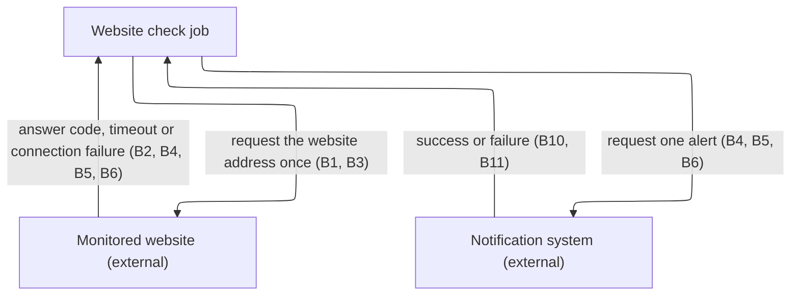

# Job Behavior: Website Availability Check

| Field | Value |
| --- | --- |
| Use case name | Website Availability Check |
| Version | 1 |
| Date | 2026-11-15 |
| Status | draft |
| Source revision | fef65ff6552d2e781dbafb0f7445a5fcb0707e9f |
| Script link | website-availability-check/src/main.ts (path in this repository, at the source revision above, the last change to the script) |

## About this document

This document records what one job does today, as seen in its source code or in documents the vendor provided. It lists the questions the source cannot answer. It says nothing about how the job will be built or grouped on the migration platform. It does not describe changes anyone might want, and it does not approve any behavior that was inferred rather than shown.

Words used here: the **vendor** runs and maintains the job today and reviews this document. **Our team** writes it. A **tracker** is the shared spreadsheet our team keeps for each use case, where the vendor gives its answers and its acknowledgement. A **black box** is one closed box that stands for the whole job, so only what goes in and out is shown.

### Contents

- [Change log](#change-log)
- [Current behaviors](#current-behaviors)
- [Questions](#questions)
- [Inputs, outputs, parameters and external dependencies](#inputs-outputs-parameters-and-external-dependencies)
- [Diagram](#diagram)
- [Acceptance scenarios](#acceptance-scenarios)
- [Operational context](#operational-context)
- [Acknowledgement log](#acknowledgement-log)

## Change log

| Version | Date | What changed, in plain words | Why (source change or answered question) |
| --- | --- | --- | --- |
| 1 | 2026-11-15 | First version. | First documentation of the job. |

## Current behaviors

All source files named below are in the folder `website-availability-check/src/`.

| ID | When ... then ... (business language) | Evidence |
| --- | --- | --- |
| B1 | When the job is started, then it checks the one website address given in `CHECK_URL` once, reports the result and stops; it does not repeat the check or start itself again. | main.ts, the start-up section at the end of the file |
| B2 | When the website answers with a code from 200 to 399 within the time limit, then the job reports the website as up and requests no alert. | http-check.ts, the section that judges the answer code; run-check.ts, the section that returns early when the website is up |
| B3 | When the website answers with a redirect (a code from 300 to 399), then the job does not follow the redirect and treats the website as up. | http-check.ts, the request settings and the section that judges the answer code |
| B4 | When the website answers with any code outside 200 to 399 (that is, 400 or above, or below 200), then the job reports the website as down and requests one alert that names the address, the answer code, the time of the check in UTC (world standard time) and the recipients. | http-check.ts, the section that judges the answer code; run-check.ts, the section that builds and requests the alert |
| B5 | When the website does not answer within the time limit, then the job reports the website as down and requests one alert that names the address, the reason "timeout after" the limit in milliseconds, the time and the recipients. | http-check.ts, the section that handles a timeout; run-check.ts, the section that builds and requests the alert |
| B6 | When the connection to the website fails, then the job reports the website as down and requests one alert that names the address, the failure reason, the time and the recipients. | http-check.ts, the section that handles any other failure; run-check.ts, the section that builds and requests the alert |
| B7 | When `CHECK_TIMEOUT_MS` is not given, or is empty or only spaces, then the time limit is 5000 milliseconds. | config.ts, the section that reads the time limit |
| B8 | When `CHECK_URL` is missing, empty or only spaces, is not a valid address, or does not start with http or https, or when `CHECK_TIMEOUT_MS` is given but is not a whole number above zero, then the job stops with a configuration error message, checks nothing, requests no alert and ends with exit code 1 (the number the job hands back to whatever started it). | config.ts, the sections that check the address and the time limit; main.ts, the section that reports a configuration error |
| B9 | When `ALERT_RECIPIENTS` is missing, empty or only spaces, then this is not an error: the check still runs and a down website still produces an alert request with an empty list of recipients. When it is given, it is read as a comma-separated list with spaces around each entry removed and empty entries dropped. | config.ts, the section that reads the recipients; run-check.ts, the section that builds the alert |
| B10 | When the website is down and the alert request is handed over without failing, then the job ends with exit code 0 and reports the alert as sent. | run-check.ts, the section that requests the alert and returns the outcome |
| B11 | When the website is down and handing over the alert request fails, then the job ends with exit code 1 and reports the alert as undelivered. | run-check.ts, the section that handles a failure when requesting the alert |
| B12 | When the website is up, then the job ends with exit code 0. | run-check.ts, the section that returns early when the website is up |
| B13 | When a run ends after a check, then the job prints one outcome line stating the address, whether it is up or down, and whether the alert was none, sent or undelivered. | main.ts, the section that prints the outcome line |
| B14 | When an alert is requested, then the only alert mechanism in the script prints the alert text (recipients, address, answer code or reason, time) and sends nothing to anyone. | dry-run-notifier.ts, the whole file |

## Questions

Only what the source cannot show and whose answer would change what the migrated workflow must do. Never what the source already states, and never the reason behind a behavior it shows.

| ID | Question for the vendor | Status |
| --- | --- | --- |
| Q1 | Which notification system does the job use in production to send the alert? | open |
| Q2 | At what times and how often is the job started in production? | open |
| Q3 | Is a failed website check ever tried again from outside the script, and if so how many times and how far apart? | open |
| Q4 | Is a failed alert request ever tried again from outside the script, and if so how many times and how far apart? | open |
| Q5 | When the website stays down over several runs, is an alert requested every time, or only once? | open |
| Q6 | When an alert is requested for a down website, is it one message addressed to all recipients together, or one message per recipient? | open |

## Inputs, outputs, parameters and external dependencies

### Inputs

| Input | What it is | Where it comes from |
| --- | --- | --- |
| Website address | The one web address to check. | A setting given to the job when it is started |
| Time limit | How long the job waits for an answer. | A setting given to the job when it is started; optional |
| Alert recipients | The list of people or addresses to alert. | A setting given to the job when it is started; optional |
| Website answer | An answer code, or a timeout or connection failure. | The monitored website |

### Outputs

| Output | What it is | Who or what receives it |
| --- | --- | --- |
| Outcome line | One line per check: the address, up or down, and the alert status (none, sent or undelivered). | The job's normal output |
| Configuration error message | A line starting "configuration error" with the reason, when a setting is wrong. | The job's error output |
| Alert request | The address, the answer code or failure reason, the time in UTC and the recipients, for a down website. | The notification system (today the script only prints it) |
| Exit code | 0 when the website is up or the alert request was handed over; 1 for a configuration error or an undelivered alert. | Whatever started the job |

### Parameters

| Parameter name | This job's value |
| --- | --- |
| `CHECK_URL` | Required. The address of the website to check; it must start with http or https. No default. |
| `CHECK_TIMEOUT_MS` | Optional. Whole number of milliseconds above zero. Default 5000; empty counts as not given. |
| `ALERT_RECIPIENTS` | Optional. Comma-separated list of recipients. Default: empty, which is allowed; blank counts as empty. |

### External dependencies

| System | Role | Direction of each call |
| --- | --- | --- |
| Monitored website | The website whose availability is checked. | Outgoing call: the job requests the website's address once and does not follow redirects. Response: an answer code, or a timeout or connection failure. |
| Notification system | Receives the alert request when the website is down. Which real system this is, is open ([Q1](#q1)); today the script only prints the alert. | Outgoing call: the job hands it one alert request. Response: success, or a failure. |

## Diagram

In plain text: the website check job is one closed box with two outside systems. It asks the monitored website for its address once ([B1](#b1)), without following redirects ([B3](#b3)), and gets back an answer code ([B2](#b2), [B4](#b4)), a timeout ([B5](#b5)) or a connection failure ([B6](#b6)). When the website is down, it hands one alert request to the notification system and gets back success ([B10](#b10)) or a failure ([B11](#b11)). Today the script only prints the alert and does not contact a real notification system ([B14](#b14), [Q1](#q1)).

## Acceptance scenarios

| ID | Given | When | Then | Covers |
| --- | --- | --- | --- | --- |
| AC1 | A valid address and the website answers 200 | The job is started | The outcome line says up with no alert, no alert is requested and the exit code is 0. | covers: [B1](#b1), [B2](#b2), [B12](#b12), [B13](#b13) |
| AC2 | A valid address and the website answers with a redirect code such as 301 | The job is started | The job does not follow the redirect, reports up, requests no alert and exits with 0. | covers: [B3](#b3), [B2](#b2), [B12](#b12) |
| AC3 | A valid address, recipients listed and the website answers 503 | The job is started and the alert request is handed over | One alert request names the address, 503, the time and the recipients; the outcome line says down with alert sent; the exit code is 0. | covers: [B4](#b4), [B10](#b10), [B13](#b13) |
| AC4 | A valid address and the website does not answer within the time limit | The job is started | The job reports down and requests one alert with a timeout reason that includes the limit. | covers: [B5](#b5) |
| AC5 | A valid address and the connection to the website fails | The job is started | The job reports down and requests one alert with the failure reason. | covers: [B6](#b6) |
| AC6 | A valid address and no `CHECK_TIMEOUT_MS`, or an empty one | The job is started | The job waits up to 5000 milliseconds for an answer. | covers: [B7](#b7) |
| AC7 | `CHECK_URL` is empty, is not a valid address or starts with ftp; or `CHECK_TIMEOUT_MS` is 0 or not a number | The job is started | A configuration error message is printed, nothing is checked, no alert is requested and the exit code is 1. | covers: [B8](#b8) |
| AC8 | A valid address, no `ALERT_RECIPIENTS`, and the website is down | The job is started | The job still requests an alert, with an empty recipient list. With the list "a@x.test, b@x.test," the recipients are the two entries. | covers: [B9](#b9) |
| AC9 | A valid address, the website is down and the alert request fails | The job is started | The outcome line says down with alert undelivered and the exit code is 1. | covers: [B11](#b11), [B13](#b13) |
| AC10 | A valid address and the website is down, run as it exists today | The job is started | The alert text is printed and nothing is sent. | covers: [B14](#b14), [B10](#b10) |
| AC11 | Any valid settings | The job is started once | One check is made and the job stops without repeating. | covers: [B1](#b1) |

## Operational context

Not behavior. Each row cites a vendor document or a configuration in the source, otherwise it says `unknown`.

| Topic | Answer | Evidence |
| --- | --- | --- |
| Schedule and trigger | unknown | |
| Logging | unknown | |
| Monitoring and alerts | unknown | |
| Owner | unknown | |
| Failure handling | unknown | |

## Acknowledgement log

One row per version, added by our team from the tracker entry or the vendor's reply. Earlier rows are never edited. No person name or role is recorded.

| Company name | Date acknowledged | Version reviewed | Script link and revision | Production script | Overall confirmation | Tracker entry or reply |
| --- | --- | --- | --- | --- | --- | --- |
| | | | | [ ] The supplied script is the one running in production today. | [ ] The current behaviors are correct for this version. | |

What an acknowledgement claims: the vendor has reviewed the behavior stated in this document for the version and script named in that row. What it does not claim: that the behavior is free of errors, that any question is answered or any inferred behavior approved, or that later versions are covered.
