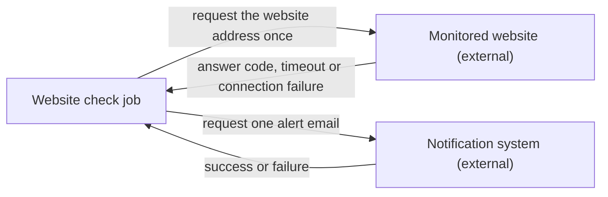

# Job Behavior: Website Availability Check

## 1. How to fill in this form

Use this form to record what one job does today, based on its source code. A business reviewer will read it, so write in short, plain sentences and explain any technical term the first time you use it. You need only a text editor or GitHub Copilot. Copy this form, keep every numbered part and its heading, and replace each text in angle brackets with your own words.

Rules to follow while you fill it in:

1. One job per document. Give the job one stable job ID in part 2 and never change it.
2. Every statement goes in exactly one of two kinds:
   - **Current behavior** (`CUR-1`, `CUR-2`, ...): something you saw in the source code and can point to. Part 5.
   - **Assumption or unknown** (`ASM-1`, `ASM-2`, ...): anything you inferred, guessed or could not find out. Part 6.
3. If you are not sure that the source shows a behavior, it is not current behavior. Put it in part 6. Never present a guess as current behavior.
4. Write each current behavior as "When ... then ..." in business language. Say what happens, not how the code is built. A file name may appear only in the source pointer.
5. Call each issued edition of the document a "version".
6. Where a part asks for something you do not know, write `unknown`. Do not leave it empty and do not invent an answer.
7. Leave part 11 (Acknowledgement) blank. Only our team fills it in, later, from the vendor's reply.
8. Do not describe how the job will be built or grouped on the migration platform.

Words used in this form: the **vendor** runs and maintains the job today and reviews this document; **our client** owns the platform the job will move to; **our team** writes this document. A **tracker** is the vendor's own ticket or issue system where it answers questions. A **black box** is a single closed box that stands for the whole job, so you show only what goes in and out.

## 2. Header

| Field | Value |
| --- | --- |
| Use case name | Website Availability Check |
| Job ID | JOB-001 |
| Version | 1 |
| Date | 2026-11-14 |
| Status | draft |
| Source revision | fef65ff6552d2e781dbafb0f7445a5fcb0707e9f |
| Script link | website-availability-check/src/main.ts (path in this repository, at the source revision above, the last change to the script) |

An acknowledged version is never edited. If anything changes, issue the next version, add a line to part 3 and set the new version's status to draft.

## 3. Change log

One line per version, newest last.

| Version | Date | What changed, in plain words | Why (source change or answered unknown) |
| --- | --- | --- | --- |
| 1 | 2026-11-14 | First version. | First documentation of the job. |

## 4. What this document says and does not say

This document records what the job does today, as seen in its source code, and lists what is still unknown. It says nothing about how the job will be built or grouped on the migration platform. It does not describe changes the vendor might want, and it does not approve any inferred behavior.

## 5. Current behavior

Only statements you can point to in the source. Use one row per behavior and number them in order. If you cannot give a source pointer, move the statement to part 6.

All source files named below are in the folder `website-availability-check/src/`.

| ID | When ... then ... (business language) | Source pointer (file and place) |
| --- | --- | --- |
| CUR-1 | When the job is started, then it checks the one website address given in `CHECK_URL` once, reports the result and stops; it does not repeat the check or start itself again. | main.ts, the start-up section at the end of the file |
| CUR-2 | When the website answers with a code from 200 to 399 within the time limit, then the job reports the website as up and requests no alert. | http-check.ts, the section that judges the answer code; run-check.ts, the section that returns early when the website is up |
| CUR-3 | When the website answers with a redirect (a code from 300 to 399), then the job does not follow the redirect and treats the website as up. | http-check.ts, the request settings and the section that judges the answer code |
| CUR-4 | When the website answers with a code of 400 or above, then the job reports the website as down and requests one alert email that names the address, the answer code, the time of the check in UTC (world standard time) and the recipients. | http-check.ts, the section that judges the answer code; run-check.ts, the section that builds and requests the alert |
| CUR-5 | When the website does not answer within the time limit, then the job reports the website as down and requests one alert email that names the address, the reason "timeout after" the limit in milliseconds, the time and the recipients. | http-check.ts, the section that handles a timeout; run-check.ts, the section that builds and requests the alert |
| CUR-6 | When the connection to the website fails, then the job reports the website as down and requests one alert email that names the address, the failure reason, the time and the recipients. | http-check.ts, the section that handles any other failure; run-check.ts, the section that builds and requests the alert |
| CUR-7 | When `CHECK_TIMEOUT_MS` is not given or is empty, then the time limit is 5000 milliseconds. | config.ts, the section that reads the time limit |
| CUR-8 | When `CHECK_URL` is missing, empty, not a valid address, or does not start with http or https, or when `CHECK_TIMEOUT_MS` is given but is not a whole number above zero, then the job stops with a configuration error message, checks nothing, requests no alert and ends with exit code 1 (the number the job hands back to whatever started it). | config.ts, the sections that check the address and the time limit; main.ts, the section that reports a configuration error |
| CUR-9 | When `ALERT_RECIPIENTS` is missing or empty, then this is not an error: the check still runs and a down website still produces an alert request with an empty list of recipients. When it is given, it is read as a comma-separated list with spaces around each entry removed and empty entries dropped. | config.ts, the section that reads the recipients; run-check.ts, the section that builds the alert |
| CUR-10 | When the website is down and the alert request is handed over without failing, then the job ends with exit code 0 and reports the alert as sent. | run-check.ts, the section that requests the alert and returns the outcome |
| CUR-11 | When the website is down and handing over the alert request fails, then the job ends with exit code 1 and reports the alert as undelivered. | run-check.ts, the section that handles a failure when requesting the alert |
| CUR-12 | When the website is up, then the job ends with exit code 0. | run-check.ts, the section that returns early when the website is up |
| CUR-13 | When a run ends after a check, then the job prints one outcome line stating the address, whether it is up or down, and whether the alert was none, sent or undelivered. | main.ts, the section that prints the outcome line |
| CUR-14 | When an alert is requested, then the only alert mechanism in the script prints the alert text (recipients, address, answer code or reason, time) and sends no email. | dry-run-notifier.ts, the whole file |

## 6. Assumptions and unknowns

Each item is separate so the vendor can answer it one by one. Never merge two questions into one item.

| ID | Assumption or unknown | Question for the vendor | Status |
| --- | --- | --- | --- |
| ASM-1 | The source does not show which real email system or notification system sends the alert email. The script only prints the alert today. | Which notification system does the job use in production to send the alert email? | open |
| ASM-2 | The source does not show when or how often the job is started; it only runs one check per start. | At what times and how often is the job started in production? | open |
| ASM-3 | The source shows no retry of the website check: a failed check is not tried again by the script. We do not know whether the vendor's setup retries it from outside the script. | Is a failed website check ever tried again, and if so how many times and how far apart? | open |
| ASM-4 | The source shows no retry of the alert request: a failed request is reported as undelivered and not tried again by the script. We do not know whether the vendor's setup retries it from outside the script. | Is a failed alert request ever tried again, and if so how many times and how far apart? | open |
| ASM-5 | The source does not show what happens when the website stays down over several runs. Each run seems to request its own alert, but we do not know whether repeats are held back elsewhere. | Is the alert requested every time, or only once, when the website stays down over several runs? | open |
| ASM-6 | The source requests one alert per run for a down website, but we do not know whether "one email" means one email to all recipients together or one email to each recipient. | When the job requests "one email", is that one message addressed to all recipients together, or one message per recipient? | open |

When an unknown is answered, keep its row, set the status to "resolved: now CUR-n" naming the new current behavior, and add that behavior in part 5 in the next version.

## 7. Inputs, outputs, parameters and external dependencies

### Inputs

| Input | What it is | Where it comes from |
| --- | --- | --- |
| Website address | The one web address to check (`CHECK_URL`). | A setting given to the job when it is started |
| Time limit | How long the job waits for an answer (`CHECK_TIMEOUT_MS`). | A setting given to the job when it is started; optional |
| Alert recipients | The list of people or addresses to alert (`ALERT_RECIPIENTS`). | A setting given to the job when it is started; optional |
| Website answer | An answer code, or a timeout or connection failure. | The monitored website |

### Outputs

| Output | What it is | Who or what receives it |
| --- | --- | --- |
| Outcome line | One line per check: the address, up or down, and the alert status (none, sent or undelivered). | The job's normal output |
| Configuration error message | A line starting "configuration error" with the reason, when a setting is wrong. | The job's error output |
| Alert request | The address, the answer code or failure reason, the time in UTC and the recipients, for a down website. | The notification system (today the script only prints it) |
| Exit code | 0 when the website is up or the alert request was handed over; 1 for a configuration error or an undelivered alert. | Whatever started the job |

### Parameters

| Parameter name | This job's value |
| --- | --- |
| `CHECK_URL` | Required. The address of the website to check; it must start with http or https. No default. The value used in production is unknown. |
| `CHECK_TIMEOUT_MS` | Optional. Whole number of milliseconds above zero. Default 5000. |
| `ALERT_RECIPIENTS` | Optional. Comma-separated list of recipients. Default: empty, which is allowed. |

### External dependencies

| System | Role | Direction of each call |
| --- | --- | --- |
| Monitored website | The website whose availability is checked. | Outgoing call: the job requests the website's address once and does not follow redirects. Response: an answer code, or a timeout or connection failure. |
| Notification system | Sends the alert email when the website is down. Which real system this is, is unknown (ASM-1); today the script only prints the alert. | Outgoing call: the job asks it to send one alert email. Response: success, or a failure. |

## 8. Diagram

Description in plain text: the website check job is one closed box with two outside systems. It asks the monitored website for its address once and gets back an answer code, a timeout or a connection failure. When the website is down, it asks the notification system to send one alert email and gets back success or failure. Today the script only prints the alert and does not contact a real notification system (CUR-14, ASM-1).

## 9. Acceptance scenarios

| ID | Given | When | Then | Covers |
| --- | --- | --- | --- | --- |
| SC-1 | A valid address and the website answers 200 | The job is started | The outcome line says up with no alert, no alert is requested and the exit code is 0. | covers: CUR-1, CUR-2, CUR-12, CUR-13 |
| SC-2 | A valid address and the website answers with a redirect code such as 301 | The job is started | The job does not follow the redirect, reports up, requests no alert and exits with 0. | covers: CUR-3, CUR-2, CUR-12 |
| SC-3 | A valid address, recipients listed and the website answers 503 | The job is started and the alert request is handed over | One alert request names the address, 503, the time and the recipients; the outcome line says down with alert sent; the exit code is 0. | covers: CUR-4, CUR-10, CUR-13 |
| SC-4 | A valid address and the website does not answer within the time limit | The job is started | The job reports down and requests one alert with a timeout reason that includes the limit. | covers: CUR-5 |
| SC-5 | A valid address and the connection to the website fails | The job is started | The job reports down and requests one alert with the failure reason. | covers: CUR-6 |
| SC-6 | A valid address and no `CHECK_TIMEOUT_MS` | The job is started | The job waits up to 5000 milliseconds for an answer. | covers: CUR-7 |
| SC-7 | `CHECK_URL` is empty, is not a valid address or starts with ftp; or `CHECK_TIMEOUT_MS` is 0 or not a number | The job is started | A configuration error message is printed, nothing is checked, no alert is requested and the exit code is 1. | covers: CUR-8 |
| SC-8 | A valid address, no `ALERT_RECIPIENTS`, and the website is down | The job is started | The job still requests an alert, with an empty recipient list. With the list "a@x.test, b@x.test," the recipients are the two entries. | covers: CUR-9 |
| SC-9 | A valid address, the website is down and the alert request fails | The job is started | The outcome line says down with alert undelivered and the exit code is 1. | covers: CUR-11, CUR-13 |
| SC-10 | A valid address and the website is down, run as it exists today | The job is started | The alert text is printed and no email is sent. | covers: CUR-14, CUR-10 |
| SC-11 | Any valid settings | The job is started once | One check is made and the job stops without repeating. | covers: CUR-1 |

## 10. Operational context

Write `unknown` until someone confirms the answer.

| Topic | Answer |
| --- | --- |
| Schedule and frequency | unknown |
| Logging | unknown |
| Monitoring and alerts | unknown |
| Owner | unknown |
| Failure handling | unknown |

## 11. Acknowledgement

Our team records this block from the vendor's tracker entry or reply. Leave it blank when you write the document. Do not record any person's name or role.

| Field | Value |
| --- | --- |
| Company name | |
| Date acknowledged | |
| Version reviewed | |
| Script link and revision | |
| Tracker entry or reply reference | |

- [ ] The supplied script is the one running in production today.
- [ ] The vendor confirms, overall, that the current behaviors in part 5 are correct for this version.

What this acknowledgement means: the vendor has reviewed the behavior stated in this document, for the version and script named above. It does not claim that the behavior is free of errors, that any assumption or unknown in part 6 is approved, or that future issues will not occur.
