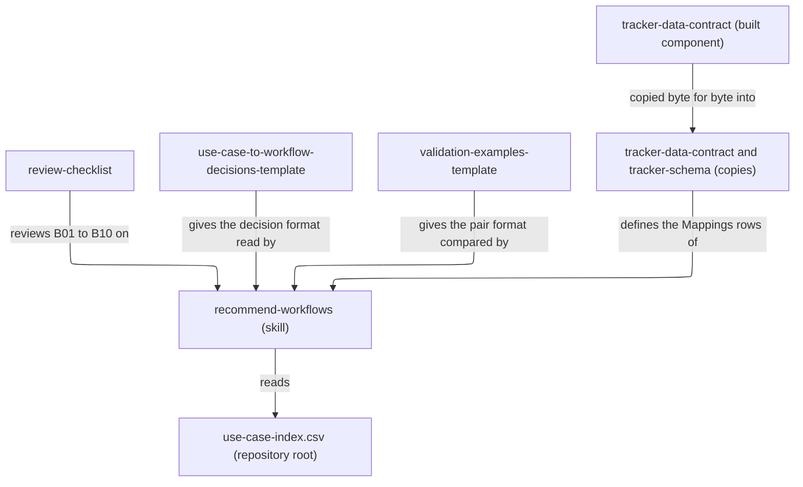
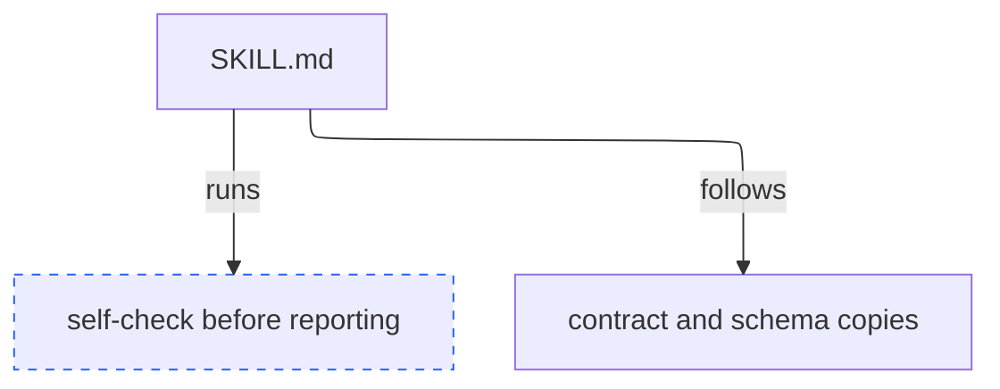

# Workflow Recommender

## Purpose

A GitHub Copilot agent skill that compares use case specifications by their behaviors and generates internal use-case-to-workflow recommendations, with the format of the lead-owned decisions file, so leads can decide which use cases can share one reusable workflow.

## Navigation

[Job Behavior Specifications](../README.md#navigation) / **Workflow Recommender**

- [Design](#design)
  - [Diagram](#diagram)
- [Behavior](#behavior)
- [Plan](#plan)
  - [Planned Navigation](#planned-navigation)
  - [Planned Design](#planned-design)
    - [Planned Diagram](#planned-diagram)
  - [Steps](#steps)
  - [Acceptance Mapping](#acceptance-mapping)
  - [Assumptions And Open Questions](#assumptions-and-open-questions)
  - [Planned Relationships](#planned-relationships)
  - [Planned Links](#planned-links)
- [Relationships](#relationships)
- [Links](#links)

## Design

The component delivers one skill folder, [recommend-workflows](recommend-workflows/SKILL.md), and one internal checklist. The folder holds the instructions written once ([SKILL.md](recommend-workflows/SKILL.md)), the format of the lead-owned decisions file ([use-case-to-workflow-decisions-template.md](recommend-workflows/use-case-to-workflow-decisions-template.md)), a template for the known same and different pairs ([validation-examples-template.md](recommend-workflows/validation-examples-template.md)), and byte-identical copies of the contract ([tracker-data-contract.md](recommend-workflows/tracker-data-contract.md), as built with the use case ID) and the schema ([tracker-schema.csv](recommend-workflows/tracker-schema.csv)) from the built Tracker Data Contract. The folder name and the skill `name` stay `recommend-workflows`. The generated recommendations file and the leads' decisions file are not part of this component; they live in the specifications repository's internal area, which the skill is told and never assumes.

The skill gets its list of use cases from the `use-case-index.csv` at the repository root that the [Discovery Orchestrator](../discovery-orchestrator/README.md#design) writes, so use cases at any folder depth are found. By default it compares every index row and reads each specification from the row's root-relative `spec` path; a row whose spec file does not exist, or whose `spec` is blank, is listed under `not compared` as `missing` and never dropped silently. The proposal ID is the fixed value `recommendations`, so the skill never asks for it and writes `tracker-updates/recommendations/tracker-updates.csv`. A Mappings `source` uses the index `spec` path. It shows the full list once with the warning that a partial list drops the other use cases' Mappings rows, unless its caller (the orchestrator) has already confirmed the list this session. If the index is absent it stops and tells the developer to run `run-discovery` first. It restates the five index column names as a read-only consumer, because skills are installed standalone; the index is defined and written only by the orchestrator, and the names must stay equal to its contract.

A use case is identified by its use case ID `uc-<vendor-slug>-<use-case-slug>`, defined once in the [Tracker Data Contract](../tracker-data-contract/README.md#design) and derived by the skill from the index row's `vendor` and `use_case_name` (never stored, and not the index `slug` column alone). A Mappings row is keyed `<use-case-id>->>candidate-slug` and a blocking question is linked as `<use-case-id>/Q<n>@v<version>`; the name form and the slug-alone form are not valid. For an index row with a blank vendor the skill asks the lead once, never invents one, and writes no Mappings row for that use case until it is known; the use case is still compared and listed.

The skill compares the whole set of specifications on every run, by behavior: shared steps and outcomes, with differences as parameter values, optional steps or exceptions. A shared external system is listed as context and never makes a candidate. A manually tagged folder of earlier workflow analyses (the user described about four or five files; the real paths and counts are unknown and not assumed) supplies starting hints only: they are not verified or approved groupings, never decide a workflow, never stand for vendor acceptance and are not reconciled exhaustively. Each candidate lists its members with the specification version, revision and status, the shared behaviors by ID, the parameter differences, the exceptions, the decision status read from the decisions file, and whether each member rests on a specification, an earlier analysis or both. Missing, unread, unversioned and draft specifications are listed under `not compared` with their state; a draft may still produce recommendations, labelled as a draft. The skill says the method is not validated and, when `validation-examples.md` is supplied, reports the agreement with the known pairs.

The skill rewrites only `use-case-to-workflow-recommendations.md` and the Mappings rows of its proposal file. It reads the decisions file and never edits it. A decided mapping is flagged for re-review only when a member's specification changed in a way that could affect grouping or whose impact is unknown: the impact comes from a lead's `grouping_impact_lead` override, else the proposer's `grouping_impact` suggestion in the optional read-only Use Cases export, else the skill's own stated assessment from the two specification versions. A behavior change with no grouping impact, a version bump, spelling, date, change-log or acknowledgement edit alone is not flagged, `unknown` is never read as no impact, a decision is never changed, and a rejected pairing returns only with stated new evidence. Only grouping-relevant unknowns block, with the existing specification question linked; a missing question is reported as a specification gap. Tracker rows are Mappings `add`, `set` or `suggest` rows that follow the contract's owner classes (`mapping_status` only as a suggestion, never a decision field). A member that rests on an earlier analysis only has no specification to cite, so it gets no row. No per-use-case profile file is kept; any normalized summary is a temporary, uncommitted cache.

No example proposal file is shipped: a candidate needs at least two use cases, only one real use case exists, and inventing a pair would be invented data. `SKILL.md` carries one invented-name illustration row instead, and its format was checked mechanically with a throwaway script (12 columns, composed `update_id`, a use case ID key, a Mappings human field proposed with an allowed value and an `add`). The decisions and validation templates each carry an invented-name illustration that is marked not to be copied. [review-checklist.md](review-checklist.md) is internal, with one item per behavior; the skill folder never mentions the internal records.

Testing policy: the behaviors are checked by the file review and by the user's manual client-environment testing on real use cases, and are marked `untested: benchmark pending`. No Copilot run has been made for this skill.

### Diagram

## Behavior

- **B01** When it compares specifications, then candidates come from shared behaviors and parameter differences, a shared external system alone never makes a candidate, and earlier workflow-analysis files that a lead tags (about four or five, paths not assumed) only supplement the candidates and never decide a workflow or stand for vendor acceptance. (untested: benchmark pending)
- **B02** When it lists a candidate, then it gives the member use cases, shared steps and behaviors by ID, differences (parameters, exceptions), the specification versions and revisions used, and whether each member rests on a specification, on an earlier analysis or on both. (untested: benchmark pending)
- **B03** When a specification is missing, unread, unversioned or still a draft, then it is listed under `not compared` with its state, a use case without a specification is listed and never silently dropped, a listed spec file that does not exist or a blank `spec` is listed as `missing`, and a draft specification may still produce recommendations before any vendor acknowledgement. (untested: benchmark pending)
- **B04** When it describes its method, then it states the grouping is not validated, compares its results against known same and different examples when `validation-examples.md` is supplied and reports the agreement, and otherwise says not validated. (untested: benchmark pending)
- **B05** When it regenerates `use-case-to-workflow-recommendations.md`, then it rewrites only that file and the Mappings rows of `tracker-updates/recommendations/tracker-updates.csv`, each keyed `<use-case-id>->>candidate-slug` with no row for a use case whose vendor is not known (it asks the lead once and never invents one), reads `use-case-to-workflow-decisions.md` and never edits it, and shows each candidate's decision status. Before reporting, the skill runs a self-check on the proposal file: every row has exactly 12 fields, any value with a comma, a double quote or a line break is quoted, the header is exact, `created_on` and any date value are `YYYY-MM-DD`, each `record_key` has the form of its tab, and the file ends with exactly one line feed; when appending to the shared file it first makes sure the file ends with a line feed so its first row starts on a new line; and when the toolkit is available it also runs `validate <file>` of the Tracker Reconciler and fixes every error before reporting. (untested: benchmark pending)
- **B06** When a specification of a decided mapping changed, then it assesses whether the change could affect grouping (could-affect, not-expected or unknown) with a short reason, using a lead's override or the proposer's suggestion when the optional Use Cases export is supplied and otherwise its own assessment from the two specification versions, flags the recommendation for re-review with the changed behavior IDs when the impact could affect grouping or is unknown, never treats unknown as no impact, and does not flag a behavior change with no grouping impact or a version bump, spelling, date, change-log or acknowledgement edit alone; it does not change the decision, and a rejected pairing is not re-proposed unless it states new evidence. (untested: benchmark pending)
- **B07** When unknowns could change a mapping, then only those grouping-relevant unknowns are listed as blocking with their existing specification questions linked by their local reference `<use-case-id>/Q<n>@v<version>`, other open questions are non-blocking, and a missing question is reported as a specification gap and never as a new question. (untested: benchmark pending)
- **B08** When it emits tracker rows, then they are Mappings `add` or `suggest` rows only, with no human-owned or forbidden field. (untested: benchmark pending)
- **B09** When it works, then it keeps no persistent per-use-case profile file, and any normalized summary is a temporary, uncommitted cache. (untested: benchmark pending)
- **B10** When it runs, then the default list is every use case in `use-case-index.csv`, with each specification read from the row's `spec` path, and it uses the fixed proposal ID `recommendations` without asking; it compares the full set, states which specifications, earlier analyses and date it covered and what was not compared, and marks the output internal; when its caller has not already confirmed the list this session it shows the list once with a warning that a partial list drops the other use cases' mappings; when the index is absent it stops and says to run `run-discovery` first; the decisions file format has decision ID, status (accepted, rejected, pending-clarification), candidate, affected use cases, rationale, evidence and versions, date and decided-by name, is append-only, and a changed decision is a new row that refers to the earlier one. (untested: benchmark pending)

## Plan

### Planned Navigation

[Job Behavior Specifications](../README.md#plan) / **Workflow Recommender**

- [Planned Design](#planned-design)
  - [Planned Diagram](#planned-diagram)
- [Steps](#steps)
- [Acceptance Mapping](#acceptance-mapping)
- [Assumptions And Open Questions](#assumptions-and-open-questions)
- [Planned Relationships](#planned-relationships)
- [Planned Links](#planned-links)

### Planned Design

The skill file `workflow-recommender/recommend-workflows/SKILL.md` gains a short self-check section: the checklist above, run after writing and before reporting, and the rule to make sure the shared file ends with a line feed before appending a row. It stays plain Markdown and needs nothing installed (the root `B02`): the validator step reads "if the toolkit is available". Its key is `<use-case-id>->><candidate-slug>`, where the slug follows the contract's rule (each run of characters outside `a-z` and `0-9` becomes one `-`), replacing the looser "lower case with hyphens". The copies of the contract and schema are recopied byte for byte from the Tracker Data Contract after its own build, and the example proposal file is checked against the new rules.

#### Planned Diagram

### Steps

1. After the Tracker Data Contract is built, recopy `tracker-data-contract.md` and `tracker-schema.csv` into `workflow-recommender/recommend-workflows/` byte for byte.
2. In `workflow-recommender/recommend-workflows/SKILL.md`, add the self-check and the append rule; state that blank `base_value` stays blank; keep the example proposal file well formed (12 fields, one final line feed).
3. Update this README's `B05`, `contract.md`, `requirements.md` and `review-checklist.md`, then dissolve this Plan into Design.
4. Run the scan in `review-checklist.md` and the root `B05` test.

### Acceptance Mapping

| Acceptance | Behaviors | Step | Check |
| --- | --- | --- | --- |
| The skill self-checks the file and ensures a final line feed before appending, with the validator optional | B05 | 2 | review-checklist `[B05]` |
| The contract and schema copies equal the originals | B10 | 1 | root `B05` test |

### Assumptions And Open Questions

Assumptions (override any in chat):

1. **Policy and scope.** Planned under `deciding-what-to-ask`; the change is part of one request (validation of proposal files) that also touches the other components named in the root request, each planned in its own README. Nothing is built.
2. **Choices.** An empty `base_value` stays blank (no dot); on a `set` a blank `base_value` means the field was blank when seen. The exact 12-field check and the final-line-feed check catch a lost trailing field and a fused row. Validation lives in the existing Tracker Reconciler `validate` command; the exporter shares its loader and gains no new mode. Recorded from the user's answers of 2026-11-17.
3. **Optional validator.** The pack skills stay Markdown-only (root `B02`); the validator is named as optional for developers who have the toolkit, as the user chose. The mandatory run is in the Discovery Batch Agent, which already needs Node.
4. **Order.** Built after the Tracker Data Contract.

Open questions: none. The behavior changes and the choices on the base value (kept blank, with checks) and on the pack skills (a self-check checklist, the validator optional) were confirmed by the user on 2026-11-17.

### Planned Relationships

- [Tracker Data Contract](../tracker-data-contract/README.md#purpose) — the originals the copies follow.
- [Tracker Reconciler](../tracker-tools/tracker-reconciler/README.md#purpose) — the optional `validate` command.

### Planned Links

- [requirements.md](requirements.md#requirements) — what the change must do, with the planned change section.
- [contract.md](contract.md#contract) — the interface, with the planned change section.

## Relationships

- [Tracker Data Contract](../tracker-data-contract/README.md#purpose) — the Mappings columns, the use case ID and the proposal format this skill follows, copied into its folder.
- [Discovery Orchestrator](../discovery-orchestrator/README.md#design) — writes the `use-case-index.csv` this skill reads and defines its columns.
- [Job Behavior Template](../job-behavior-template/README.md#purpose) — the form whose behavior IDs, parameters and versions the recommendations cite.

## Links

- [requirements.md](requirements.md#requirements) — what the component must do and what it need not.
- [contract.md](contract.md#contract) — the shapes, formats and wording rules.
- [review-checklist.md](review-checklist.md) — the internal review items tagged B01 to B10.
- [recommend-workflows/SKILL.md](recommend-workflows/SKILL.md) — the skill instructions.
- [recommend-workflows/use-case-to-workflow-decisions-template.md](recommend-workflows/use-case-to-workflow-decisions-template.md) — the decisions file format.
- [recommend-workflows/validation-examples-template.md](recommend-workflows/validation-examples-template.md) — the known same and different pairs format.
