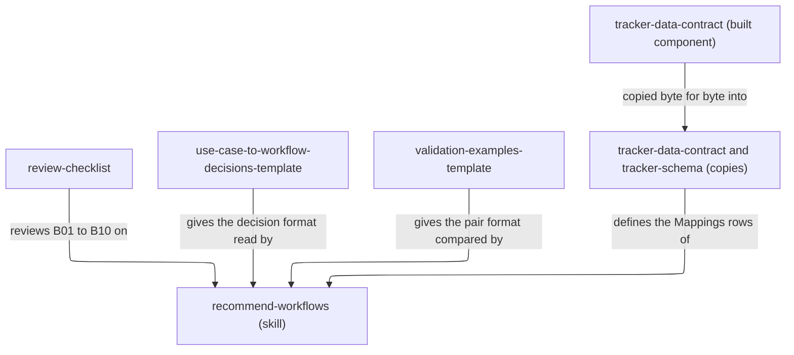
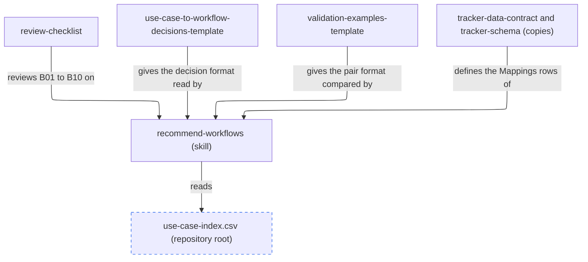

# Workflow Recommender

## Purpose

A GitHub Copilot agent skill that compares use case specifications by their behaviors and generates internal use-case-to-workflow recommendations, with the format of the lead-owned decisions file, so leads can decide which use cases can share one reusable workflow.

## Navigation

[Job Behavior Specifications](../README.md#navigation) / **Workflow Recommender**

- [Design](#design)
  - [Diagram](#diagram)
- [Behavior](#behavior)
- [Plan](#plan)
  - [Planned Navigation](#planned-navigation)
  - [Planned Design](#planned-design)
    - [Planned Diagram](#planned-diagram)
  - [Planned Behavior](#planned-behavior)
  - [Steps](#steps)
  - [Acceptance Mapping](#acceptance-mapping)
  - [Assumptions And Open Questions](#assumptions-and-open-questions)
  - [Planned Relationships](#planned-relationships)
  - [Planned Links](#planned-links)
- [Relationships](#relationships)
- [Links](#links)

## Design

The component delivers one skill folder, [recommend-workflows](recommend-workflows/SKILL.md), and one internal checklist. The folder holds the instructions written once ([SKILL.md](recommend-workflows/SKILL.md)), the format of the lead-owned decisions file ([use-case-to-workflow-decisions-template.md](recommend-workflows/use-case-to-workflow-decisions-template.md)), a template for the known same and different pairs ([validation-examples-template.md](recommend-workflows/validation-examples-template.md)), and byte-identical copies of the contract ([tracker-data-contract.md](recommend-workflows/tracker-data-contract.md)) and the schema ([tracker-schema.csv](recommend-workflows/tracker-schema.csv)) from the built Tracker Data Contract. The folder name and the skill `name` stay `recommend-workflows`. The generated recommendations file and the leads' decisions file are not part of this component; they live in the specifications repository's internal area, which the skill is told and never assumes.

The skill compares the whole set of specifications on every run, by behavior: shared steps and outcomes, with differences as parameter values, optional steps or exceptions. A shared external system is listed as context and never makes a candidate. A manually tagged folder of earlier workflow analyses (the user described about four or five files; the real paths and counts are unknown and not assumed) supplies starting hints only: they are not verified or approved groupings, never decide a workflow, never stand for vendor acceptance and are not reconciled exhaustively. Each candidate lists its members with the specification version, revision and status, the shared behaviors by ID, the parameter differences, the exceptions, the decision status read from the decisions file, and whether each member rests on a specification, an earlier analysis or both. Missing, unread, unversioned and draft specifications are listed under `not compared` with their state; a draft may still produce recommendations, labelled as a draft. The skill says the method is not validated and, when `validation-examples.md` is supplied, reports the agreement with the known pairs.

The skill rewrites only `use-case-to-workflow-recommendations.md` and the Mappings rows of its proposal file. It reads the decisions file and never edits it. A decided mapping is flagged for re-review only when a member's specification changed in a way that could affect grouping or whose impact is unknown: the impact comes from a lead's `grouping_impact_lead` override, else the proposer's `grouping_impact` suggestion in the optional read-only Use Cases export, else the skill's own stated assessment from the two specification versions. A behavior change with no grouping impact, a version bump, spelling, date, change-log or acknowledgement edit alone is not flagged, `unknown` is never read as no impact, a decision is never changed, and a rejected pairing returns only with stated new evidence. Only grouping-relevant unknowns block, with the existing specification question linked; a missing question is reported as a specification gap. Tracker rows are Mappings `add`, `set` or `suggest` rows that follow the contract's owner classes (`mapping_status` only as a suggestion, never a decision field). A member that rests on an earlier analysis only has no specification to cite, so it gets no row. No per-use-case profile file is kept; any normalized summary is a temporary, uncommitted cache.

No example proposal file is shipped: a candidate needs at least two use cases, only one real use case exists, and inventing a pair would be invented data. `SKILL.md` carries one invented-name illustration row instead, and its format was checked mechanically with a throwaway script (12 columns, composed `update_id`, a Mappings human field proposed with an allowed value and an `add`). The decisions and validation templates each carry an invented-name illustration that is marked not to be copied. [review-checklist.md](review-checklist.md) is internal, with one item per behavior; the skill folder never mentions the internal records.

Testing policy: the behaviors are checked by the file review and by the user's manual client-environment testing on real use cases, and are marked `untested: benchmark pending`. No Copilot run has been made for this skill.

### Diagram

## Behavior

- **B01** When it compares specifications, then candidates come from shared behaviors and parameter differences, a shared external system alone never makes a candidate, and earlier workflow-analysis files that a lead tags (about four or five, paths not assumed) only supplement the candidates and never decide a workflow or stand for vendor acceptance. (untested: benchmark pending)
- **B02** When it lists a candidate, then it gives the member use cases, shared steps and behaviors by ID, differences (parameters, exceptions), the specification versions and revisions used, and whether each member rests on a specification, on an earlier analysis or on both. (untested: benchmark pending)
- **B03** When a specification is missing, unread, unversioned or still a draft, then it is listed under `not compared` with its state, a use case without a specification is listed and never silently dropped, and a draft specification may still produce recommendations before any vendor acknowledgement. (untested: benchmark pending)
- **B04** When it describes its method, then it states the grouping is not validated, compares its results against known same and different examples when `validation-examples.md` is supplied and reports the agreement, and otherwise says not validated. (untested: benchmark pending)
- **B05** When it regenerates `use-case-to-workflow-recommendations.md`, then it rewrites only that file, reads `use-case-to-workflow-decisions.md` and never edits it, and shows each candidate's decision status. (untested: benchmark pending)
- **B06** When a specification of a decided mapping changed, then it assesses whether the change could affect grouping (could-affect, not-expected or unknown) with a short reason, using a lead's override or the proposer's suggestion when the optional Use Cases export is supplied and otherwise its own assessment from the two specification versions, flags the recommendation for re-review with the changed behavior IDs when the impact could affect grouping or is unknown, never treats unknown as no impact, and does not flag a behavior change with no grouping impact or a version bump, spelling, date, change-log or acknowledgement edit alone; it does not change the decision, and a rejected pairing is not re-proposed unless it states new evidence. (untested: benchmark pending)
- **B07** When unknowns could change a mapping, then only those grouping-relevant unknowns are listed as blocking with their existing specification questions linked, other open questions are non-blocking, and a missing question is reported as a specification gap and never as a new question. (untested: benchmark pending)
- **B08** When it emits tracker rows, then they are Mappings `add` or `suggest` rows only, with no human-owned or forbidden field. (untested: benchmark pending)
- **B09** When it works, then it keeps no persistent per-use-case profile file, and any normalized summary is a temporary, uncommitted cache. (untested: benchmark pending)
- **B10** When it runs again on a new or revised specification, then it compares it with the full set, states which specifications, earlier analyses and date it covered and what was not compared, and marks the output internal; the decisions file format has decision ID, status (accepted, rejected, pending-clarification), candidate, affected use cases, rationale, evidence and versions, date and decided-by name, is append-only, and a changed decision is a new row that refers to the earlier one. (untested: benchmark pending)

## Plan

### Planned Navigation

[Job Behavior Specifications](../README.md#plan) / **Workflow Recommender**

- [Planned Design](#planned-design)
  - [Planned Diagram](#planned-diagram)
- [Planned Behavior](#planned-behavior)
- [Steps](#steps)
- [Acceptance Mapping](#acceptance-mapping)
- [Assumptions And Open Questions](#assumptions-and-open-questions)
- [Planned Relationships](#planned-relationships)
- [Planned Links](#planned-links)

### Planned Design

This plan is extended, not replaced: it keeps the use case index change below and adds the use case ID key rules (confirmed by the user on 2026-11-16).

The skill gets its list of use cases from the `use-case-index.csv` at the repository root that the [Discovery Orchestrator](../discovery-orchestrator/README.md#planned-design) writes, instead of from the proposals' Use Cases rows, so use cases at any folder depth are found. By default it compares every index row and reads each specification from the row's root-relative `spec` path; a row whose spec file does not exist, or whose `spec` is blank, is listed under `not compared` as `missing` and never dropped silently. The proposal ID is the fixed value `recommendations`, so the skill never asks for it and writes `tracker-updates/recommendations/tracker-updates.csv`. A Mappings `source` uses the index `spec` path. The skill still compares the full set on every run, so it shows the full list once with the warning that a partial list drops the other use cases' Mappings rows, unless its caller (the orchestrator) has already confirmed the list this session. If the index is absent the skill stops and tells the developer to run `run-discovery` first. The skill restates the five index column names as a read-only consumer, because skills are installed standalone; the index is defined and written only by the orchestrator.

A use case is also identified by its use case ID `uc-<vendor-slug>-<use-case-slug>`, defined once in the [Tracker Data Contract](../tracker-data-contract/README.md#planned-design) and derived from the index row's `vendor` and `use_case_name` (never stored, and the same string the orchestrator uses as the proposal ID). A Mappings row is keyed `<use-case-id>->>candidate-slug`, replacing `<use-case-name>->>candidate-slug`, and a blocking question is linked by its local reference `<use-case-id>/Q<n>@v<version>`, replacing `<use-case-slug>/Q<n>@v<version>`. The ID needs a vendor: for an index row with a blank vendor the skill asks the lead once, never invents one, and writes no Mappings row for that use case until it is known; the use case is still compared and is listed in the report. An old name form or slug-alone form is not valid. The skill folder's `tracker-data-contract.md` is replaced by the contract component's file as built, so the earlier statement that the contract copies are not changed no longer holds; `tracker-schema.csv` stays byte-identical. The component now builds after the Tracker Data Contract.

#### Planned Diagram

### Planned Behavior

These replace or extend the current wording of the named behaviors when built; the other behaviors (`B01`, `B02`, `B04`, `B06`, `B08` and `B09`) are unchanged in wording. The `B08` wording stays as it is for the backlog item `recommender-b08-wording`, which aligns it with the ownership table separately.

- **B03** When a specification is missing, unread, unversioned or still a draft, then it is listed under `not compared` with its state, a use case without a specification is listed and never silently dropped, a listed spec file that does not exist or a blank `spec` is listed as `missing`, and a draft specification may still produce recommendations before any vendor acknowledgement. (untested: benchmark pending)
- **B05** When it regenerates `use-case-to-workflow-recommendations.md`, then it rewrites only that file and the Mappings rows of `tracker-updates/recommendations/tracker-updates.csv`, each keyed `<use-case-id>->>candidate-slug` with no row for a use case whose vendor is not known (it asks the lead once and never invents one), reads `use-case-to-workflow-decisions.md` and never edits it, and shows each candidate's decision status. (untested: benchmark pending)
- **B07** When unknowns could change a mapping, then only those grouping-relevant unknowns are listed as blocking with their existing specification questions linked by their local reference `<use-case-id>/Q<n>@v<version>`, other open questions are non-blocking, and a missing question is reported as a specification gap and never as a new question. (untested: benchmark pending)
- **B10** When it runs, then the default list is every use case in `use-case-index.csv`, with each specification read from the row's `spec` path, and it uses the fixed proposal ID `recommendations` without asking; it compares the full set, states which specifications, earlier analyses and date it covered and what was not compared, and marks the output internal; when its caller has not already confirmed the list this session it shows the list once with a warning that a partial list drops the other use cases' mappings; when the index is absent it stops and says to run `run-discovery` first; the decisions file format has decision ID, status (accepted, rejected, pending-clarification), candidate, affected use cases, rationale, evidence and versions, date and decided-by name, is append-only, and a changed decision is a new row that refers to the earlier one. (untested: benchmark pending)

### Steps

1. [recommend-workflows/SKILL.md](recommend-workflows/SKILL.md): `Inputs` (the index and the repository root replace the specification set; the proposal ID is fixed), the `missing` handling, the confirmation with the partial-list warning, and the Mappings path and `source` text.
   Key rules (new in this extension), in the same file: line 77, the blocking question link becomes `<use-case-id>/Q<n>@v<version>`; line 113, the `record_key` bullet becomes `<use-case-id>->><candidate-slug>` with the ID built from the index row's vendor and use case name (the contract's slug rule), no longer the use case name, and the vendor-unknown rule (ask once, no Mappings row until known, the use case still compared and listed); line 127, the invented-name illustration shows `uc-example-vendor-example-use-case->>example-candidate`; line 49, a `missing` member keeps its handling, unchanged. A search for `<use-case-name>->>` and `<use-case-slug>/Q` finds nothing left. The `spec_versions_considered` folder examples and `source` paths are file paths and stay.
2. [contract.md](contract.md), [requirements.md](requirements.md) and this README: the input row, the full-set requirement, the Design text, and `B03`, `B05`, `B07`, `B10`; contract.md also gains the key rules (a second planned section below the first).
3. [review-checklist.md](review-checklist.md): `B03`, `B05`, `B10` match the new wording; add an item that the five column names equal the orchestrator contract's. The task and `tasks.md` already exist and are not created again.

4. [recommend-workflows/tracker-data-contract.md](recommend-workflows/tracker-data-contract.md): replace with the Tracker Data Contract component's file as built and check with `cmp`; leave [tracker-schema.csv](recommend-workflows/tracker-schema.csv) untouched.

Build after the [Tracker Data Contract](../tracker-data-contract/README.md#plan), whose built file is copied in step 4, and straight after it, because root `B05` is red until the three skill copies match. The index change in this plan still needs the [Discovery Orchestrator](../discovery-orchestrator/README.md#plan) contract, which already holds the index definition the five names are compared with.

### Acceptance Mapping

| Acceptance | Behaviors | Step | Check |
| --- | --- | --- | --- |
| The default list is the index, with no assembly from Use Cases rows | B10 | 1, 2 | checklist `B10` |
| A missing or blank spec is reported as `missing` and no use case is silently dropped | B03 | 1 | checklist `B03` |
| The proposal ID is fixed and never asked, and the output path is `tracker-updates/recommendations/` | B05, B10 | 1, 2 | checklist `B05`, `B10` |
| The five column names agree with the orchestrator contract and the Mappings `source` uses the index `spec` path | B03, B10 | 1, 3 | checklist column item, `B10` |
| Mappings rows are keyed `<use-case-id>->>candidate-slug`, blocking questions are linked as `<use-case-id>/Q<n>@v<version>`, and a blank vendor gives no Mappings row (asked once, never invented), with no name or slug key form left | B05, B07 | 1 | checklist `B05`, `B07` and the search in step 1 |
| The contract copy equals the contract component's file as built and the schema copy is unchanged | B10 | 4 | `cmp`, checklist folder item, the root `test` check |

Validation, narrowest first: the checklist items for the changed behaviors, the wording scan of the skill folder, `cmp` of both copies with the contract component's files, a throwaway script outside the repository checking the illustration Mappings row against the contract copy, then the root `test` check (its contract-copy test, root `B05`, passes once all three skill copies have landed). No Copilot run is claimed.

### Assumptions And Open Questions

Assumptions (override any in chat):

1. The recommender is a consumer only: it never writes or repairs the index. Override by letting a lead supply an explicit list when the index is missing.
2. Standalone use asks the developer once for the repository root (or takes it from the caller) and once for the list confirmation; when the orchestrator calls it, the orchestrator's confirmation stands.
3. The fixed ID `recommendations` regenerates the Mappings rows each run, so a use case left out of the list loses its rows from the proposal file (not from the tracker). The list confirmation with the warning is the safeguard.
4. **The use case ID key change is confirmed behavior** (user, 2026-11-16): the use case ID derives from the index row's vendor and name, is never stored, and an old name or slug-alone form is not valid, with no migration. The schema copy is unchanged; the contract copy is replaced (this replaces the earlier assumption that the copies are not changed).
5. **The recommender derives the ID itself** from the index row's `vendor` and `use_case_name` with the contract's slug rule, and does not use the index `slug` column alone. Override by reading the ID from a stored column, which changes the schema.
6. **`B08` is not reworded here**; its wording is the backlog item `recommender-b08-wording`. The key form does not change what it says.
7. **A blank index vendor** is not expected, because the orchestrator asks for the vendor when absent; if it happens the skill asks once and writes no Mappings row for that use case until known.

Open questions: none.

### Planned Relationships

- [Discovery Orchestrator](../discovery-orchestrator/README.md#planned-design) — writes the `use-case-index.csv` this skill reads and defines its columns.
- [Tracker Data Contract](../tracker-data-contract/README.md#planned-design) — defines the use case ID and the Mappings and question references; its built `tracker-data-contract.md` is copied here, so it is built first.

### Planned Links

- [requirements.md](requirements.md#planned-change-use-case-index) — the planned requirement changes.
- [contract.md](contract.md#planned-input-from-the-use-case-index-and-fixed-proposal-id) — the planned input and ID.
- [contract.md](contract.md#planned-use-case-id-keys) — the planned key rules.

## Relationships

- [Tracker Data Contract](../tracker-data-contract/README.md#purpose) — the Mappings columns and the proposal format this skill follows, copied into its folder.
- [Job Behavior Template](../job-behavior-template/README.md#purpose) — the form whose behavior IDs, parameters and versions the recommendations cite.

## Links

- [requirements.md](requirements.md#requirements) — what the component must do and what it need not.
- [contract.md](contract.md#contract) — the shapes, formats and wording rules.
- [review-checklist.md](review-checklist.md) — the internal review items tagged B01 to B10.
- [recommend-workflows/SKILL.md](recommend-workflows/SKILL.md) — the skill instructions.
- [recommend-workflows/use-case-to-workflow-decisions-template.md](recommend-workflows/use-case-to-workflow-decisions-template.md) — the decisions file format.
- [recommend-workflows/validation-examples-template.md](recommend-workflows/validation-examples-template.md) — the known same and different pairs format.
