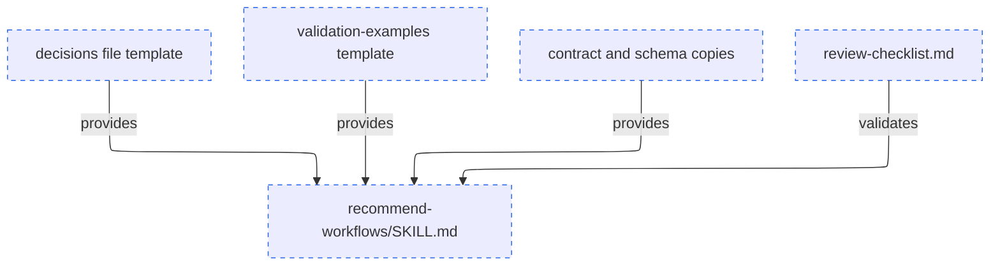

# Workflow Recommender

## Purpose

A GitHub Copilot agent skill that compares use case specifications by their behaviors and generates internal use-case-to-workflow recommendations, with the format of the lead-owned decisions file, so leads can decide which use cases can share one reusable workflow.

## Navigation

[Job Behavior Specifications](../README.md#navigation) / **Workflow Recommender**

- [Design](#design)
- [Behavior](#behavior)
- [Plan](#plan)
- [Relationships](#relationships)
- [Links](#links)

## Design

Not built yet.

## Behavior

- **B01** When it compares specifications, then candidates come from shared behaviors and parameter differences, a shared external system alone never makes a candidate, and earlier workflow-analysis files that a lead tags (about four or five, paths not assumed) only supplement the candidates and never decide a workflow or stand for vendor acceptance. (untested: benchmark pending)
- **B02** When it lists a candidate, then it gives the member use cases, shared steps and behaviors by ID, differences (parameters, exceptions), the specification versions and revisions used, and whether each member rests on a specification, on an earlier analysis or on both. (untested: benchmark pending)
- **B03** When a specification is missing, unread, unversioned or still a draft, then it is listed under `not compared` with its state, a use case without a specification is listed and never silently dropped, and a draft specification may still produce recommendations before any vendor acknowledgement. (untested: benchmark pending)
- **B04** When it describes its method, then it states the grouping is not validated, compares its results against known same and different examples when `validation-examples.md` is supplied and reports the agreement, and otherwise says not validated. (untested: benchmark pending)
- **B05** When it regenerates `use-case-to-workflow-recommendations.md`, then it rewrites only that file, reads `use-case-to-workflow-decisions.md` and never edits it, and shows each candidate's decision status. (untested: benchmark pending)
- **B06** When a specification of a decided mapping changed, then it assesses whether the change could affect grouping (could-affect, not-expected or unknown) with a short reason, using a lead's override or the proposer's suggestion when the optional Use Cases export is supplied and otherwise its own assessment from the two specification versions, flags the recommendation for re-review with the changed behavior IDs when the impact could affect grouping or is unknown, never treats unknown as no impact, and does not flag a behavior change with no grouping impact or a version bump, spelling, date, change-log or acknowledgement edit alone; it does not change the decision, and a rejected pairing is not re-proposed unless it states new evidence. (untested: benchmark pending)
- **B07** When unknowns could change a mapping, then only those grouping-relevant unknowns are listed as blocking with their existing specification questions linked, other open questions are non-blocking, and a missing question is reported as a specification gap and never as a new question. (untested: benchmark pending)
- **B08** When it emits tracker rows, then they are Mappings `add` or `suggest` rows only, with no human-owned or forbidden field. (untested: benchmark pending)
- **B09** When it works, then it keeps no persistent per-use-case profile file, and any normalized summary is a temporary, uncommitted cache. (untested: benchmark pending)
- **B10** When it runs again on a new or revised specification, then it compares it with the full set, states which specifications, earlier analyses and date it covered and what was not compared, and marks the output internal; the decisions file format has decision ID, status (accepted, rejected, pending-clarification), candidate, affected use cases, rationale, evidence and versions, date and decided-by name, is append-only, and a changed decision is a new row that refers to the earlier one. (untested: benchmark pending)

## Plan

### Planned Navigation

[Job Behavior Specifications](../README.md#plan) / **Workflow Recommender**

- [Planned Design](#planned-design)
  - [Planned Diagram](#planned-diagram)
- [Steps](#steps)
- [Acceptance Mapping](#acceptance-mapping)
- [Assumptions And Open Questions](#assumptions-and-open-questions)
- [Planned Relationships](#planned-relationships)
- [Planned Links](#planned-links)

### Planned Design

The component delivers one skill folder, `recommend-workflows/`, holding `SKILL.md`, the format of the lead-owned decisions file, a template for the validation examples and byte-identical copies of the contract and schema, plus an internal checklist. The generated recommendations file and the decisions file themselves live in the specifications repository's internal area, not in this component. The lead may point the skill at a manually tagged folder of earlier workflow analyses (the user described about four or five, for example on existing workflow overlap, proposed workflow counts and an active use case onboarding workflow summary; the real client paths and counts are not known and are not assumed). Those analyses are starting candidates, not verified or approved baselines, and the skill does not reconcile them exhaustively.

#### Planned Diagram

### Steps

1. Write `recommend-workflows/SKILL.md` (behavior-based comparison, the optional tagged earlier analyses as supplements, the not-compared list, grouping-relevant blocking unknowns, the grouping-relevant re-review rule, no profile file, report).
2. Write the decisions file template (`use-case-to-workflow-decisions.md` format) and the `validation-examples.md` template, and copy the contract and schema byte for byte.
3. Write `review-checklist.md` with one item per behavior and run the file review and the hygiene scan.

### Acceptance Mapping

| Acceptance condition | Behaviors | Step | Validation |
| --- | --- | --- | --- |
| Candidates rest on behaviors, tagged earlier analyses only supplement them, and the output exposes unread, draft and missing specifications (B01, B02, B03). | B01, B02, B03 | 1 | [B01] to [B03], file review; the user's manual test results on real specifications recorded when reported |
| The method is marked not validated and the validation procedure is present (B04). | B04 | 1 | [B04], method text read and validation templates present |
| Decisions are read and never edited, re-review is flagged for changes that could affect grouping or whose impact is unknown (never silently none), rejected pairings return only with new evidence, and the decisions format is as stated (B05, B06, B10). | B05, B06, B10 | 2 | [B05], [B06], [B10], decisions template read; the user's manual test results recorded when reported |
| Only grouping-relevant unknowns block, tracker rows are mapping rows only, and no profile file is written (B07, B08, B09). | B07, B08, B09 | 1 | [B07] to [B09], file review and scan; the user's manual test results recorded when reported |

Checks: none declared; verification is the component's `review-checklist.md` file review, plus the record validators at the end of each plan and build.

### Assumptions And Open Questions

Assumptions (override any of them in chat before `/craft:build`):

1. Similarity is behavior-based. Shared systems may be listed as context and never decide a candidate. Override: allow a coarse system filter as an optional first pass.
2. The grouping method is unproven and the skill says so. The validation procedure compares it with 10 to 15 same or different pairs the leads already know; the number is provisional.
3. The recommendations and decisions files are internal and stay out of any vendor-readable scope.
4. Draft specifications may generate recommendations before vendor acknowledgement (confirmed); the output labels them as drafts.
5. Grouping impact is separate from behavior change (confirmed): a behavior change does not necessarily affect grouping. The skill, like the proposer, suggests whether a change could affect grouping with a short reason; a lead overrides; unknown stays visible and is never treated as no impact; existing lead decisions are preserved. The reconciler uses the same assessment.
6. The tagged earlier analyses are read as candidate hints only; the skill reports which it read and does not invent paths or counts. Override: ask for an exhaustive reconciliation.
7. The lead's grouping-impact override lives in the Use Cases tab, so the skill reads it from an optional, read-only export of that tab; without the export it assesses the impact itself and states that no override was available. Override: put overrides in the decisions file instead.

Open questions: none about behavior.

### Planned Relationships

- [Tracker Data Contract](../tracker-data-contract/README.md#plan) — the Mappings columns and the proposal format this skill follows, copied into its folder.
- [Job Behavior Template](../job-behavior-template/README.md#plan) — the form whose behavior IDs, parameters and versions the recommendations cite.

### Planned Links

- [requirements.md](requirements.md#requirements) — what the component must do and what it need not.
- [contract.md](contract.md#contract) — the shapes, formats and wording rules.

## Relationships

- [Tracker Data Contract](../tracker-data-contract/README.md#purpose) — the Mappings columns and the proposal format this skill follows, copied into its folder.
- [Job Behavior Template](../job-behavior-template/README.md#purpose) — the form whose behavior IDs, parameters and versions the recommendations cite.

## Links

- [requirements.md](requirements.md#requirements) — what the component must do and what it need not.
- [contract.md](contract.md#contract) — the shapes, formats and wording rules.
